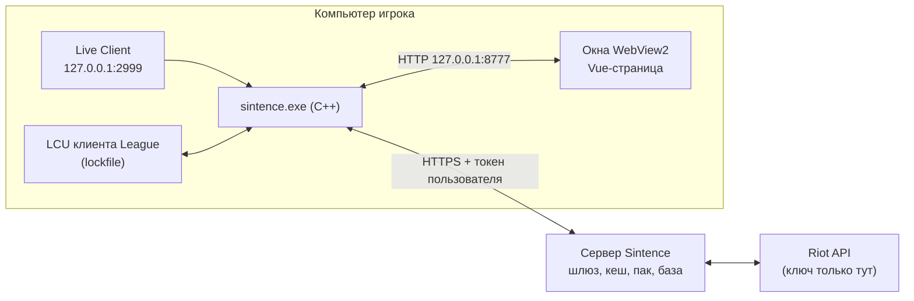

# 1. Обзор

## Что это

Sintence — приложение для Windows к League of Legends (регион RU). Оно:

- рисует **оверлей** поверх игры: табло живого матча (предметы, руны, заклинания
  всех десяти игроков);
- показывает **профили** игроков лобби: ранг, мастерство чемпионов, «плашки»
  стиля игры;
- даёт **советы** активному игроку: руны, прокачка, предметы против конкретного
  противника — по статистике ранговых матчей;
- имеет **окно профиля**: история матчей, подробности, график по минутам; и отдельное
  необязательное **окно статистики в матче** (миньоны, золото, сравнение со средними по рангу);
- в выборе чемпиона может **по клику** поставить руны и заклинания в клиент игры.

Живёт в трее, один `.exe`, прав администратора не требует, сам обновляется.

## Из каких частей состоит система

Одной фразой: **C++ собирает данные из трёх мест (игра, клиент, сервер),
отдаёт их по локальному HTTP, а нарисованное — это веб-страница в окне WebView2.**

## Репозитории

Все лежат подмодулями в `sintence-workspace` (см. его `README.md`).

| Папка | Язык | Что | Тебе нужно? |
|---|---|---|---|
| `sintence-app` | **C++23** | само приложение, главные документы | да, твоя основная работа |
| `sintence-web` | Vue 3 + TypeScript | интерфейс окон | иногда: когда меняешь, что видит игрок |
| `sintence-data` | Python + PostgreSQL + Docker | сервер: сбор матчей, пак, шлюз Riot | читать; **push туда = выкладка на боевой сервер** |
| `sintence-site` | HTML | публичный сайт sintence.ru | нет |
| `sintence-main-site` | Nuxt | будущий сайт | нет |
| `sintence-wiki` | Markdown | эта вики | да |

## Три источника данных

| Источник | Где | Когда есть | Доступ |
|---|---|---|---|
| **Live Client Data API** | `https://127.0.0.1:2999` | только пока идёт матч | без ключа, самоподписанный сертификат |
| **LCU** (клиент League) | локальный порт из lockfile | пока запущен клиент | неофициальный, пароль из lockfile |
| **Сервер Sintence** | интернет | почти всегда | токен пользователя |

Приложение **не ходит в Riot напрямую**: ключ Riot хранится только на сервере,
запросы идут через шлюз (`/v1/riot/...`). Это правило нельзя менять.

## Главные принципы (запомни — на них держится всё)

1. **Слои** `app → analysis → core` и `app → data → core`: нижний слой ничего не
   знает о верхнем (страница 3).
2. **Данные живут на сервере**, на компьютере игрока — только программа и журнал.
3. **Только то, что игрок и так видит.** Никакого скрытого состояния противника
   (страница 8).
4. **Локальный сервер слушает только `127.0.0.1`.**
5. **Секреты** (ключ Riot, токен пользователя, пароль lockfile) — никогда в журнал,
   вывод, коммит.
6. **Граница C++ ↔ интерфейс — JSON**. Поменял ответ — поменяй схему в `sintence-web`
   (страница 5).

## Что читать дальше из документов проекта

| Документ | Когда |
|---|---|
| `sintence-app/CLAUDE.md` | команды сборки, правила кода — **сразу** |
| `sintence-app/ARCHITECTURE.md` (1260 строк, 19 разделов) | перед правкой подсистемы читай её раздел |
| `sintence-app/POLICY.md` | перед любой функцией, работающей с данными игры |
| `sintence-app/CHAMP_SELECT.md` | выбор чемпиона, LCU |
| `sintence-app/SERVER.md` | как приложение говорит с сервером |
