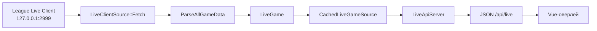

# 13. Live Client: живой матч и разбор JSON

Live Client Data API — локальный HTTPS-сервис самой игры. Sintence читает его только
на `127.0.0.1:2999`; ключ Riot и сервер Sintence для табло не нужны.

Страница отвечает на вопрос: как байты `allgamedata` превращаются в `core::LiveGame`.
Контракт локального API, который отдаёт этот объект интерфейсу, описан на [5. Локальный API](05-lokalny-api.md).

## Файлы участка

| Файл | Роль |
|---|---|
| `src/data/live_client_source.h/.cpp` | HTTPS-клиент Live Client |
| `src/data/live_client_json.h/.cpp` | защитный разбор JSON в типы `core/` |
| `src/data/cached_live_game_source.h/.cpp` | кеш и single-flight для параллельных запросов |
| `src/core/live_game.h` | доменные типы живого матча |
| `src/app/live_api_server.cpp` | сериализация `LiveGame` в `/api/live` |
| `tests/test_live_client_json.cpp` | разбор ответов и границы формата |
| `tests/data/allgamedata_practice.json` | настоящий ответ Practice Tool |

## Поток данных



`main.cpp` создаёт настоящий источник и оборачивает его в `CachedLiveGameSource`.
Остальные части приложения знают только интерфейс `LiveGameSource`, поэтому парсер и
сеть можно тестировать отдельно.

## Почему используется `allgamedata`

`LiveClientSource::LoadGame()` делает один запрос:

```text
GET https://127.0.0.1:2999/liveclientdata/allgamedata
```

Ответ содержит одновременно:

- `gameData`: режим, карту и время матча;
- `allPlayers`: табло, команды, предметы, KDA и CS всех участников;
- `activePlayer`: своего игрока, золото, способности и полную страницу рун.

Отдельные запросы `gamestats`, `playerlist` и `activeplayer` дали бы снимки разных
моментов. Для табло один согласованный ответ важнее небольшого размера отдельных
запросов.

Сертификат Live Client самоподписанный. Проверка сертификата отключается только для
локального адреса игры; это не шаблон для внешнего HTTPS.

## Два слоя: транспорт и разбор

`LiveClientSource` не знает деталей доменных моделей. Он:

1. создаёт HTTPS-клиент к локальному порту;
2. запрашивает путь;
3. при недоступности возвращает `std::nullopt`;
4. передаёт тело в функцию из `live_client_json.cpp`.

`live_client_json` не ходит в сеть и не пишет в журнал. Его функции принимают строку и
возвращают `std::optional` доменного типа. Битый JSON, объект неправильного типа и
невосстановимое обязательное поле — `nullopt`, а не исключение наружу.

## Парсер игроков

`ParseLivePlayers` читает массив `playerlist`. Обязательны:

- `championName`;
- `team` со значением `ORDER` или `CHAOS`;
- объект `scores` с числами `kills`, `deaths`, `assists`, `creepScore`.

Игрок без обязательного поля пропускается. Неизвестная команда тоже пропускается,
а не превращается молча в `ORDER`. Необязательные `level`, `position`, `isBot`,
`isDead` и `wardScore` получают значения по умолчанию.

Особые случаи:

- в ARAM `position` обычно пустой;
- Riot ID без `#` или без tag line помечается скрытым;
- свой игрок определяется отдельно и скрытым не считается;
- скрытые имена не восстанавливаются из других источников.

`ChampionKeyFromRaw` приводит несколько форматов служебного имени чемпиона к ключу
Data Dragon. Например, `Character_Aatrox_Name` должен дать `Aatrox`, а не последний
фрагмент `Name`.

## Статистика матча

`ParseLiveGameStats` разбирает `GET /liveclientdata/gamestats`:

| JSON | Тип в core | Важная деталь |
|---|---|---|
| `gameMode` | `game_mode` | может быть `CLASSIC`, `ARAM`, `KIWI` и др. |
| `mapName` | `map_name` | название карты |
| `gameTime` | `game_time_seconds` | дробное число, не округлять при разборе |

Без времени матча функция возвращает `nullopt`.

В основном пути `ParseAllGameData` извлекает эти сведения из общего ответа. Если
`activePlayer` отсутствует или пришёл строкой с ошибкой, например в режиме наблюдателя,
матч всё равно может быть разобран — просто без активного игрока.

## `CachedLiveGameSource`

Опрос интерфейса и HTTP-запросы к `/api/live` идут параллельно. Кеш защищает игру от
лишних запросов:

| Состояние | Срок |
|---|---:|
| успешный снимок | 900 мс |
| ответа «игры нет» | 2 с |
| одинаковые запросы одновременно | один реальный запрос, остальные ждут |

После истечения срока один поток становится загрузчиком. Остальные ждут
`condition_variable`, затем получают тот же результат. Если внутренний источник
неожиданно бросил исключение, кеш освобождает ожидающих и возвращает отсутствие игры.

Это single-flight, а не просто mutex: mutex защищает состояние, но не удерживается во
время медленного запроса к игре.

## Нет игры — это нормальный результат

`LoadGame()` возвращает `nullopt`, когда:

- League не запущена;
- Live Client ещё не поднялся;
- соединение оборвалось;
- ответ не разобрался.

`/api/live` превращает это в HTTP `503`, потому что это временное отсутствие текущего
матча, а не неправильный URL. В тестах не нужен запущенный клиент: берётся JSON из
`tests/data/`.

## Как добавить поле

1. Добавь поле в доменный тип `src/core/live_game.h`.
2. Разбери его в `live_client_json.cpp`, сохранив значение по умолчанию при отсутствии.
3. Добавь тест на наличие и отсутствие поля.
4. Если поле видно интерфейсу, добавь его в сериализацию `live_api_server.cpp`, zod-схему
   и моки `sintence-web`.
5. Если поле удаляется или меняется его тип, подними `kApiVersion` и
   `EXPECTED_API_VERSION` в одном изменении.

Не добавляй HTTP или `nlohmann::json` в `core/`: зависимость должна оставаться в `data/`.

## Проверка

```powershell
cd sintence-app
.\build.ps1 -Debug
build\tests\Debug\sintence_tests.exe --source-file="*live_client*"
```

Для ручной проверки без игры используй мок интерфейса. Для живого API нужен Practice
Tool или матч; в режиме без игры `GET /api/live` с ответом `503` является ожидаемым.
