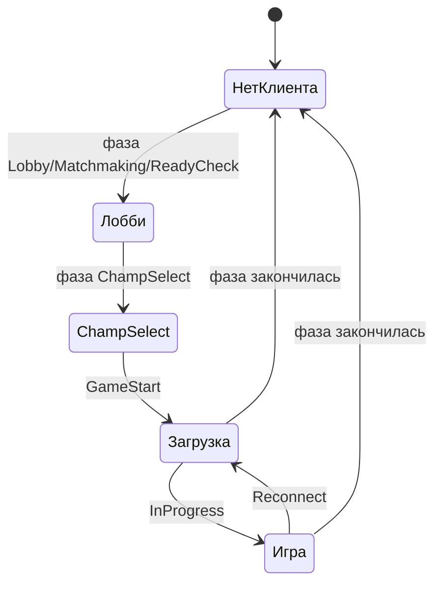

# 14. LCU: клиент League и лобби

LCU — локальный HTTPS API запущенного клиента League. Через него Sintence читает фазу
игры, выбор чемпиона, состав загрузочного экрана, друзей и свою пати. Запись в LCU
вынесена отдельно на [15. Запись в клиент](15-lcu-zapis.md) и разрешена только по
явному клику.

## Файлы участка

| Файл | Роль |
|---|---|
| `src/data/lcu_client.h/.cpp` | поиск `lockfile`, HTTPS GET/POST/PATCH/DELETE |
| `src/data/lcu_json.h/.cpp` | разбор ответов LCU в типы `core/` |
| `src/data/lobby_service.h/.cpp` | фоновый снимок фазы, лобби и загрузки |
| `src/core/lobby.h` | `Lobby`, `LobbyMember`, роли и состояния |
| `src/data/lcu_actions.h/.cpp` | разрешённые записи по клику |
| `src/app/live_api_server.cpp` | `/api/lobby`, `/api/friends`, POST-действия |
| `tests/test_lcu_json.cpp` | чистые тесты разбора |

## Откуда берутся порт и пароль

При запуске League рядом с `LeagueClientUx.exe` появляется файл `lockfile` примерно
такого вида:

```text
LeagueClient:12345:54321:секретный-пароль:https
```

Поля означают имя процесса, PID, порт, пароль и протокол. `ParseLockfile` принимает
ровно пять полей и числовой порт. Пароль хранится только в памяти и никогда не должен
попадать в журнал, тестовый вывод или ответ `/api`.

Каталог клиента ищется в таком порядке:

1. `SINTENCE_LOL_DIR`;
2. каталог запущенного `LeagueClientUx.exe`;
3. стандартные каталоги установки League.

Если запрос не отвечает или возвращает `401`, сохранённые credentials сбрасываются.
Следующий запрос перечитывает lockfile: клиент мог перезапуститься с новым портом и
паролем.

## Разбор в `lcu_json`

Парсер отделён от сети. Основные функции:

| Функция | Ответ LCU | Результат |
|---|---|---|
| `ParseLockfile` | содержимое файла | `LcuCredentials` |
| `ParseGameflowPhase` | JSON-строка | `ChampSelect`, `GameStart`, `InProgress` и т. п. |
| `ParseCurrentSummoner` | текущий игрок | puuid и Riot ID |
| `ParseChampSelectSession` | `/lol-champ-select/v1/session` | пики, баны, роли и таймер |
| `ParseGameflowQueueId` | `/lol-gameflow/v1/session` | номер очереди |
| `ParseGameflowSession` | состав загрузки/матча | десять участников |
| `ParseLobbyMembers` | `/lol-lobby/v2/lobby` | puuid своей пати |
| `ParseFriends` | `/lol-chat/v1/friends` | список друзей и статус |

Битый JSON или объект не того типа превращается в `nullopt`. Это позволяет отличать
«ответ LCU сломан» от валидного пустого лобби.

## Приватность выбора чемпиона

В `ParseChampSelectSession`:

- `myTeam` становится союзниками, `theirTeam` — противниками;
- `localPlayerCellId` определяет `is_self`;
- `assignedPosition` переводится из нижнего регистра в роль пака;
- скрытый игрок получает `hidden = true`, пустые puuid и Riot ID;
- противники в выборе чемпиона остаются безымянными независимо от того, что прислал
  клиент;
- специальное значение `2^64 - 1` для незаданного заклинания превращается в `0`.

Это не косметика. Нельзя восстанавливать имя, puuid или руны скрытого игрока из
другого ответа.

## `LobbyService`

`LobbyService` — фоновый поток, который периодически обновляет один снимок `Lobby`.
Интерфейс HTTP только читает последний снимок под mutex и не ждёт LCU дольше обработки
очередного tick.



Правила фаз в коде:

- `Lobby`, `Matchmaking`, `ReadyCheck`, `ChampSelect` — есть предматчевое лобби;
- `GameStart`, `InProgress`, `Reconnect` — идёт игра или экран загрузки;
- прочие фазы дают пустой состав.

В `ChampSelect` источник — `/lol-champ-select/v1/session`. На экране загрузки и в
матче сначала читается `/lol-gameflow/v1/session`: это локальный источник состава,
который не тратит запросы Riot. Если имена или состав там недоступны, `LobbyService`
пытается получить участников через spectator-v5 через сервер Sintence.

## Периоды обновления

Клиент League работает рядом с игрой, поэтому он опрашивается умеренно:

- обычный интервал задаётся конструктором службы, по умолчанию 1,5 с;
- в `InProgress` интервал не меньше 5 с;
- spectator-v5 в первые секунды загрузки может отвечать `404`, повтор выполняется раз
  в 10 с и ограниченное число раз;
- после смены фазы кеш старого состава сбрасывается.

В `ChampSelect` профили видимых союзников можно заказывать сразу. Противники не должны
получать скрытые данные.

## Пати и друзья

`/lol-lobby/v2/lobby` используется только для puuid игроков своей пати. Этот список
нужен аналитике пати, но не является списком всех участников матча.

`/lol-chat/v1/friends` разбирается в `LcuFriend`. Статусы нормализуются в `inGame`,
`champSelect`, `lobby`, `online`, `away`, `mobile`, `offline`. Поля `lol.*` клиента
могут быть строками или числами, поэтому парсер читает их мягко.

Для «Смотреть в клиенте» внутренние `lcu_puuid` и `spectator_key` остаются внутри
приложения. В интерфейс передаётся только разрешённый признак и результат действия.

## Типичный сбой

| Симптом | Причина | Что делать |
|---|---|---|
| пустая `phase` | клиент League не найден или lockfile недоступен | проверить League и `SINTENCE_LOL_DIR` |
| старый порт/401 | League перезапустилась | повторить запрос: credentials перечитаются |
| нет имён на загрузке | LCU ещё не отдал сессию или нет сервера | смотреть `source` и `note` в `/api/lobby` |
| `hidden` вместо имени | имя скрыто клиентом | не пытаться восстанавливать |
| нет spectator-состава | сервер недоступен, Practice Tool или пользовательская игра | использовать локальный LCU-состав |

## Как добавить чтение

1. Опиши доменный результат в `core/`.
2. Добавь чистый парсер в `lcu_json.*` и тест на реальный/минимальный JSON.
3. Добавь один метод чтения в `LcuClient`.
4. Подключи его в `LobbyService`, если результат относится к фоновому снимку.
5. Добавь сериализацию в `/api/lobby` и zod-схему, если поле видит интерфейс.

Новый метод записи нельзя добавлять в `LobbyService`: запись живёт только в
`lcu_actions`, под `TrustedWrite` и только после клика.
