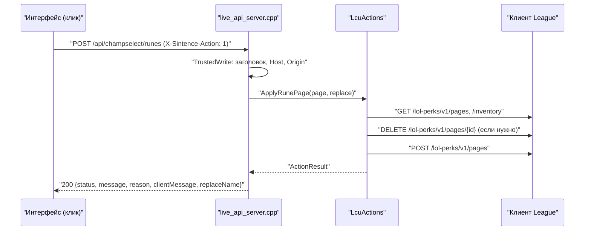
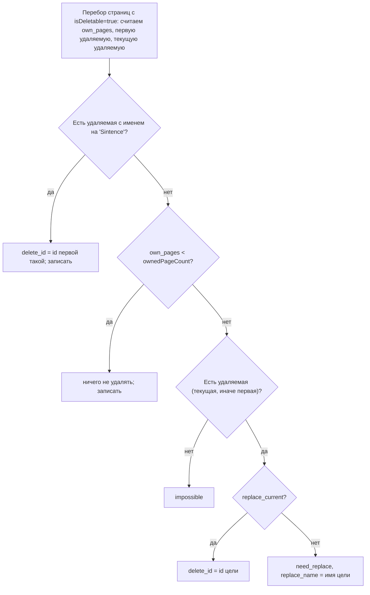

# 15. Запись в клиент: руны, заклинания, наблюдение

Что здесь и зачем: единственное место, где Sintence что-то меняет в клиенте League (LCU), —
`data/lcu_actions`. Три действия: записать страницу рун, поставить свои заклинания
призывателя, запустить наблюдение за игрой друга. Всё — только как ответ на клик в интерфейсе.
Чтение LCU (lockfile, `LcuClient`, лобби) — на странице [14-lcu-klient](14-lcu-klient.md).

## Файлы участка

| Файл | Роль | Строк |
|---|---|---|
| `data/lcu_actions.h` | типы `RunePageSpec`, `PagePlan`, `ActionResult`, класс `LcuActions` | 117 |
| `data/lcu_actions.cpp` | чистые функции решений и три действия с запросами к LCU | 343 |
| `app/live_api_server.cpp` | `TrustedWrite` (344), `ActionStatusName` (380), `ActionToJson` (394), обработчики POST (2145, 2174, 2306) | 2391 |
| `tests/test_lcu_actions.cpp` | тесты чистых функций и ранних отказов | 141 |
| `sintence-web/src/composables/useLoadoutActions.ts` | кнопки «применить» в интерфейсе | — |
| `sintence-web/src/api/client.ts` | `fetch` с заголовком `X-Sintence-Action` | — |
| `CHAMP_SELECT.md` («Применить руны и заклинания»), `POLICY.md` («Действия в клиенте League») | правила | — |

## Общая схема



Все запросы к LCU идут через `LcuClient` (поле `lcu_` в `LcuActions`, `data/lcu_actions.h:112`):

- `Get(path)` — `std::optional<std::string>`; `nullopt` — клиент не запущен, путь недоступен
  в текущей фазе (404) или ошибка сети (`data/lcu_client.h:33-35`).
- `Send(method, path, body)` — `Response{status, body}`; `status == 0` — клиент не найден или
  не ответил (`data/lcu_client.h:37-44`).

`LcuActions` держит `std::mutex mutex_`, каждое действие берёт `lock_guard` целиком
(`data/lcu_actions.cpp:134`, `:198`, `:254`): удаление страницы и запись новой — два запроса,
два клика подряд не должны переплестись (`data/lcu_actions.h:109-111`). Вызывающий —
поток HTTP-сервера `httplib`, действие выполняется синхронно внутри обработчика.

## Ограничения политики Riot

- Запись — **только ответ на явный клик**: в `lcu_actions` нет ни одного вызова «по событию»,
  только ответ на POST из интерфейса (`data/lcu_actions.h:17-20`, `CHAMP_SELECT.md` «Что говорит Riot»).
- Не выбирать чемпиона, не банить, не принимать матч за игрока (`POLICY.md`, «Действия в клиенте League»).
- Чужие страницы рун молча не трогаются; замена — только повторным кликом с согласием;
  встроенные (`isDeletable: false`) — никогда (`data/lcu_actions.h:22-25`, `data/lcu_actions.cpp:85`).
- Скрытые клиентом имена союзников не восстанавливаются, противники в выборе безымянны
  (`sintence-app/CLAUDE.md`, раздел LCU) — к записи это не относится, но правило участка LCU общее.
- Продукт на LCU перед распространением регистрируется в Developer Portal с перечнем эндпоинтов;
  игрокам из Кореи такие приложения запрещены (`POLICY.md`, `CHAMP_SELECT.md`).
- Подробно — [08-pravila-riot](08-pravila-riot.md).

## Защита эндпоинтов записи: `TrustedWrite`

Сервер слушает `127.0.0.1`, но любой сайт в браузере пользователя может послать запрос
на `127.0.0.1:8777`. Поэтому каждый POST записи проверяется (`app/live_api_server.cpp:335-359`):

| Проверка | Точное условие | Зачем (из комментария) |
|---|---|---|
| Заголовок | `X-Sintence-Action` равен `"1"` | чужой сайт может послать его только через CORS-preflight, а разрешения сервер не даёт |
| `Host` | `127.0.0.1:<port>` или `localhost:<port>` | защита от DNS-rebinding |
| `Origin` | пустой — пропуск; иначе `http://127.0.0.1:<port>`, `http://localhost:<port>`, `http://localhost:5173`, `http://127.0.0.1:5173` | сам сервер или Vite в разработке |

`<port>` — порт сервера (`impl_->port`, по умолчанию 8777). Не прошёл — `403 {"error":"forbidden"}`.
Той же функцией защищены `/api/update/check`, `/api/update/apply`, `/api/badge-visibility`,
`/api/autostart` (`app/live_api_server.cpp:1145`, `:1159`, `:1208`, `:1912`).
Интерфейс ставит заголовок во всех POST (`sintence-web/src/api/client.ts:54-57`).
Правило проекта: проверки не ослаблять (`sintence-app/CLAUDE.md`, раздел LCU).

## Формат ответа всех трёх действий

Исход действия — данные, а не ошибка HTTP: всегда **200** (`app/live_api_server.cpp:392-402`).
Коды 403 и 400 — только для отказа защиты и битого тела.

| Поле | Тип | Значение |
|---|---|---|
| `status` | string | см. таблицу ниже (`ActionStatusName`, `app/live_api_server.cpp:380-390`) |
| `message` | string | русский текст: журнал и запасной текст интерфейса |
| `reason` | string | код исхода (`runes_applied`, …) — по нему интерфейс выбирает текст |
| `clientMessage` | string | сырой текст клиента LCU или `""` |
| `replaceName` | string | имя страницы, которую предлагается заменить; `""` вне `need_replace` |

### Значения `status`

| `status` | `ActionResult::Status` | Когда |
|---|---|---|
| `ok` | `Ok` | действие выполнено |
| `need_replace` | `NeedReplace` | свободной страницы рун нет, нужен повторный клик с `replace: true` |
| `not_in_champselect` | `NotInChampSelect` | заклинания вне фазы `ChampSelect` |
| `client_unavailable` | `ClientUnavailable` | клиент League не отвечает |
| `invalid` | `Invalid` | неполная страница рун или одинаковые/нулевые заклинания |
| `failed` | `Failed` | всё прочее: клиент отказал, нечего заменить, не разобран ответ (значение по умолчанию, `data/lcu_actions.h:86`) |

### Все `reason`

| `reason` | `status` | Действие | Ссылка |
|---|---|---|---|
| `runes_incomplete` | invalid | руны | `data/lcu_actions.cpp:139` |
| `client_unavailable` | client_unavailable | руны, заклинания | `:148`, `:211` |
| `pages_unreadable` | failed | руны | `:155` |
| `no_replaceable_page` | failed | руны | `:160` |
| `no_free_page` | need_replace | руны | `:167` |
| `page_delete_rejected` | failed | руны | `:176` |
| `page_create_rejected` | failed | руны | `:185` |
| `runes_applied` | ok | руны | `:192` |
| `spells_same` | invalid | заклинания | `:203` |
| `not_in_champselect` | not_in_champselect | заклинания | `:217` |
| `spells_rejected` | failed | заклинания | `:240` |
| `spells_applied` | ok | заклинания | `:247` |
| `not_friend` | failed | наблюдение | `:257` |
| `no_client` | client_unavailable | наблюдение | `:263` |
| `not_found` | failed | наблюдение | `:270`, `:291` |
| `not_observable` | failed | наблюдение | `:311` |
| `refused` | failed | наблюдение | `:330` |
| `spectate_launched` | ok | наблюдение | `:338` |

`clientMessage` берётся из ответа клиента функцией `ClientMessage`: поле `message` из JSON-тела,
если оно непустое, иначе строка `клиент ответил <код>` (`data/lcu_actions.cpp:34-43`).

## Страница рун

### Тело `POST /api/champselect/runes`

Разбор — `app/live_api_server.cpp:2145-2170`.

| Поле | Тип | Нет поля | Обработка |
|---|---|---|---|
| `name` | string | `"Sintence"` | обрезается `substr(0, 25)` — по **байтам** UTF-8 |
| `primaryStyleId` | int | `0` | `body.value(..., 0)` |
| `subStyleId` | int | `0` | то же |
| `perkIds` | int[] | пустой вектор | нецелые элементы превращаются в `0` (`:2164`) |
| `replace` | bool | `false` | согласие на замену чужой страницы |

Битый JSON или не объект — `400 {"error":"bad json"}`. Интерфейс собирает тело так
(`sintence-web/src/composables/useLoadoutActions.ts:36-58`):

```typescript
function pageName(championName: string): string {
  return `Sintence ${championName}`.slice(0, 25)
}
// perkIds: [keystoneId, ...primaryIds, ...secondaryIds, ...shardIds]
```

Пример тела (собрано из кода и теста `Electrocute()`, `tests/test_lcu_actions.cpp:15`):

```json
{"name": "Sintence Ари", "primaryStyleId": 8100, "subStyleId": 8200,
 "perkIds": [8112, 8139, 8140, 8106, 8224, 8236, 5008, 5008, 5001], "replace": false}
```

### `IsCompleteRunePage`

Страница полная, если оба дерева `> 0` и различны, ровно 9 id и все `> 0`
(`data/lcu_actions.cpp:47-58`). Порядок 9 id — ключевая, три малых основного древа, две
дополнительного, три осколка (`data/lcu_actions.h:29-30`). Нули приходят от пака без id
(сообщение «нужна схема 3», `data/lcu_actions.cpp:140`).

### `PlanRunePage(pages_json, inventory_json, replace_current)`

Чистая функция: по ответам `GET /lol-perks/v1/pages` и `GET /lol-perks/v1/inventory`
решает, что удалить (`data/lcu_actions.cpp:71-121`). Возвращает `PagePlan`
(`data/lcu_actions.h:45-50`) или `nullopt`, если `pages` не массив либо `inventory` не объект.

Используемые поля страницы клиента: `id` (целое, иначе `-1`, `:18-23`), `isDeletable`,
`current` или `isActive` (`:29-32`), `name`. Из inventory — `ownedPageCount` (нет — 0, `:104`).



Особенности:
- «Своя» страница — имя начинается с `"Sintence"` (`kOwnPrefix`, `data/lcu_actions.cpp:16`, `:96`),
  берётся первая из них. Проверяется только среди удаляемых.
- Цель замены — текущая удаляемая; если текущая встроенная — первая удаляемая
  (`:109`; тест `tests/test_lcu_actions.cpp:88-97`).
- Встроенные страницы не учитываются в `own_pages` и не удаляются никогда (`:85`).

### `ApplyRunePage(page, replace_current)` — порядок запросов

`data/lcu_actions.cpp:133-195`:

| Шаг | Запрос / проверка | Сбой → `reason` |
|---|---|---|
| 1 | `IsCompleteRunePage` (клиент не трогается) | `runes_incomplete` |
| 2 | `GET /lol-perks/v1/pages` и `GET /lol-perks/v1/inventory` | любой `nullopt` → `client_unavailable` |
| 3 | `PlanRunePage` | `nullopt` → `pages_unreadable`; `impossible` → `no_replaceable_page`; `need_replace` → `no_free_page` + `replaceName` |
| 4 | если `delete_id`: `DELETE /lol-perks/v1/pages/{id}` | не 2xx → `page_delete_rejected` |
| 5 | `POST /lol-perks/v1/pages`, тело `RunePageJson` | не 2xx → `page_create_rejected` |
| 6 | `Log("руны: страница «…» записана и выбрана")` | `runes_applied` |

Тело шага 5 (`RunePageJson`, `data/lcu_actions.cpp:60-69`) — `current: true` сразу делает
страницу активной:

```cpp
const nlohmann::json doc = {
    {"name", page.name},
    {"primaryStyleId", page.primary_style_id},
    {"subStyleId", page.sub_style_id},
    {"selectedPerkIds", page.perk_ids},
    {"current", true},
};
```

Если шаг 4 прошёл, а шаг 5 нет — страница уже удалена, а новая не создана: отката нет
(видно из кода `:172-189`).

### Как решается замена (`need_replace`)

1. Первый клик: `replace: false` → `status: need_replace`, `replaceName: "Мид-маги"`.
2. Интерфейс переходит в состояние `confirm` с этим именем (`useLoadoutActions.ts:66`) и
   показывает кнопку «заменить «имя»» (`CHAMP_SELECT.md`).
3. Второй клик: тот же POST с `replace: true` → `PlanRunePage` ставит `delete_id` цели → удаление
   и запись.

Между кликами набор страниц может измениться — план пересчитывается заново на втором клике,
так что удалится текущая цель, не обязательно та, чьё имя показали (вывод из того, что
`replace_name` не передаётся обратно, `:2158-2167`).

## Заклинания призывателя

### Тело `POST /api/champselect/spells`

`{"spell1Id": 4, "spell2Id": 14}`; нет поля — `0` (`app/live_api_server.cpp:2172-2190`).
Порядок не важен: раскладку по D/F подбирает C++. Интерфейс шлёт `spellIds[0] ?? 0`,
`spellIds[1] ?? 0` (`useLoadoutActions.ts:76`). Пара в паке — поле `summonerSpells`, набор без
порядка (`CHAMP_SELECT.md`).

### `ApplySummonerSpells(spell_a, spell_b)` — порядок

`data/lcu_actions.cpp:197-250`:

| Шаг | Запрос / проверка | Сбой → `reason` |
|---|---|---|
| 1 | оба `> 0` и различны | `spells_same` (invalid) |
| 2 | `GET /lol-gameflow/v1/gameflow-phase` | `nullopt` → `client_unavailable` |
| 3 | фаза (`ParseGameflowPhase`) равна `"ChampSelect"` | иначе `not_in_champselect` |
| 4 | `GET /lol-champ-select/v1/session` → свои `spell1_id/spell2_id` (участник `is_self`) | сбой не ошибка: текущие считаются `0, 0` |
| 5 | `ChooseSpellSlots` | — |
| 6 | `PATCH /lol-champ-select/v1/session/my-selection` `{"spell1Id", "spell2Id"}` | не 2xx → `spells_rejected` |

### `ChooseSpellSlots(current1, current2, want_a, want_b)`

Уже стоящее заклинание остаётся в своём слоте, новое занимает другой — чтобы Скачок
не переехал с привычной клавиши (`data/lcu_actions.h:65-74`, `.cpp:123-131`):

| Сейчас (D, F) | Нужно | Итог | Тест |
|---|---|---|---|
| (Скачок, Лечение) | {Воспламенение, Скачок} | (Скачок, Воспламенение) | `tests/test_lcu_actions.cpp:117` |
| (Призрак, Скачок) | {Скачок, Телепорт} | (Телепорт, Скачок) | `:119` |
| (Воспламенение, Скачок) | {Скачок, Воспламенение} | без изменений | `:121` |
| ничего общего / (0, 0) | {a, b} | (a, b) | `:123`, `:125` |

## Наблюдение («Смотреть в клиенте»)

### Тело `POST /api/spectate`

`{"riotId": "Имя#TAG"}` (`app/live_api_server.cpp:2305-2332`). Нет поля, не строка или пустое —
`400 {"error":"no riot id"}`. Ключ наблюдения и puuid клиента C++ берёт сам из
`LiveGameService::FriendSpectateInfo(id)` (`lcu_puuid`, `spectator_key`); нет службы — пустые.

### `Spectate(riot_id, lcu_puuid_hint, spectator_key)` — порядок

`data/lcu_actions.cpp:252-341`:

| Шаг | Запрос / проверка | Сбой → `reason` |
|---|---|---|
| 1 | `spectator_key` непустой (ключ есть только у друга в игре) | `not_friend`, клиент не трогается |
| 2 | `SplitRiotId(riot_id)` | `not_found` («неверный Riot ID») |
| 3 | если подсказки puuid нет: `GET /lol-summoner/v1/alias/lookup?gameName=&tagLine=` (части через `UrlEncodePathSegment`) | `status 0` → `no_client`; нет `puuid` → `not_found` (`clientMessage` — при не-200) |
| 4 | `GET /lol-spectator/v3/buddy/can-spectate/{puuid}/{spectatorKey}` | `status 0` → `no_client`; 200 и `availableForWatching == false` → `not_observable`; иной код — идём дальше |
| 5 | `POST /lol-spectator/v1/spectate/launch` | `status 0` → `no_client`; не 2xx → `refused` |

Тело шага 5 (`:318-324`):

```cpp
const nlohmann::json body = {
    {"allowObserveMode", "ALL"},
    {"dropInSpectateGameId", parts->first},
    {"gameQueueType", ""},
    {"puuid", puuid},
    {"spectatorKey", spectator_key},
};
```

`dropInSpectateGameId` — имя из Riot ID (`parts->first`), не номер игры. Шаг 4 нужен, чтобы
тренировка, игра с ботами без трансляции или законченная игра давали понятный отказ вместо 400
(комментарий `:300-301`). Отсутствие поля `availableForWatching` считается «можно» (`doc.value(..., true)`).

## Тесты

`tests/test_lcu_actions.cpp`:

| Тест | Что проверяет |
|---|---|
| `IsCompleteRunePage` (`:28`) | одинаковые деревья, 8 id, нулевой id → неполная |
| `RunePageJson` (`:45`) | ключи тела и `current: true` |
| `PlanRunePage: своя страница` (`:54`) | удаляется «Sintence: Зед» (id 7) |
| `есть свободное место` (`:66`) | ничего не удаляется |
| `места нет` (`:74`) | без согласия — `need_replace` с текущей, с согласием — `delete_id` текущей |
| `текущая встроенная` (`:88`) | предлагается первая удаляемая |
| `impossible / nullopt` (`:99`) | только встроенные; битый `pages`; `inventory` массивом |
| `ChooseSpellSlots` (`:109`) | пять раскладок |
| `LcuActions: код исхода` (`:128`) | `runes_incomplete` и `spells_same` без обращения к клиенту |

Не покрыто: запросы к LCU (порядок, обработка кодов, отсутствие отката после DELETE),
`Spectate` целиком, `TrustedWrite`, `ActionToJson`, разбор тел POST в `live_api_server.cpp`.
Тесты не ходят в сеть, поэтому всё с `LcuClient` проверяется только вживую (`CHAMP_SELECT.md`:
«на живом клиенте — ждёт проверки»). Каталог — [30-katalog-testov](30-katalog-testov.md).

## Как менять

1. **Новый исход** (`reason`): добавить в `lcu_actions.cpp` рядом с похожим, затем текст
   в интерфейсе по коду (`sintence-web`), строку в таблицу ARCHITECTURE.md §11; если нужен
   новый `status` — значение в `ActionResult::Status`, ветку в `ActionStatusName`
   и в zod-схему `ActionResultSchema`.
2. **Новое действие в клиенте**: сначала проверить по `POLICY.md`, что это не решение за игрока;
   метод в `LcuActions` с `lock_guard`, решения — чистой функцией с тестом; обработчик POST
   обязательно начинается с `TrustedWrite`; эндпоинт LCU — в таблицу `CHAMP_SELECT.md`.
3. **Изменить выбор страницы для замены** — только `PlanRunePage` и тесты `PlanRunePage:*`;
   встроенные страницы не трогать.
4. **Поле в теле POST** — разбор в обработчике `live_api_server.cpp` и то же поле
   в `useLoadoutActions.ts` в одном заходе.
5. Проверка: `build\tests\Release\sintence_tests.exe --source-file="*lcu_actions*"`, затем
   вживую в выборе чемпиона.

## Подводные камни

- `name` обрезается `substr(0, 25)` по байтам (`app/live_api_server.cpp:2159`), а интерфейс режет
  `slice(0, 25)` по UTF-16 (`useLoadoutActions.ts:37`): кириллическое имя длиннее 12 букв
  может обрезаться посреди символа UTF-8.
- `body.value("name", ...)`, `value("spell1Id", 0)` и т. п. бросают исключение nlohmann, если поле
  есть, но другого типа (`app/live_api_server.cpp:2159-2167`, `:2187`) — проверки типа там нет.
- `DELETE` прошёл, `POST` нет — страница игрока потеряна без восстановления (`data/lcu_actions.cpp:172-189`).
- Сбой чтения сессии выбора не ошибка: текущие заклинания станут `0, 0`, раскладка — «как
  рекомендовано», то есть Скачок может переехать (`data/lcu_actions.cpp:222-235`).
- В `Spectate` не-200 от `can-spectate` (кроме 0) игнорируется, и запуск всё равно пробуется
  (`data/lcu_actions.cpp:305-316`).
- Действие держит мьютекс на всё время запросов к LCU; параллельный клик ждёт (`data/lcu_actions.h:111`).

## Не проверено

- Как именно интерфейс показывает кнопку «заменить» и тексты по `reason` — читал только
  `useLoadoutActions.ts`, компонент кнопок не открывал.
- Поведение клиента League на сами запросы (коды ответов, тексты `message`) — в коде и тестах
  этого нет.
- Содержимое `LiveGameService::FriendSpectateInfo` — не читал.
