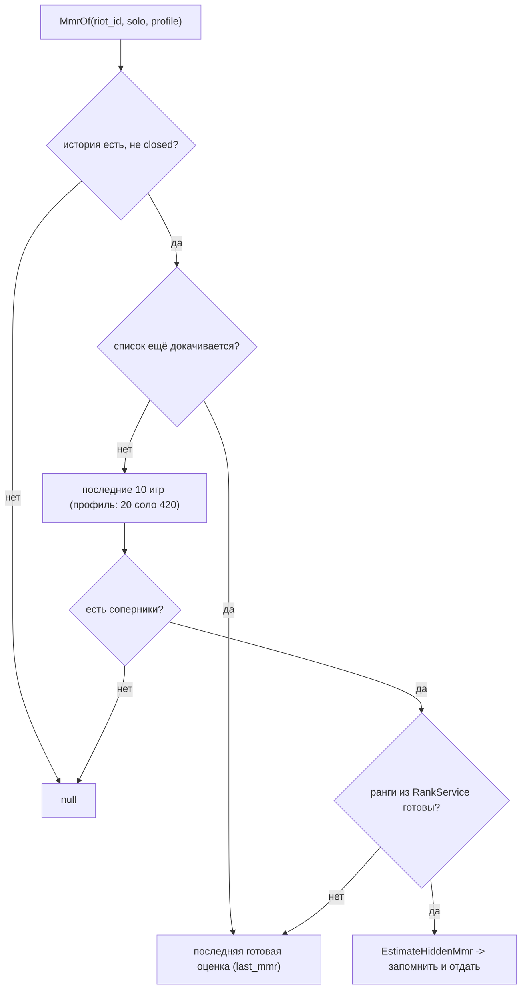

# 16. Контракты API: здоровье, матч, лобби, профили

Справочник точных JSON-ответов семи эндпоинтов локального API, которые читает интерфейс:
`/api/health`, `/api/live`, `/api/lobby`, `/api/profiles`, `/api/active-game`,
`/api/active-game/cards`, `/api/friends`. Для каждого поля указано, где его собирает C++
и как его описывает zod-схема. Общее устройство сервера, коды ответов и `TrustedWrite`
описаны в [5. Локальный API](05-lokalny-api.md), здесь они не повторяются.

| Файл | Роль | Строк |
|---|---|---|
| `sintence-app/src/app/live_api_server.cpp` | сборщики JSON и обработчики маршрутов | 2391 |
| `sintence-app/src/data/recent_json.cpp` | `RecentToJson`: поле `recent` в профилях | 33 |
| `sintence-app/src/data/live_game_service.cpp/.h` | «Сейчас в игре», карточки, друзья | — |
| `sintence-web/src/api/schemas.ts` | zod-схемы контракта | 980 |
| `sintence-web/src/api/client.ts` | `apiGet`/`apiPost`, разбор ответа схемой | 146 |
| `sintence-web/src/mock/data.ts`, `scenarios.ts` | мок-данные для примеров | 1218 / 885 |

Пути C++ ниже даны от `sintence-app/src/`, пути интерфейса — от `sintence-web/src/`.

## Оглавление

| Эндпоинт | Сборщик C++ | zod-схема |
|---|---|---|
| `GET /api/health` | `app/live_api_server.cpp:1104` | `HealthSchema`, `api/schemas.ts:515` |
| `GET /api/live` | `LiveGameToJson`, `app/live_api_server.cpp:580` | `LiveGameSchema`, `api/schemas.ts:136` |
| `GET /api/lobby` | `LobbyToJson`, `app/live_api_server.cpp:544` | `LobbySchema`, `api/schemas.ts:449` |
| `GET /api/profiles` | `ProfilesToJson`, `app/live_api_server.cpp:735` | `ProfilesResponseSchema`, `api/schemas.ts:288` |
| `GET /api/active-game` | `SpectatedGameToJson`, `app/live_api_server.cpp:419` | `ActiveGameSchema`, `api/schemas.ts:921` |
| `GET /api/active-game/cards` | `app/live_api_server.cpp:2213` | `ActiveGameCardsSchema`, `api/schemas.ts:949` |
| `GET /api/friends` | `app/live_api_server.cpp:2279` | `FriendsSchema`, `api/schemas.ts:970` |

## Как интерфейс читает ответ

- `apiGet` любой код, кроме 200, превращает в `{kind: 'status', status}`: тело ошибки
  для GET не читается (`api/client.ts:101-103`). Значит, текст `{"error": ...}` у GET
  нужен только человеку, интерфейс смотрит на код.
- Тело 200 проверяется `schema.safeParse`. При несовпадении возвращается `{kind: 'invalid'}`,
  а в консоль пишется до 5 замечаний один раз на путь (`api/client.ts:78-114`).
- Схемы — `z.object`, а не `strictObject`: лишние поля от C++ не роняют разбор
  (`api/schemas.ts:14-16`).
- `.default(x)` в схеме означает «старый exe поля не присылает — подставить x».
  Нынешний C++ почти все такие поля присылает всегда (см. «Расхождения»).
- `Access-Control-Allow-Origin: *` ставят все семь обработчиков этой страницы
  (например `app/live_api_server.cpp:1106`, `:1440`, `:1452`, `:1537`, `:2195`, `:2215`, `:2281`).

## GET /api/health

Что умеет этот запуск. Интерфейс спрашивает один раз при старте (`app/live_api_server.cpp:1101-1103`).
Параметров нет. Всегда 200.

| Поле | Тип | Обяз. в zod | Смысл | C++ | zod |
|---|---|---|---|---|---|
| `apiVersion` | int | да | версия контракта, `kApiVersion = 5` | `:1108`, `:44` | `:516` |
| `appVersion` | string | default `''` | `SINTENCE_VERSION_STRING` | `:1109` | `:525` |
| `profiles` | bool | да | есть `ProfileService` (сервер Sintence) | `:1110` | `:517` |
| `preferences` | bool | да | есть `PackStore` | `:1111` | `:518` |
| `history` | bool | default `false` | есть `MatchStore` и `HistoryService` | `:1112` | `:520` |
| `badges` | bool | нет в схеме | есть `BadgeStore` | `:1113` | — |
| `game` | bool | да | `source.IsAvailable()` — идёт матч | `:1114` | `:521` |
| `averages` | bool | нет в схеме | в текущем паке есть `rankAverages` | `:1118` | — |
| `pack` | object / null | да, nullable | `{patch, region}` текущего пака; null — пака нет | `:1121`, `:1124` | `:522` |
| `modes` | string[] | default `[]` | режимы с советами в паке (`["ARAM","MAYHEM"]`) | `:1122`, `:1125` | `:531` |
| `update` | object | nullable, default null | состояние самообновления | `UpdateToJson`, `:363` | `UpdateStatusSchema`, `:490` |
| `account` | object | nullable, default null, `.catch(null)` | учётная запись на сервере | `:1134` | `AccountSchema`, `:509` |

### update

| Поле | Тип | Смысл | C++ | zod |
|---|---|---|---|---|
| `state` | enum string | `idle`, `checking`, `downloading`, `ready`, `applying`, `error`, `disabled` | `:372`; без службы `"disabled"` (`:365`) | `:491` |
| `latest` | string / null | последняя версия на сервере | `:376` | default null, `:492` |
| `message` | string | текст состояния; без службы `"обновления выключены"` | `:373`, `:367` | default `''`, `:493` |
| `checkedAt` | number | unix-секунды последней проверки, 0 — не было | `:374` | default 0, `:495` |

### account

| Поле | Тип | Смысл | C++ | zod |
|---|---|---|---|---|
| `state` | string | `AccountStateName(...)`; в комментарии схемы: `ok`, `registering`, `blocked`, `error`, `none` | `:1134` | `:510` |
| `userId` | string / null | id пользователя; пустой — null. Сам токен в ответ не попадает (`:1128-1129`) | `:1135` | default null, `:511` |

Без сервера или без `auth` берётся `AccountInfo` по умолчанию (`:1130-1133`).

Пример (собрано из кода, значения условные):

```json
{"apiVersion":5,"appVersion":"1.2.3","profiles":true,"preferences":true,"history":true,
 "badges":true,"game":false,"averages":true,
 "pack":{"patch":"16.19","region":"EUW1"},"modes":["ARAM"],
 "update":{"state":"idle","message":"","checkedAt":1730700000,"latest":null},
 "account":{"state":"ok","userId":"u123"}}
```

## GET /api/live

Табло идущего матча из Live Client (`allgamedata`, см. [13](13-live-client-json.md)). Параметров нет.

| Код | Тело | Когда |
|---|---|---|
| 200 | `LiveGameToJson` | `source.LoadGame()` вернул игру |
| 503 | `{"error":"no active game"}` | матча нет (`:1443-1446`) |

### Корень

| Поле | Тип | zod | C++ |
|---|---|---|---|
| `stats` | object | обязательное, `:137` | `:582` |
| `players` | array | обязательное, `:138` | `:630` |
| `objectives` | object | nullable, default null, `:142` | `:656` (всегда объект) |
| `activePlayer` | object / null | nullable, обязательное, `:140` | `:676`; null — наблюдатель или реплей (`:684-686`) |

### stats (`LiveGameStatsSchema`, `api/schemas.ts:96`)

| Поле | Тип | zod | C++ |
|---|---|---|---|
| `gameMode` | string | обязательное | `:583` |
| `mapName` | string | обязательное | `:584` |
| `gameTimeSeconds` | number ≥ 0 | `nonnegative()` | `:585` |
| `started` | bool | default `true` | `:586` — загрузка кончилась (GameStart) |

### players[] (`LivePlayerSchema`, `api/schemas.ts:52`)

| Поле | Тип | zod | Смысл | C++ |
|---|---|---|---|---|
| `championName` | string | обяз. | имя на языке клиента | `:608` |
| `championKey` | string | default `''` | ключ Data Dragon (`FiddleSticks`, регистр гуляет) | `:609` |
| `riotId` | string | обяз. | у скрытого — `""` | `:612` |
| `hidden` | bool | default false | игрок скрыт игрой | `:613` |
| `position` | string | обяз. | `TOP`…`UTILITY`, `NONE`, пусто | `:614` |
| `team` | `"ORDER"`/`"CHAOS"` | enum | `TeamName`, `:46` | `:615` |
| `level`, `kills`, `deaths`, `assists`, `creepScore` | int | обяз. | | `:616-620` |
| `wardScore` | number | default 0 | | `:621` |
| `isBot`, `isDead` | bool | обяз. | | `:622-623` |
| `respawnSeconds` | number | default 0 | 0 — жив | `:624` |
| `items` | array | обяз. | см. ниже | `:625` |
| `runes` | object | nullable, default null | `RunesToJson` | `:626` |
| `summonerSpells` | `{key,name}[]` | default [] | `key` — ключ Data Dragon | `:604`, `:627` |

`items[]` (`LiveItemSchema`, `:20`): `itemId` int, `name` string, `slot` int, `count` int,
`price` number — все обязательные (`app/live_api_server.cpp:593-599`).

`runes` (`LiveRunesSchema`, `:35`; C++ `RunesToJson`, `app/live_api_server.cpp:57-69`):
`keystone`, `primaryTree`, `secondaryTree` — строки (обяз.); `keystoneId`, `primaryTreeId`,
`secondaryTreeId` — int, default 0; `minorRunes` string[], `minorRuneIds` int[], `shardIds`
int[] — default []. У чужих игроков Live Client даёт только ключевую руну и деревья, мелкие
приходят пустыми (`api/schemas.ts:28-31`).

### activePlayer (`LiveActivePlayerSchema`, `:88`)

| Поле | Тип | zod | C++ |
|---|---|---|---|
| `riotId` | string | обяз. | `:677` |
| `level` | int | обяз. | `:678` |
| `currentGold` | number | обяз. | `:679` |
| `abilities[]` | `{slot, id, name, level}` | `id` default `''` (`:81`) | `:669-672` |
| `runes` | object | обязательное (не nullable) | `:681` |

### objectives (`MatchObjectivesSchema`, `:129`)

| Поле | Тип | zod | C++ |
|---|---|---|---|
| `ORDER`, `CHAOS` | `TeamObjectives` | обяз. | `:657-658` |
| `soul` | `{team, type}` / null | nullable, default null | `:649-655`; `type` null, если стихия неизвестна |
| `mapTerrain` | string | default `'Default'` | `:660` |

`TeamObjectives` (`:114`, C++ `:638-646`): `dragons[]` — `{type: string, stolen: bool, time: number}`;
`elders`, `barons`, `heralds`, `grubs`, `towers`, `inhibitors` — int. В схеме все с default.

Пример: моки `rankedGame()`, `spectatorGame()`, `practiceGame()` в `mock/data.ts:395`, `:405`, `:854`.

## GET /api/lobby

Состав до матча: выбор чемпиона из LCU и экран загрузки (см. [14](14-lcu-klient.md)).
Параметров нет. Клиент League не запущен — всё равно 200, с пустым `phase` (`:1533-1535`).

| Код | Тело | Когда |
|---|---|---|
| 200 | `LobbyToJson(lobby->Snapshot())` | всегда, если служба есть |
| 501 | `{"error":"lobby service disabled"}` | `lobby == nullptr` (`:1538-1541`) |

### Корень (`LobbySchema`, `api/schemas.ts:449`; C++ `:562-576`)

| Поле | Тип | zod | Смысл |
|---|---|---|---|
| `phase` | string | обяз. | фаза клиента; в моках `ChampSelect`, `InProgress`; пусто — клиента нет |
| `source` | string | обяз. | откуда состав; в моках и комментариях `lcu`, `lcu-game`, `spectator` |
| `timerPhase` | string | обяз. | фаза таймера выбора |
| `timeLeftMs` | number | обяз. | остаток на момент изменения сессии (между пиками стоит) |
| `timerEndsAtMs` | number | default 0 | Unix мс конца таймера — по нему считать отсчёт |
| `note` | string | default `''` | почему состава нет («жду spectator-v5: попытка 3, ответ 404») |
| `bans` | int[] | обяз. | id забаненных чемпионов |
| `members` | array | обяз. | см. ниже |
| `selfRiotId` | string | default `''` | свой Riot ID; пусто — клиента нет |
| `queueId` | int | default 0 | очередь (450 — ARAM) |
| `mode` | `CLASSIC`/`ARAM`/`MAYHEM` | default `CLASSIC`, `.catch('CLASSIC')` (`:331`) | `ModeOfQueue(queue_id)` (`:573`) |
| `benchEnabled` | bool | default false | скамейка ARAM |
| `benchChampionIds` | int[] | default [] | чемпионы на скамейке |

### members[] (`LobbyMemberSchema`, `:434`; C++ `:549-560`)

| Поле | Тип | Смысл |
|---|---|---|
| `side` | `"ALLY"`/`"ENEMY"` | `SideName`, `:538` |
| `cellId` | int | ячейка выбора |
| `riotId` | string | пусто: клиент имя скрыл или это противник в выборе чемпиона |
| `hidden` | bool | имя скрыто |
| `championId` | int | выбран и зафиксирован, иначе 0 |
| `pickIntentId` | int | наведён, но не выбран, иначе 0 |
| `position` | string | `"MIDDLE"` или пусто |
| `spell1Id`, `spell2Id` | int | заклинания |
| `isSelf` | bool | это я |

Все поля `members[]` в схеме обязательные. `puuid` наружу не уходит (`:547-548`), хотя
в `LobbyMember` он есть и используется для пати (`:1018`).

Пример из мока (`mock/data.ts:1052`, сокращено):

```json
{"phase":"InProgress","source":"lcu-game","timerPhase":"","timeLeftMs":0,"timerEndsAtMs":0,
 "note":"","bans":[],"selfRiotId":"Лисья тропа#RU1","queueId":420,"mode":"CLASSIC",
 "benchEnabled":false,"benchChampionIds":[],
 "members":[{"side":"ALLY","cellId":0,"riotId":"Лисья тропа#RU1","championId":103,
             "spell1Id":4,"spell2Id":14,"isSelf":true}]}
```

В моке `members` собираются хелпером `member(...)`, который дописывает остальные поля
(`hidden`, `pickIntentId`, `position`); его текст здесь не проверялся.

## GET /api/profiles

Профили игроков матча или выбора чемпиона: ранг, мастери, стиль, ММР, пати. Параметров нет.

| Код | Тело | Когда |
|---|---|---|
| 200 | `ProfilesToJson(...)` | есть `ProfileService` |
| 501 | `{"error":"no riot api key"}` | `profiles == nullptr` — нет сервера Sintence (`:1454-1459`) |

### Побочный эффект запроса

GET здесь не только читает, но и заказывает данные:

1. Если идёт матч, заказываются профили игроков табло, кроме ботов, скрытых и Riot ID без
   `#` (`:1465-1499`). Без матча отдаётся готовое: профили заказывает и `LobbyService` (`:1462-1464`).
2. Для каждого готового незакрытого профиля — `history->Request(riot_id, 10, false)`
   (`kLobbyStyleDepth = 10`, `:695`, `:1505-1512`). Нужно для `style`, `recent`, `mmr`.

### Корень (`ProfilesResponseSchema`, `api/schemas.ts:288`)

| Поле | Тип | zod | C++ |
|---|---|---|---|
| `progress` | `{done, total, running}` | обяз., `ProfilesProgressSchema` `:282` | `:744-748` |
| `profiles` | array | обяз. | `:792` |
| `parties` | array | default [] | `:794`, всегда есть |

`progress` (`data/profile_service.h:36-38`): `done` — сколько профилей готово, `total` — сколько
заказано за сессию, `running` — идёт ли докачка. В схеме `done`/`total` — `int().nonnegative()`.
Счётчик сессионный, а не по текущему матчу: `total` растёт от матча к матчу.

### profiles[] (`PlayerProfileSchema`, `:258`; C++ `:751-790`)

| Поле | Тип | zod | Смысл | C++ |
|---|---|---|---|---|
| `riotId` | string | обяз. | | `:753` |
| `closed` | bool | default false | игрок попросил удалить данные | `:755` |
| `solo` | `RankedStats` / null | nullable, обяз. | null — не играл в соло | `:757-769` |
| `masteries` | array | обяз. | `{championId, level, points, lastPlayTimeMs}` | `:771-780` |
| `style` | `PlayStyle` / null | nullable, default null | null — история не загружена или closed | `:781` |
| `recent` | array | default [] | до 5 последних игр; closed — [] | `:783` |
| `mmr` | `Mmr` / null | nullable, **optional** | скрытый ММР; null — оценки нет | `:786` |
| `sintence` | bool | default false | значок «S» | `:789` |

`RankedStats` (`RankedStatsSchema`, `:165`): `tier`, `division` — string; `leaguePoints` int;
`wins`, `losses` — int ≥ 0.

`ChampionMastery` (`:173`): `championId`, `level`, `points` — int; `lastPlayTimeMs` — number.

### recent[] (`RecentGameSchema`, `:235`; C++ `data/recent_json.cpp:16-27`)

`matchId` string, `championId` int, `champion` string (ключ Data Dragon), `win` bool,
`kills`/`deaths`/`assists` int — обязательные; `queueId` int, `startedAt` (Unix мс),
`durationS` — default 0. Матчи, где игрока нет, пропускаются (`data/recent_json.cpp:12-15`).
Лимит 5 — `kRecentGames` (`app/live_api_server.cpp:957`).

### style (`PlayStyleSchema`, `:188`; C++ `StyleToJson`, `app/live_api_server.cpp:707-730`)

| Поле | Тип | Смысл |
|---|---|---|
| `games` | int | матчей, без ремейков |
| `roleGames` | int | из них с ролью (Ущелье) |
| `streak` | int | серия от свежей игры: +N побед, −N поражений |
| `champions[]` | `{championId, games}` | чемпионы последних игр |
| `metrics` | `{метрика: {роль: {sum, games}}}` | суммы по ролям |

Все ключи метрик есть всегда, роль без игр не выводится (`:706`, `:717`). Метрики —
`kStyleMetricIds` (`analysis/playstyle.h:57-61`): `csPerMin`, `goldPerMin`, `damagePerMin`,
`damageTakenPerMin`, `visionPerMin`, `wardsPlaced`, `wardsKilled`, `kills`, `deaths`, `assists`,
`kda`, `killParticipation`, `buildingsPerMin`, `earlyTakedowns`, `soloKills`, `laneLead`,
`earlyDeaths`, `win`, `gameMinutes`. Роли — `TOP`, `JUNGLE`, `MIDDLE`, `BOTTOM`, `UTILITY`
(`analysis/playstyle.h:65`). Горит ли плашка, решает интерфейс по `/api/badges`
([17](17-kontrakt-sovety-spravochniki.md)).

### mmr (`MmrSchema`, `:250`; C++ `:940-947`)

| Поле | Тип | Смысл |
|---|---|---|
| `tier`, `division` | string | оценённый ранг |
| `leaguePoints` | number | |
| `games` | number | по скольким играм оценено |
| `vsRank` | `"above"`/`"below"`/`"same"` / null | стрелка относительно своего ранга; null — сравнивать не с чем |

`vsRank`: разница ≥ `kMmrArrowLp = 100` LP — `above`, ≤ −100 — `below`, иначе `same`
(`analysis/hidden_mmr.cpp:141-143`, `analysis/hidden_mmr.h:21`). Пустая строка в C++ даёт null (`:945`).

### parties[] (`PartySchema`, `:276`; C++ `:1048-1049`)

| Поле | Тип | Смысл |
|---|---|---|
| `id` | int | 1, 2, … по порядку в этом ответе (`:1046-1049`) — не стабилен между ответами |
| `riotIds` | string[] | игроки группы |
| `source` | `"lobby"`/`"history"` | из клиента League или по совместным играм; незнакомое — `history` (`.catch`) |

Значения `source` ставятся в `analysis/party.cpp:49` (`lobby`) и `:90` (`history`).

Пример (из мока `mock/data.ts:544`, `mock/scenarios.ts:117`, профиль сокращён):

```json
{"progress":{"done":3,"total":4,"running":true},
 "profiles":[{"riotId":"Лисья тропа#RU1","closed":false,
   "solo":{"tier":"EMERALD","division":"II","leaguePoints":47,"wins":88,"losses":71},
   "mmr":{"tier":"DIAMOND","division":"IV","leaguePoints":30,"games":14,"vsRank":"above"},
   "masteries":[{"championId":103,"level":34,"points":412560,"lastPlayTimeMs":1730700000000}],
   "style":null,"recent":[],"sintence":false}],
 "parties":[{"id":1,"riotIds":["Ветер с реки#EUW","Демасийский щит#RU1"],"source":"lobby"}]}
```

## Скрытые игроки, ММР, значок, пати, докачка

### Скрытые (`hidden`)

| Где | Что отдаётся скрытому | Ссылка |
|---|---|---|
| `/api/live` | `riotId: ""` (в C++ там лежало бы имя чемпиона), `hidden: true` | `app/live_api_server.cpp:610-613` |
| `/api/lobby` | `riotId` пустой, `hidden` из клиента | `:552-553` |
| `/api/active-game` | `riotId: null`, `profileIconId`, `keystoneId`, `primaryStyleId`, `subStyleId` = 0 | `:429-438` |
| `/api/profiles` | скрытый не заказывается и не участвует в пати | `:1480-1483`, `:1027-1028` |
| `/api/active-game/cards` | карточки нет; `history=` для скрытого игнорируется | `data/live_game_service.cpp` (`member.hidden` → skip), `app/live_api_server.cpp:2238-2243` |

Правило: скрытого не называем и ни с кем не связываем (POLICY.md, комментарии `:611`, `:2234`).

### Скрытый ММР — как получается (`Impl::MmrOf`, `:903-952`)



- В `/api/profiles` и карточках — `profile=false`: 10 игр (`kLobbyStyleDepth`), ключ кеша `riot_id|o`.
  Окно профиля — 20 соло (`kMmrProfileGames`, `analysis/hidden_mmr.h:22`), ключ `|p` (`:912`).
- Кеш `last_mmr` нужен, чтобы стрелка не прыгала, пока игры докачиваются (`:847-849`).
- Сам `MmrOf` историю не заказывает (`:902`): её заказывает обработчик `/api/profiles`.

### Значок «S» (`sintence`)

`active_users->IsActive(riot_id)`; служба не подключена — `false` (`:1521-1524`, `:789`).
Неизвестно — тоже `false`.

### Пати (`Impl::Parties`, `:995-1052`)

- Идёт матч — кандидаты все игроки табло, команда 0 (ORDER) или 1 (CHAOS). Исключены боты,
  скрытые и закрытые (`:1025-1034`).
- Матча нет, фаза `ChampSelect` — только видимые союзники (`:1035-1042`).
- В кандидате исключён и Riot ID без `#` (`:975-976`).
- puuid клиента берётся из состава LCU. Если `source == "spectator"`, puuid не берётся:
  там puuid ключа Riot, а не клиента (`:1009-1015`).
- Сами группы находит `FindParties` по puuid пати из клиента и по совместным последним
  10 играм (`:986`, `:1047`).

## GET /api/active-game

«Сейчас в игре» для игрока окна профиля.

| Параметр | Тип | По умолчанию | Проверка |
|---|---|---|---|
| `riotId` | string | — | непустой и содержит `#`, иначе 400 (`:2201-2206`) |

| Код | Тело | Когда |
|---|---|---|
| 200 | `{riotId, state, game}` | всегда при верном запросе |
| 400 | `{"error":"no riot id"}` | нет `riotId` или без `#` |
| 501 | `{"error":"no riot api key"}` | нет `profiles` или `live_games` (`:2196-2200`) |

Ответ кешируется на 30 с на Riot ID (`data/live_game_service.h:55`), первый запрос синхронно идёт к Riot.

### Корень (`ActiveGameSchema`, `api/schemas.ts:921`; C++ `:2208-2209`)

| Поле | Тип | zod | Смысл |
|---|---|---|---|
| `riotId` | string | обяз. | эхо запроса |
| `state` | string | обяз. | `ingame`, `none` (Riot 404), `hidden` (искомый скрыт), `error` (не найден puuid или другой ответ) — `data/live_game_service.cpp:42-53` |
| `game` | object / null | nullable, default null | есть только при `ingame` |

### game (C++ `SpectatedGameToJson`, `:419-449`)

| Поле | Тип | zod | Смысл |
|---|---|---|---|
| `gameId` | number | обяз. | |
| `queueId`, `mapId` | int | обяз. | |
| `startTimeMs` | number | обяз. | 0 — ещё загрузка |
| `bans[]` | `{championId, teamId, pickTurn}` | обяз. | |
| `participants[]` | array | обяз. | см. ниже |

`participants[]` (`ActiveGameParticipantSchema`, `:907`): `teamId` int, `riotId` string/null,
`hidden` bool, `bot` bool, `championId`, `spell1Id`, `spell2Id`, `keystoneId`, `primaryStyleId`,
`subStyleId` — int (обяз.); `profileIconId` int, default 0. puuid наружу не уходит (`:417`).

## GET /api/active-game/cards

Карточки (ранг, мастери, стиль, ММР) участников идущей игры.

| Параметр | Тип | По умолчанию | Смысл |
|---|---|---|---|
| `riotId` | string | — | чью игру; непустой, с `#`, иначе 400 |
| `history` | string | пусто | Riot ID участника, которому заказать историю (10 игр) для плашек; только видимому не-боту этой игры (`:2236-2244`) |

| Код | Тело | Когда |
|---|---|---|
| 200 | `{gameId, done, total, cards}` | игра найдена |
| 400 | `{"error":"no riot id"}` | плохой `riotId` |
| 404 | `{"error":"no game"}` | `Lookup` не дал игры (`:2228-2232`) |
| 501 | `{"error":"no riot api key"}` | нет служб |

Первый вызов на `gameId` ставит в фон загрузку карточек видимых не-ботов, следующие отдают
только готовое (`data/live_game_service.h:70-72`).

### Корень (`ActiveGameCardsSchema`, `:949`; C++ `:2270-2273`)

`gameId` number, `done` int, `total` int, `cards` array — все обязательные.

### cards[] (`ActiveGameCardSchema`, `:938`; C++ `:2258-2268`)

| Поле | Тип | zod | Смысл |
|---|---|---|---|
| `riotId` | string | обяз. | |
| `closed` | bool | default false | сервер ответил 404 erased (`data/live_game_service.h:60`) |
| `solo`, `flex` | `RankedStats` / null | nullable, обяз. | `RankedToJson`, `:404-415` |
| `mmr` | `Mmr` / null | nullable, optional | closed — null, иначе `MmrOf(..., false)` |
| `mastery` | `{level, points}` / null | nullable, обяз. | мастери на текущем чемпионе |
| `style` | `PlayStyle` / null | nullable, default null | `StyleOf(riot_id, 10)` |
| `styleLoading` | bool | default false | style null, но история не закрыта и без ошибки — ещё грузится (`:2249-2253`) |

## GET /api/friends

Друзья из клиента League, к Riot ни одного запроса (`:2277-2278`). Параметров нет. Всегда 200:
нет службы или клиента — `{"client": false, "friends": []}` (`:2282-2285`).

| Поле | Тип | zod (`FriendSchema`, `:957`) | Смысл | C++ |
|---|---|---|---|---|
| `client` | bool | обяз. (`:971`) | клиент League отвечает | `:2301` |
| `friends[].riotId` | string | обяз. | | `:2289` |
| `.gameName`, `.tagLine` | string | обяз. | | `:2290-2291` |
| `.iconId` | int | обяз. | | `:2292` |
| `.status` | string | обяз. | в схеме: `inGame`, `champSelect`, `lobby`, `online`, `away`, `offline`, `mobile` | `:2293` |
| `.championId`, `.queueId` | int | default 0 | | `:2294-2295` |
| `.sinceMs` | number | default 0 | | `:2296` |
| `.spectatable` | bool | default false | `status == "inGame"` и есть ключ наблюдения | `:2298` |

puuid и ключ наблюдения наружу не уходят; их берёт `POST /api/spectate` через
`FriendSpectateInfo` (`:2327-2330`).

## Расхождения C++ ↔ zod-схема

| Эндпоинт / поле | C++ | zod | Последствие |
|---|---|---|---|
| health `badges`, `averages` | шлёт (`:1113`, `:1118`) | нет в `HealthSchema` | молча отбрасываются при разборе, `Health` их не содержит |
| health `account` | всегда объект | `.catch(null)` | кривое поле не роняет ответ, а превращается в null |
| live `players[].runes` | всегда объект (`:626`) | `nullable().default(null)` | схема мягче кода (под старый exe) |
| live `objectives` | всегда объект | `nullable().default(null)` | то же |
| profiles/cards `mmr` | ключ всегда есть, объект или null | `.nullable().optional()` | тип в TS — `Mmr \| null \| undefined` |
| lobby `mode` | `ModeOfQueue(...)` | `.catch('CLASSIC')` | новый режим C++ превратится в CLASSIC |
| party `source` | `lobby`/`history` | `.catch('history')` | незнакомое — `history` |
| active-game `state` | 4 значения | `z.string()` | незнакомое — «не в игре» (комментарий `:923`) |
| profile `solo` | ключ всегда есть | `nullable()` без default | если ключа не будет, разбор упадёт |

Полей, которые схема требует, а C++ не шлёт, на этих эндпоинтах не найдено.

## Тесты

Сборщики `LobbyToJson`, `LiveGameToJson`, `ProfilesToJson` и обработчики маршрутов тестами
`sintence-app/tests/` не вызываются: поиск по имени этих функций в `tests/` ничего не нашёл.
Логику под ними проверяют `tests/test_hidden_mmr.cpp` (ММР), `tests/test_party.cpp` (пати),
`tests/test_profile_summary.cpp`. Форму JSON со стороны интерфейса проверяют только моки,
прошедшие через zod в `npm run dev:mock`. Подробнее — [30](30-katalog-testov.md), [10](10-testy.md).

## Как менять: добавить поле в ответ

1. C++: допиши поле в сборщик (например в `ProfilesToJson`, `app/live_api_server.cpp:751-790`).
   Если «нет данных» — отдавай `null`, а не пропускай ключ: так сделаны `solo`, `activePlayer`, `mmr`
   (`:766-768`, `:684-686`).
2. zod: добавь поле в схему `api/schemas.ts` как необязательное — `.default(...)` или
   `.nullable().default(null)`. Тогда старый exe не уронит интерфейс.
3. Моки: допиши поле в `mock/data.ts` (и, если надо, сценарий в `mock/scenarios.ts`).
4. `kApiVersion` (`app/live_api_server.cpp:44`) и `EXPECTED_API_VERSION` в интерфейсе **не**
   поднимаются: новые поля версию не меняют (`:40-43`).
5. Удалил поле или сменил тип — подними обе версии в одном заходе ([5](05-lokalny-api.md), «Версии контракта»).
6. Поле про другого игрока — проверь, что скрытый и `closed` его не получают
   (образец — `:429-438`, `:781-787`).

## Подводные камни

- `GET /api/profiles` заказывает профили и историю — частый опрос расходует ключ Riot,
  но только на новые Riot ID (`:1491-1512`).
- `parties[].id` выдаётся заново в каждом ответе (`:1046-1049`) — не храни его как ключ между опросами.
- `progress` в `/api/profiles` считает за всю сессию, а не за текущий матч (`data/profile_service.h:37`).
- У скрытого в `/api/live` `riotId` — пустая строка, а в `/api/active-game` — `null`
  (`:612` против `:429`). Проверять надо поле `hidden`, а не имя.
- `mmr` в профилях может быть устаревшей оценкой из кеша, пока докачивается история (`:921-924`, `:934-936`).
- `/api/active-game` синхронно ходит к Riot при промахе кеша (30 с): ответ может быть медленным
  (`data/live_game_service.cpp:31-57`).

## Не проверено

- Полный список значений `phase`, `source`, `timerPhase` лобби: в коде `core/lobby.h` и `LobbyService`
  не прочитан, значения взяты из моков и комментария схемы (`api/schemas.ts:430-433`).
- Значения `AccountStateName` и `UpdateStateName` — из комментариев zod, их реализации не читались.
- Содержимое хелпера `member()` в `mock/data.ts`.
- Как `FindParties` и `EstimateHiddenMmr` считают внутри — см. [25](25-analiz-metriki.md).
