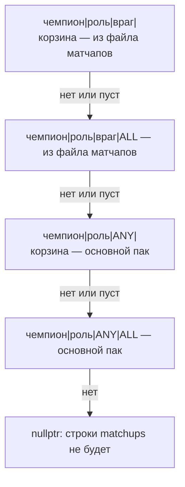

# 17. Контракты API: советы, мета, справочники

На этой странице описано, как выглядят запросы и ответы локального API для советов
(`/api/preferences`, `/api/counters`), справочников из пака (`/api/benchmarks`,
`/api/averages`, `/api/champion-roles`, `/api/mode-champions`) и данных, которые
приходят с сервера как есть (`/api/meta`, `/api/trends`, `/api/badges`,
`/api/badge-visibility`). Формат самих файлов пака, меты и трендов описан в
[23. Пак предпочтений](23-pak-predpochtenij.md). Общий список маршрутов приведён в
[5. Локальный API](05-lokalny-api.md).

Пути указаны от `sintence-app/src/` (C++) и от `sintence-web/src/` (интерфейс).

## Файлы участка

| Файл | Роль | Строк |
|---|---|---|
| `app/live_api_server.cpp` | обработчики маршрутов, `BuildPreferences`, `BuildModePreferences`, `BucketToJson`, `VariantsToJson` | 2391 |
| `data/preference_pack.h/.cpp` | `Lookup`, `LookupMode`, `ModeBucket`, `TierBucket`, `Benchmarks`, `RankAverages`, `RoleGames`, `MainRole`, `EnemyClasses` | 299 / 671 |
| `data/pack_store.h/.cpp` | `PackStore::Current`, `Matchups` (файл матчапов докачивается по запросу), `PackUpdater` | 107 / 238 |
| `data/counters.cpp` | `CounterPicks`, `WilsonLower` | 61 |
| `data/meta_store.h/.cpp` | `ParseMetaFile`, `BuildMetaResponse`, `MetaStore` | 55 / 95 |
| `data/trends_store.h/.cpp` | `ParseTrendsFile`, `BuildTrendsResponse`, `TrendsStore` | 63 / 64 |
| `data/badge_store.h/.cpp` | `BadgeStore`, `BadgeUpdater` (обновление раз в 10 минут) | 73 / 122 |
| `core/game_mode.h/.cpp` | `ModeOfQueue`, `ModeOf` | 21 / 27 |
| `api/schemas.ts` (web) | zod-схемы ответов | 980 |
| `api/client.ts` (web) | `apiGet`/`apiPost`, четыре вида результата | 146 |
| `mock/data.ts`, `mock/scenarios.ts` (web) | моки для `npm run dev:mock` | — |

## Оглавление

| Эндпоинт | Обработчик | zod-схема |
|---|---|---|
| `GET /api/preferences` | `app/live_api_server.cpp:1546` | `PreferencesResponseSchema`, `api/schemas.ts:360` |
| `GET /api/counters` | `app/live_api_server.cpp:1823` | `CountersResponseSchema`, `api/schemas.ts:396` |
| `GET /api/benchmarks` | `app/live_api_server.cpp:1676` | `BenchmarksResponseSchema`, `api/schemas.ts:159` |
| `GET /api/champion-roles` | `app/live_api_server.cpp:1709` | локальная `RoleGamesSchema`, `profile/LiveGamePanel.vue:39` |
| `GET /api/mode-champions` | `app/live_api_server.cpp:1738` | `ModeChampionsSchema`, `api/schemas.ts:404` |
| `GET /api/averages` | `app/live_api_server.cpp:1772` | `AveragesSchema`, `api/schemas.ts:897` |
| `GET /api/meta` | `app/live_api_server.cpp:1241` | `MetaSchema`, `api/schemas.ts:714` |
| `GET /api/trends` | `app/live_api_server.cpp:1253` | `TrendsSchema`, `api/schemas.ts:778` |
| `GET /api/badges` | `app/live_api_server.cpp:1418` | `BadgeConfigSchema`, `api/schemas.ts:225` |
| `GET/POST /api/badge-visibility` | `app/live_api_server.cpp:1193`, `:1206` | нет (в `sintence-web/src` не используется) |

Все GET-маршруты этой страницы, кроме `/api/badge-visibility`, ставят заголовок
`Access-Control-Allow-Origin: *`. У `/api/badge-visibility` его нет
(`app/live_api_server.cpp:1193-1233`).

## Общее: откуда берутся данные и когда бывают 501 и 503

- `impl_->packs` равен `nullptr`, если сервера Sintence нет: `main.cpp` передаёт
  `server_config ? &packs : nullptr` (`app/main.cpp:363`). Тогда `/api/preferences` и
  `/api/counters` отвечают **501**.
- `impl_->Pack()` возвращает `packs->Current()` (`app/live_api_server.cpp:880`). Это
  `shared_ptr`, поэтому пак доживает до конца запроса, даже если в это время приехал новый.
  `nullptr` означает, что пак ещё не загружен, и тогда ответ **503**.
- `impl_->badges` тоже `nullptr` без сервера (`app/main.cpp:365`), отсюда 501 у `/api/badges`.
- `MetaStore` и `TrendsStore` передаются всегда (`app/main.cpp:368-369`). Поэтому без
  сервера `/api/meta` и `/api/trends` отвечают **503**, а не 501.
- Интерфейс для GET ответов не 200 тело не читает: `apiGet` возвращает только
  `{kind:'status', status}` (`api/client.ts:101-103`). Строка `error` в теле нужна
  только людям, например при отладке через `curl`.

## GET /api/preferences

Советы активному игроку: руны, прокачка, предметы и заклинания против каждого врага.

### Параметры запроса

Параметры читаются только когда матча нет. Если матч идёт, данные берутся из табло,
а параметры не учитываются.

| Имя | Тип | По умолчанию | Валидация | Смысл | Ссылка |
|---|---|---|---|---|---|
| `champion` | строка, ключ Data Dragon | — | пусто → 503 `no active game`; иначе не проверяется | свой чемпион | `app/live_api_server.cpp:1610-1615` |
| `role` | строка | `""` | не проверяется; всё, кроме `TOP/JUNGLE/MIDDLE/BOTTOM/UTILITY`, заменяется на `MainRole` | своя роль | `:1625`, `:52`, `:174` |
| `name` | строка | `""` | нет | локализованное имя для `you.championName` | `:1624` |
| `enemies` | CSV ключей | `""` | `SplitCsv` пропускает пустые куски; ограничения длины нет | пики противника | `:1627`, `:137-152` |

Ключ чемпиона проверяется только при загрузке файла матчапов: `MatchupFile` пропускает
лишь буквы и цифры длиной до 32 символов (`data/preference_pack.cpp:28-38`, `:479-487`).

### Коды ответов

| Код | Тело | Когда | Ссылка |
|---|---|---|---|
| 501 | `{"error":"no preference pack"}` | нет сервера (`packs == nullptr`) | `app/live_api_server.cpp:1550-1554` |
| 503 | `{"error":"preference pack not loaded"}` | пак ещё не приехал | `:1557-1562` |
| 503 | `{"error":"no active game"}` | матча нет и `champion` пуст | `:1611-1615` |
| 503 | `{"error":"no active player"}` | в матче нет `active_player` (например, в режиме наблюдателя) | `:1639-1643` |
| 503 | `{"error":"active player not on scoreboard"}` | активного игрока нет среди `players` или у него пустой `champion_key` | `:1653-1658` |
| 200 | документ ниже | — | `:1630`, `:1667` |

`usePreferences` при 501 прекращает опрос насовсем. При остальных кодах, кроме сетевой
ошибки, он очищает советы и продолжает опрашивать (`composables/usePreferences.ts:37-50`).

### Как выбирается режим

`mode = game ? ModeOf(queue_id, game->stats.game_mode) : ModeOfQueue(queue_id)`
(`app/live_api_server.cpp:1581-1582`), где `queue_id` берётся из `LobbyService` (`:1578`).

| Вход | Режим | Ссылка |
|---|---|---|
| очередь 450 | `ARAM` | `core/game_mode.cpp:7-8` |
| очередь 2400 | `MAYHEM` | `:9-10` |
| другая очередь, не 0 | `CLASSIC` (очередь важнее `gameMode`) | `:17-18` |
| очередь 0, `gameMode == "ARAM"` | `ARAM` | `:21-23` |
| очередь 0, `gameMode == "KIWI"` | `MAYHEM` | `:24` |
| всё остальное | `CLASSIC` | `:24` |

Для режима не CLASSIC вызывается `BuildModePreferences`. Для CLASSIC вызывается
`BuildPreferences` с файлом матчапов своего чемпиона `packs->Matchups(me.key)`, после чего
ставится `doc["mode"]="CLASSIC"` (`app/live_api_server.cpp:1595-1604`). Пара gameMode и
очередь записывается в журнал один раз на смену пары (`:1583-1594`).

### Откуда берутся «я», враги и ранг

| | В матче | До матча |
|---|---|---|
| мой Riot ID | `game->active_player->riot_id` (`:1644`) | участник лобби с `is_self` (`:1617-1623`), может быть пустым |
| чемпион, имя, роль | строка табло: `champion_key`, `champion_name`, `position` (`:1666`) | параметры `champion`, `name`, `role` |
| враги | все игроки другой команды с непустым ключом, с именем и позицией (`:1660-1665`) | `enemies`: только ключи, имя и позиция пустые (`:1628`) |
| ранг | `tier_of`: `solo_queue->tier` из готового профиля `ProfileService`; если профиля нет — `"ALL"` (`:1567-1576`) | так же, по своему Riot ID из лобби |

Советы строятся только для активного игрока. Карточкам противников они не нужны по
POLICY.md (`app/live_api_server.cpp:1635-1638`).

### Как ранг превращается в tier

`Lookup` переводит ранг в укрупнённую корзину через `TierBucket`
(`data/preference_pack.cpp:263-280`, `:527`):

| Ранг игрока | Корзина |
|---|---|
| IRON, BRONZE | `BRONZE` |
| SILVER, GOLD | `GOLD` |
| PLATINUM, EMERALD | `EMERALD` |
| DIAMOND, MASTER, GRANDMASTER, CHALLENGER | `DIAMOND` |
| пусто, нет профиля или нет ранга в соло | `ALL` |

Регистр не важен: перед сравнением строка переводится в верхний регистр (`:264`).

### Лестница отката (CLASSIC)

`Lookup(champion, role, opponent, tier, matchups)` берёт первый бакет, в котором есть
хотя бы один вариант рун, прокачки или предметов (`HasVariants`,
`data/preference_pack.cpp:256-259`, `:558-568`):



- Если корзина уже `ALL`, ступени с ALL не дублируются (`:544`, `:549`).
- Если файла матчапов нет (не скачан, у чемпиона их нет, сервер не ответил), первые две
  ступени ищутся в основном паке. Матчапов там нет, поэтому лестница сразу спускается
  к «против всех» (`:540`, `data/preference_pack.h:196-198`).
- Пустые `champion` или `role` дают `nullptr` (`data/preference_pack.cpp:523-525`).

Интерфейс видит результат лестницы в трёх полях каждой строки `matchups[]`:

| Поле | Значение | Как читать |
|---|---|---|
| `exact` | `bucket->opponent == enemy.key` (`app/live_api_server.cpp:216`) | `true` — статистика именно против этого врага; `false` — по матчапу данных не набралось, показан бакет «против всех» |
| `opponent` | оппонент найденного бакета: ключ врага или `"ANY"` | для `versus:"ANY"` всегда `ANY`, и `exact` тогда `true` |
| `tier` | корзина найденного бакета: `BRONZE…DIAMOND` или `ALL` | `ALL` — откат на все ранги, либо ранг неизвестен |

`AdvicePanel.vue` показывает это так: `versus` равен `ANY` — «против всех»
(`components/AdvicePanel.vue:273-277`); `exact` — «против <врага>» (`:278-280`); иначе —
«против всех» и предупреждение о малой выборке (`:281-286`). В конце строки выводятся
игры, винрейт, `tier` и `patch` (`:287-290`).

### Роль и `roleSource`

| `roleSource` | Когда | `you.role` | Ссылка |
|---|---|---|---|
| `client` | позиция — одна из пяти линий | позиция | `app/live_api_server.cpp:172-173` |
| `pack` | линии нет (`NONE` или `""`), взята `MainRole` по паку | роль из пака | `:174-176` |
| `none` | линии нет, и чемпиона нет в паке | исходная позиция (`NONE` или `""`) | `:176`, `:186` |
| `mode` | ARAM или MAYHEM | `""` | `:263-264` |

При `roleSource: pack` интерфейс помечает роль как угаданную (`components/AdvicePanel.vue:260`).
При `none` советов нет: `Lookup` с пустой ролью возвращает `nullptr`, и `matchups` пуст.

### Порядок строк `matchups[]` (CLASSIC)

1. Соперник по линии: первый враг, у которого `enemy_role` совпадает с моей ролью.
   `enemy_role` — это позиция врага, если она линия, иначе его `MainRole`
   (`app/live_api_server.cpp:190-200`). У него `lane:true`.
2. Остальные враги в исходном порядке, `lane:false` (`:223-227`).
3. Если соперника по линии нет, добавляется строка `versus:"ANY"` (`:232-234`).
   Это бывает, когда враги ещё не выбраны или роль не совпала ни у кого.
4. Враг, для которого `Lookup` вернул `nullptr`, пропускается (`:205-207`).

`generalItemChains` и `generalBoots` берутся из `Lookup(me, role, "", tier)`, то есть
«против всех» своей корзины с откатом на ALL. Если роли нет, это `[]` (`:240-244`).

### Режимы ARAM и MAYHEM (`BuildModePreferences`)

- Бакет «против всех»: `LookupMode(mode, champion, "ANY")` (`app/live_api_server.cpp:268`).
  Если его нет, `matchups` пуст, а `generalItemChains` и `generalBoots` равны `[]`
  (`:269`, `:302-304`).
- Для каждого класса, которого у врагов не меньше двух (`EnemyClasses`), добавляется строка
  `LookupMode(mode, champion, cls)`. У первой `lane:true`, `enemyClass` и `enemyClassCount`
  заполнены (`:275-290`). Классы сортируются по убыванию числа, при равенстве — в порядке
  TANK, FIGHTER, MAYHEM… точнее TANK, FIGHTER, MAGE, ASSASSIN, MARKSMAN, SUPPORT
  (`data/preference_pack.cpp:429-456`).
- Последней всегда идёт строка `versus:"ANY"` с `exact:true`, `lane:false`,
  `enemyClass:""` и `enemyClassCount:0` (`app/live_api_server.cpp:291-299`).
- Лестница режима: `чемпион|КЛАСС|ALL`, затем `чемпион|ANY|ALL`. Имя чемпиона
  сравнивается без учёта регистра, бакеты без вариантов пропускаются
  (`data/preference_pack.cpp:382-401`). Если класс-бакет откатился на ANY, у строки класса
  будет `exact:false` (`app/live_api_server.cpp:285`).
- Ранг в режимах не используется: в ключе всегда `ALL`.
- `versusName` и `versusRole` пустые. Ключа `enemyClass` в CLASSIC нет, zod подставляет
  `''` и `0` (`api/schemas.ts:356-357`).

### Поля ответа

| Путь | Тип | Обяз. | Смысл | C++ | zod |
|---|---|---|---|---|---|
| `patch` | string | да | патч пака | `app/live_api_server.cpp:180`, `:256` | `api/schemas.ts:361` |
| `mode` | `CLASSIC\|ARAM\|MAYHEM` | да | режим | `:1602`, `:258` | `:362` (незнакомое значение → `CLASSIC`, `:331`) |
| `region` | string | да | регион пака | `:181`, `:257` | `:363` |
| `you.riotId` | string | да | мой Riot ID, до матча может быть `""` | `:183` | `:365` |
| `you.champion` | string | да | ключ чемпиона | `:184` | `:366` |
| `you.championName` | string | да | имя из клиента, может быть `""` | `:185` | `:367` |
| `you.role` | string | да | см. `roleSource` | `:186`, `:263` | `:368` |
| `you.roleSource` | `client\|pack\|none\|mode` | да | откуда роль | `:187`, `:264` | `:372` (по умолчанию `client`) |
| `matchups[]` | array | да | строки советов | `:235`, `:301` | `:374` |
| `matchups[].riotId` | string | шлётся | мой Riot ID | `:112` | не описан |
| `matchups[].champion` | string | шлётся | чемпион бакета | `:113` | не описан |
| `matchups[].role` | string | шлётся | роль бакета (в режимах `""`) | `:114` | не описан |
| `matchups[].versus` | string | да | ключ врага, `ANY` или класс | `:209`, `:281`, `:292` | `:334` |
| `matchups[].versusName` | string | да | имя врага (до матча `""`) | `:210` | `:335` |
| `matchups[].versusRole` | string | да | роль врага по табло или пака | `:211` | `:336` |
| `matchups[].lane` | bool | да | соперник по линии или первый класс | `:212`, `:284` | `:337` |
| `matchups[].exact` | bool | да | см. лестницу | `:216`, `:285`, `:296` | `:339` |
| `matchups[].opponent` | string | да | оппонент найденного бакета | `:115` | `:340` |
| `matchups[].tier` | string | да | корзина найденного бакета | `:116` | `:341` |
| `matchups[].patch` | string | да | патч | `:117` | `:342` |
| `matchups[].games` | int ≥0 | да | игр в бакете | `:118` | `:343` |
| `matchups[].winrate` | 0..1 | да | винрейт бакета | `:119` | `:344` |
| `matchups[].runePages[]` | Variant[] | да | страницы рун | `:120` | `:345` |
| `matchups[].skillOrders[]` | Variant[] | да | прокачка | `:121` | `:346` |
| `matchups[].itemChains[]` | Variant[] | да | цепочки предметов | `:122` | `:347` |
| `matchups[].summonerSpells[]` | Variant[] | да | заклинания | `:123` | `:348` (по умолчанию `[]`) |
| `matchups[].starterItems[]` | Variant[] | да | стартовые предметы | `:124` | `:351` (по умолчанию `[]`) |
| `matchups[].boots[]` | Variant[] | да | сапоги | `:125` | `:353` (по умолчанию `[]`) |
| `matchups[].enemyClass` | string | только в режимах | класс врагов | `:286`, `:297` | `:356` (по умолчанию `''`) |
| `matchups[].enemyClassCount` | int | только в режимах | сколько врагов этого класса | `:287`, `:298` | `:357` (по умолчанию `0`) |
| `generalItemChains[]` | Variant[] | да | запасные цепочки «против всех» | `:241`, `:302` | `:378` |
| `generalBoots[]` | Variant[] | да | запасные сапоги | `:243`, `:304` | `:379` |

**Variant** (`VariantsToJson`, `app/live_api_server.cpp:71-108`; `PreferenceVariantSchema`,
`api/schemas.ts:309-327`):

| Поле | Тип | Когда есть | C++ | zod |
|---|---|---|---|---|
| `games` | int | всегда | `:75` | `:310` |
| `share` | 0..1 | всегда | `:76` | `:311` |
| `winrate` | 0..1 | всегда | `:77` | `:312` |
| `winrateLow` | 0..1 | всегда, нижняя граница Вильсона | `:78` | `:315` |
| `steps` | string[] | если не пуст (skillOrders) | `:80-82` | `:317` |
| `maxOrder` | string[] | если не пуст | `:83-85` | `:319` |
| `itemIds` | int[] | если не пуст (itemChains, starterItems, boots) | `:86-88` | `:321` |
| `nextItemIds` | int[] | если не пуст | `:89-91` | `:323` |
| `spellIds` | int[] | если не пуст | `:92-94` | `:325` |
| `page` | объект: `keystoneId, primaryTreeId, primaryIds[], secondaryTreeId, secondaryIds[], shardIds[]` | только у страницы рун | `:95-104` | `RunePageSchema`, `:298-305` |

Пустые массивы в варианте не передаются. Вариант, в котором нет ни прокачки, ни предметов,
ни заклинаний, ни страницы рун, отбрасывается ещё при чтении пака
(`data/preference_pack.cpp:129-133`).

### Пример (мок `rankedPreferences`, `mock/data.ts:634`, сокращён)

```json
{
  "patch": "16.19", "mode": "CLASSIC", "region": "RU",
  "you": { "riotId": "…", "champion": "Ahri", "championName": "Ари", "role": "MIDDLE", "roleSource": "client" },
  "generalBoots": [{ "itemIds": [3020], "games": 380, "share": 0.9, "winrate": 0.52, "winrateLow": 0.47 }],
  "generalItemChains": [{ "itemIds": [6655, 4645, 3089], "nextItemIds": [3157, 3135], "games": 58, "share": 0.141, "winrate": 0.552, "winrateLow": 0.425 }],
  "matchups": [
    { "versus": "Zed", "versusName": "Зед", "versusRole": "MIDDLE", "lane": true, "exact": true,
      "opponent": "Zed", "tier": "EMERALD", "patch": "16.19", "games": 64, "winrate": 0.531,
      "runePages": [{ "games": 31, "share": 0.484, "winrate": 0.581, "winrateLow": 0.408,
        "page": { "keystoneId": 8112, "primaryTreeId": 8100, "primaryIds": [8139, 8140, 8106],
                  "secondaryTreeId": 8200, "secondaryIds": [8224, 8236], "shardIds": [5008, 5008, 5001] } }],
      "skillOrders": [{ "steps": ["Q","E","W","Q","Q"], "maxOrder": ["Q","E","W"], "games": 40, "share": 0.625, "winrate": 0.55, "winrateLow": 0.397 }],
      "summonerSpells": [{ "spellIds": [4, 14], "games": 41, "share": 0.64, "winrate": 0.56, "winrateLow": 0.41 }],
      "itemChains": [], "starterItems": [], "boots": [] },
    { "versus": "Viego", "versusName": "Виего", "versusRole": "JUNGLE", "lane": false, "exact": false,
      "opponent": "ANY", "tier": "EMERALD", "…": "…" }
  ]
}
```

В моке нет полей `riotId`, `champion` и `role` у строк `matchups`, а настоящий C++ их
отправляет (`app/live_api_server.cpp:112-114`). Мок для ARAM, `aramPreferences`
(`mock/data.ts:1169-1197`), содержит строку `TANK` с `enemyClassCount: 3`, затем `ANY`;
у `you` там `role: ""` и `roleSource: "mode"`.

## GET /api/counters

Контрпики в выборе чемпиона: чемпионы, которые чаще всего обыгрывают вражеских
чемпионов на моей линии.

### Параметры

| Имя | Тип | По умолчанию | Валидация | Смысл | Ссылка |
|---|---|---|---|---|---|
| `role` | строка | `""` | цели строятся только для линии (`IsLaneRole`), иначе `targets: []` | своя роль | `app/live_api_server.cpp:1839`, `:1865` |
| `enemies` | CSV | `""` | `SplitCsv`; учитываются только враги, у которых `MainRole == role`; не больше 2 целей | враги | `:1870-1879` |
| `versus` | строка | `""` | если задан, `enemies` не читается, фильтра по линии нет | один чемпион, на которого кликнули | `:1838`, `:1871-1877` |

Если задан `versus`, а `role` пуст, роль берётся как `MainRole(versus)` (`:1840-1842`).

### Коды

| Код | Тело | Когда | Ссылка |
|---|---|---|---|
| 501 | `{"error":"no preference pack"}` | нет сервера | `:1826-1830` |
| 503 | `{"error":"preference pack not loaded"}` | пак не приехал | `:1832-1836` |
| 200 | ниже | — | `:1899` |

### Как считается

- Ранг: свой Riot ID из лобби (`is_self`), затем `solo_queue->tier` из готового профиля,
  иначе `ALL`, затем `TierBucket` (`:1845-1861`).
- Для каждой цели: файл матчапов **врага** `packs->Matchups(key)`, затем
  `CounterPicks(*matchups, key, role, bucket_tier, 8)` (`:1881-1882`). Без файла
  цель всё равно попадает в ответ, но с пустым `counters` (`:1880`, `:1895`).
- `CounterPicks` берёт бакеты `враг|роль|X|корзина`. Если оппонентов меньше трёх, он
  откатывается на `ALL` (`data/counters.cpp:23-30`). Мой винрейт считается как
  `1 − винрейт врага`, остаются только строки с `winrate > 0.5`. Сортировка — по
  `winrateLow` по убыванию, затем по имени; в ответе не больше `limit` = 8 строк (`:36-57`).
- `tier` ответа — корзина первого врага, у которого нашёлся файл матчапов. Если таких
  нет, остаётся корзина по рангу (`app/live_api_server.cpp:1863`, `:1883-1887`).

### Поля

| Путь | Тип | Смысл | C++ | zod |
|---|---|---|---|---|
| `role` | string | роль, по которой считали (может быть `""`) | `:1863` | `api/schemas.ts:397` |
| `tier` | string | корзина | `:1863`, `:1885` | `:398` (по умолчанию `''`) |
| `targets[].versus` | string | ключ врага | `:1895` | `:392` |
| `targets[].counters[].champion` | string | ключ контрпика | `:1889` | `:385` |
| `…counters[].games` | int | игр в матчапе | `:1890` | `:386` |
| `…counters[].winrate` | 0..1 | винрейт контрпика | `:1891` | `:387` |
| `…counters[].winrateLow` | 0..1 | нижняя граница Вильсона | `:1892` | `:388` (по умолчанию 0) |

Пример (мок `countersFor`, `mock/data.ts:814`):

```json
{ "role": "MIDDLE", "tier": "GOLD",
  "targets": [{ "versus": "Zed", "counters": [{ "champion": "Malzahar", "games": 34, "winrate": 0.6176, "winrateLow": 0.4502 }] }] }
```

`useCounters` не делает запрос, пока `query()` возвращает `null`, отбрасывает ответ,
если параметры успели смениться, а при 501 и 503 просто не показывает блок
(`composables/useCounters.ts:20-31`).

## GET /api/benchmarks

Средние по минутам матча для окна статистики.

| Параметр | Тип | По умолчанию | Валидация |
|---|---|---|---|
| `tier` | ранг игрока | `""` | переводится через `TierBucket`, неизвестное значение → `ALL` |
| `role` | роль | `""` | точное совпадение с ключом в паке |

Коды: всегда 200. Ошибок нет (`app/live_api_server.cpp:1676-1698`).

Выбор: сначала корзина ранга, если она не `ALL` и в ней есть роль (`fallback:false`).
Иначе берётся `ALL` с `fallback:true`. Если нет и там, ответ `bucket:null`, `fallback:true`,
`minutes:[]` (`data/preference_pack.cpp:572-597`, `data/preference_pack.h:124-128`).
Без пака ответ такой же пустой (`app/live_api_server.cpp:1680-1683`).

| Путь | Тип | C++ | zod |
|---|---|---|---|
| `bucket` | string \| null | `app/live_api_server.cpp:1695` | `api/schemas.ts:160` |
| `fallback` | bool | `:1694` | `:161` |
| `minutes[].m` | int ≥1, минута | `:1686` | `:150` |
| `minutes[].n` | int >0, игр | `:1687` | `:151` |
| `minutes[].cs`, `gold`, `level`, `kp`, `vision` | number (`kp` от 0 до 1) | `:1688-1692` | `:152-156` |

Строки, в которых нет `m` или `n` либо они меньше допустимого, отбрасываются при чтении
пака. Минуты отсортированы по возрастанию (`data/preference_pack.cpp:171-184`).

## GET /api/champion-roles

Сколько игр у чемпиона на каждой роли. Нужно, чтобы расставить роли в чужой игре.

| Параметр | Тип | Валидация |
|---|---|---|
| `champions` | CSV | пустые куски и куски длиннее 40 символов пропускаются; берётся не больше 20 непустых (`app/live_api_server.cpp:1717-1724`) |

Коды: всегда 200. Без пака ответ `{}` (`:1712-1713`). Значения берутся из `RoleGames`,
это бакеты `чемпион|роль|ANY|ALL` с `games > 0` для пяти линий
(`data/preference_pack.cpp:494-503`). Чемпиона нет в паке — его значение `{}`.

```json
{ "Ahri": { "MIDDLE": 12000, "TOP": 900 }, "Zed": {} }
```

(собрано из кода; пример `Ahri` взят из комментария `app/live_api_server.cpp:1705-1706`.)
Интерфейс проверяет ответ схемой `z.record(z.string(), z.record(z.string(), z.number()))`
(`profile/LiveGamePanel.vue:39`).

## GET /api/mode-champions

Игры и винрейт чемпионов в режиме. Используется для скамейки ARAM.

| Параметр | Тип | Валидация |
|---|---|---|
| `mode` | `ARAM\|MAYHEM` | любое другое значение → **400** `{"error":"bad_mode"}` (`app/live_api_server.cpp:1741-1746`) |
| `champions` | CSV | такие же правила, как у champion-roles: до 20 имён, каждое не длиннее 40 (`:1754-1761`) |

Бакет берётся `ModeBucket`: ровно `чемпион|ANY|ALL`, без проверки вариантов
(`data/preference_pack.cpp:403-411`). Чемпиона без бакета в ответе нет. Без пака ответ
`champions:{}` и `patch:""` (`app/live_api_server.cpp:1747-1768`).

| Путь | Тип | C++ | zod |
|---|---|---|---|
| `mode` | string | `:1768` | `api/schemas.ts:405` |
| `patch` | string | `:1768` | `:406` |
| `champions.<key>.games` | int | `:1763` | `:410` |
| `champions.<key>.winrate` | 0..1 | `:1764` | `:411` |

Пример (мок `modeChampions`, `mock/data.ts:1212`):
`{"mode":"ARAM","patch":"16.19","champions":{"Ahri":{"games":1600,"winrate":0.5123}}}`.

## GET /api/averages

Средние по ролям для ранга игрока. Используется во вкладке «Моя аналитика».

| Параметр | Тип | Валидация |
|---|---|---|
| `tier` | ранг игрока (IRON…CHALLENGER) | регистр не важен; неизвестное значение → корзина или ALL |

Коды: всегда 200 (`app/live_api_server.cpp:1772-1813`).

**Источник.** Средние берутся из пака, если в нём есть `rankAverages` или `tierAverages`
(`HasRankAverages`, `data/preference_pack.h:246`). Иначе запрашивается
`/v1/rank-averages` сервера (`ServerAverages`, `app/live_api_server.cpp:817-838`). Запрос
идёт синхронно, в потоке запроса, с таймаутом 15 с, и повторяется раз в час. Если
сервер не ответил, повтор будет через минуту (`:823-834`).

**Выбор** (`data/preference_pack.cpp:599-669`):

1. Если ранг известен и `tierAverages` не пуст, для каждой из пяти ролей ищется сам ранг,
   затем ранги ниже до IRON. Найденная роль не своего ранга ставит `fallback:true`.
2. Роли, которых нет ни в одном ранге, берутся из корзины `TierBucket(tier)`, а если нет
   и её — из `ALL` (`BucketAverages`). Это тоже `fallback:true`.
3. `bucket` — источник, из которого взято больше всего ролей. При равенстве выигрывает
   первый по алфавиту, потому что используется `std::map` и строгое `>` (`:641-647`).
4. Если `tierAverages` нет, работает только `BucketAverages`: корзина, иначе `ALL`
   с `fallback:true`, иначе пусто.

| Путь | Тип | C++ | zod |
|---|---|---|---|
| `bucket` | string \| null (ранг, корзина или `ALL`) | `app/live_api_server.cpp:1810` | `api/schemas.ts:898` |
| `fallback` | bool; без источника всегда `false` | `:1808` | `:899` |
| `roles.<ROLE>.n` | int | `:1790` | `:873` |
| `roles.<ROLE>.goldPerMin`, `csPerMin`, `visionPerMin`, `kp`, `deaths`, `kda`, `damagePerMin` | number \| null | `:1791-1797` | `:874-880` |
| `roles.<ROLE>.top.{те же 7}` | объект, есть только если в данных есть `top` | `:1798-1806` | `:883-894` (если нет — `null`) |

`top` — порог лучшей четверти: у `deaths` это 25-й процентиль, у остальных 75-й
(`data/preference_pack.h:133-135`).

## GET /api/meta

Срез меты для группы рангов. Тело заранее собирается в `ParseMetaFile` для каждой группы
(`data/meta_store.cpp:22-55`).

| Параметр | Тип | По умолчанию | Валидация |
|---|---|---|---|
| `tier` | `ALL\|BRONZE\|GOLD\|EMERALD\|DIAMOND` | `""` → `ALL` | регистр важен; другое значение → **400** `{"error":"bad_tier"}` (`data/meta_store.cpp:57-67`) |

| Код | Тело | Когда |
|---|---|---|
| 400 | `{"error":"bad_tier"}` | неизвестный tier. Проверяется **до** наличия меты (`:65-67`) |
| 503 | `{"error":"meta_unavailable"}` | меты нет: сервер не ответил, сервера нет или старый сервер без `metaFile` (`:68-74`; `data/pack_store.cpp:173-175`) |
| 200 | ниже | — |

| Путь | Тип | Источник | zod |
|---|---|---|---|
| `patch` | string | `data/meta_store.cpp:45` | `api/schemas.ts:715` |
| `generatedAt` | int (если нет — 0) | `:46` | `:716` |
| `tier` | string, название группы | `:47` | `:717` |
| `matches` | int (группы нет — 0) | `:48` | `:718` |
| `banMatches` | int (группы нет — 0) | `:49` | `:719` |
| `rows[]` | массив из файла как есть (группы нет — `[]`) | `:50` | `MetaRowSchema`, `:703-713` |

Поля строки (`championId`, `role`, `tier` 1..4, `games`, `winrate`, `pickrate`,
`banrate|null`, `counters[]`, `allies[]`) C++ не проверяет. Их описывает только zod,
формат файла — на [странице 23](23-pak-predpochtenij.md). Мета скачивается вместе с паком,
когда меняется `metaSha256`, и проверяется по sha256 (`data/pack_store.cpp:172-200`).

## GET /api/trends

Файл трендов по патчам. C++ отдаёт его без изменений, с типом
`application/json; charset=utf-8` (`app/live_api_server.cpp:1253-1261`).

- Параметров нет.
- 503 `{"error":"trends_unavailable"}` — файла нет (`data/trends_store.cpp:25-30`).
- C++ принимает файл, если в нём `schemaVersion == 1` и непустой массив `patches`
  (`data/trends_store.cpp:9-23`). Больше ничего не проверяется.
- Если скачать файл не удалось, следующая попытка будет не раньше чем через `kTrendsRetry`
  (`data/trends_store.cpp:50-62`, `data/pack_store.cpp:202-236`).

Поля верхнего уровня по zod: `schemaVersion: 1`, `region` (по умолчанию `''`),
`generatedAt|null` и `patches[]` (`api/schemas.ts:778-783`). Подробнее о патче
(`pace`, `averages`, `champions`, `global`) — в `api/schemas.ts:742-777` и на
[странице 23](23-pak-predpochtenij.md). Пример данных — `mock/trends.ts`.

## GET /api/badges

Правила плашек стиля. Это копия тела `/v1/badges` с сервера без изменений
(`app/live_api_server.cpp:1418-1434`).

| Код | Тело | Когда |
|---|---|---|
| 501 | `{"error":"нет сервера Sintence"}` | `badges == nullptr`, то есть сервера нет (`:1420-1424`) |
| 503 | `{"error":"плашки ещё не загружены"}` | правила ещё не пришли (`:1427-1431`) |
| 200 | тело сервера | — |

`BadgeUpdater` запрашивает правила раз в 10 минут, а при неудаче раз в минуту, с таймаутом
30 с (`data/badge_store.cpp:16-18`, `:79-88`). Тело принимается, если это JSON-объект
со `schema == 1` и массивом `rules`; `version` не обязателен, без него он равен 0 (`:25-41`).
Если с сервера пришёл мусор, прежние правила остаются (`:48-52`). Как интерфейс
оценивает правила, описано в ARCHITECTURE.md §14 и `data/badges.ts`.

Поля по zod (`api/schemas.ts:201-232`): `schema: 1`, `version` (int), `updatedAt`
(по умолчанию 0), `baselines` (роль → метрика → число) и `rules[]`. У правила: `id`,
`enabled`, `order`, `group`, `tone`, `label`, `detail`, `labelEn`, `detailEn`, `kind`,
`metric`, `roles[]`, `minGames`, `conditions[{compare, op, threshold}]`.

## GET/POST /api/badge-visibility

Показывать ли другим игрокам свой значок «S». Запрос к серверу (`/v1/users/me`) делается
прямо в обработчике (`app/live_api_server.cpp:1191-1233`, `data/server_client.cpp:381-405`).

**GET.** Параметров нет. Ответ 200 `{"showBadge": bool}`. Если сервера нет или он не
ответил 200, ответ 503 `{"error":"server"}` (`:1195-1202`).

**POST.** Тело `{"showBadge": bool}`.

| Код | Тело | Когда | Ссылка |
|---|---|---|---|
| 403 | `{"error":"forbidden"}` | не прошла проверка `TrustedWrite` (заголовок `X-Sintence-Action`, `Host`, `Origin`) | `:1208-1212` |
| 400 | `{"error":"bad_request"}` | не JSON-объект или `showBadge` не bool | `:1213-1219` |
| 409 | `{"error":"legacy"}` | сервер ответил 403 без признака блокировки (общий токен старых версий) | `:1226-1229`, `data/server_client.cpp:395-400` |
| 503 | `{"error":"server"}` | сервера нет или он ответил не 200 | `:1227-1228` |
| 200 | `{"showBadge": bool}` | значение, которое сервер вернул после записи | `:1232` |

## Расхождения C++ ↔ zod-схема

| Где | C++ | zod | Последствие |
|---|---|---|---|
| `/api/badges` | `version` и `baselines` не обязательны (`data/badge_store.cpp:39-40`) | `version: z.number().int()` и `baselines` обязательны (`api/schemas.ts:227`, `:230`) | тело без них C++ принимает, а интерфейс получит `invalid` |
| `/api/trends` | проверяет только `schemaVersion` и непустой `patches` | требует `patch: string` у каждого патча (`api/schemas.ts:743`) | файл, принятый C++, может не пройти zod |
| `/api/meta` | `rows` отдаётся как есть | строгая форма строки, `tier` 1..4 (`api/schemas.ts:706`) | то же |
| `/api/preferences` | у строк `matchups` есть `riotId`, `champion`, `role` (`app/live_api_server.cpp:112-114`) | не описаны | лишние поля zod пропускает, вреда нет |
| `/api/preferences` | `enemyClass*` только в режимах | по умолчанию `''` и `0` | всё в порядке |
| `/api/champion-roles` | — | схема локальная, в `LiveGamePanel.vue:39`, а не в `schemas.ts` | при изменении ответа её легко пропустить |
| `/api/badge-visibility` | маршрут есть | в `sintence-web/src` вызовов и схемы нет | — |

## Тесты

| Файл | Что проверяет |
|---|---|
| `tests/test_preference_pack.cpp` | чтение бакетов и вариантов, все ступени `Lookup`, пропуск пустых бакетов, `TierBucket`, `MainRole`, `MatchupFile`, `PackStore::Matchups`, benchmarks, режимы, `ChampionClass`, `EnemyClasses` |
| `tests/test_preference_pack_averages.cpp` | `rankAverages`, `tierAverages`, откат по рангам и корзинам, `top`, `RankAveragesFromJson` |
| `tests/test_counters.cpp` | `WilsonLower`, `CounterPicks`: своя корзина, откат на ALL, фильтр `> 0.5`, лимит |
| `tests/test_game_mode.cpp` | `ModeOfQueue`, `ModeOf` (очередь важнее gameMode) |
| `tests/test_meta_store.cpp` | разбор меты, `BuildMetaResponse`: 400 и 503 |
| `tests/test_trends_store.cpp` | разбор трендов, 503 и 200, повтор не чаще раза в минуту |
| `tests/test_badge_store.cpp` | `ParseBadgeConfigVersion`, мусор не затирает прежние правила |

Тестами **не покрыты**: `BuildPreferences` и `BuildModePreferences` (порядок `matchups`,
`lane`, `exact`, `roleSource`), сами обработчики маршрутов, коды 501 и 503 у
`/api/preferences` и `/api/counters`, обрезка CSV до 20 имён. Функции из
`app/live_api_server.cpp` лежат в анонимном namespace, и тесты их не вызывают.

## Подводные камни

- Файл матчапов скачивается синхронно в потоке HTTP-запроса, таймаут 10 с
  (`data/pack_store.cpp:22`, `:75`). При медленном сервере первый ответ
  `/api/preferences` после выбора чемпиона задерживается.
- `/api/averages` без средних в паке тоже ходит на сервер синхронно, с таймаутом 15 с
  (`app/live_api_server.cpp:826`).
- `exact` сравнивает `opponent` с ключом врага с учётом регистра
  (`app/live_api_server.cpp:216`). Если ключи в паке и в табло написаны по-разному
  (`FiddleSticks`), строка будет `exact:false`.
- До матча противники не имеют позиций, поэтому соперник по линии определяется по
  `MainRole` из пака (`app/live_api_server.cpp:190-192`). Такая догадка бывает неверной.
- `/api/meta?tier=gold` возвращает 400: регистр важен (`data/meta_store.cpp:62-64`).
- В `/api/counters` при `role` вне пяти линий ответ 200 с `targets: []`, а не ошибка
  (`app/live_api_server.cpp:1865`).

## Как менять

1. **Новое поле в бакете советов.** Добавьте его в `PreferenceBucket` или
   `PreferenceVariant` (`data/preference_pack.h`) и в разбор `ParseBucketBody` или
   `ParseVariants`. Затем в `BucketToJson` или `VariantsToJson`. В zod (`MatchupSchema`,
   `PreferenceVariantSchema`) поле должно быть `.default(...)` или `.optional()`, чтобы
   старый exe не ломал интерфейс. Добавьте его в мок `rankedPreferences`.
2. **Удаление поля или смена типа.** Поднимите `kApiVersion` (`app/live_api_server.cpp:44`)
   и измените zod в том же заходе, как требует CLAUDE.md.
3. **Новый режим.** Добавьте очередь в `ModeOfQueue` и, если нужно, gameMode в `ModeOf`
   (`core/game_mode.cpp`), тест в `test_game_mode.cpp`, значение в `GameModeSchema`
   (`api/schemas.ts:331`) и разрешённое значение в проверке `bad_mode`
   (`app/live_api_server.cpp:1742`).
4. **Новая группа меты.** Добавьте её в `kGroups` (`data/meta_store.cpp:12`), поправьте
   тест на 400 и комментарий в `schemas.ts:690`.
5. **Новый справочник из пака.** Добавьте метод в `PreferencePack` с тестом в
   `tests/test_preference_pack*.cpp`, обработчик рядом с `/api/averages` с
   `Access-Control-Allow-Origin`, схему в `schemas.ts`, маршрут в `mock/scenarios.ts`
   и строку в таблицу [5. Локальный API](05-lokalny-api.md).

## Не проверено

- `kTrendsRetry` упомянут, но его значение в `data/trends_store.h` здесь не перепроверено.
  Тест называет его «раз в минуту».
- Точная форма `rows` меты и патчей трендов на сервере (`sintence-data`). Здесь она описана
  только по zod.
- Схема `RoleGamesSchema` и вызовы в `LiveGamePanel.vue` прочитаны только в строке 39–43.
