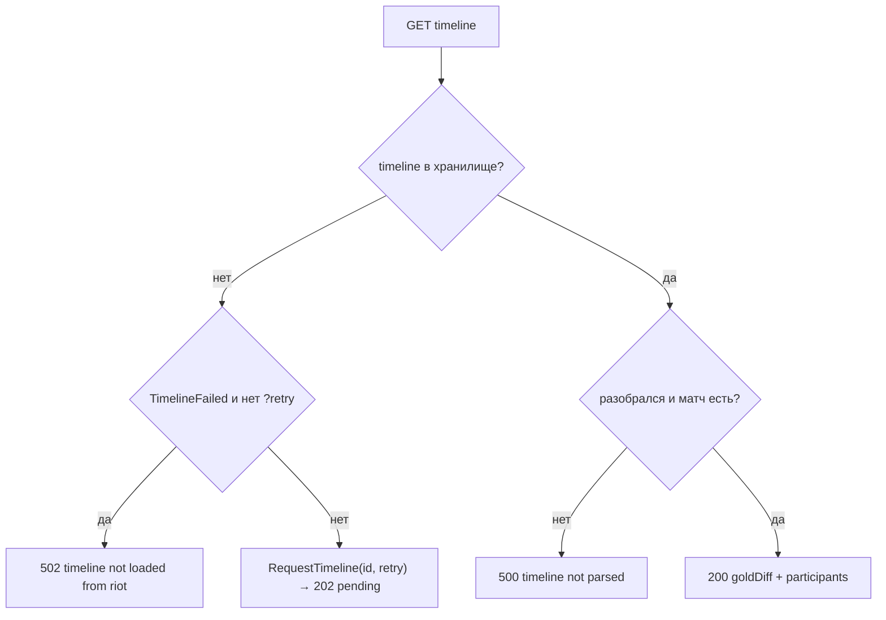

# 18. Контракты API: профиль, история, лестница, служебное; каталог кодов

Справочник по маршрутам окна профиля (`/api/profile`, `/api/matches`, timeline, подсказки
ника), лестницы «Топ», скинов, автозапуска, самообновления и форме ответа `/api/spectate`.
В конце — единый каталог кодов ответа всех 37 маршрутов `app/live_api_server.cpp`.
Обзор API без деталей — [5. Локальный API](05-lokalny-api.md); матч, лобби, профили —
[16](16-kontrakt-match-lobby-profili.md); советы и справочники — [17](17-kontrakt-sovety-spravochniki.md).

Пути ниже — от `sintence-app/src/`; zod — `sintence-web/src/api/schemas.ts` (кратко `schemas.ts`).

## Файлы участка

| Файл | Роль | Строк |
|---|---|---|
| `app/live_api_server.cpp` | все маршруты, сборщики JSON | 2391 |
| `app/live_api_server.h` | класс `LiveApiServer` | 188 |
| `data/history_service.h/.cpp` | фоновая загрузка истории, timeline | 132 / 476 |
| `data/timeline_json.h/.cpp` | разбор timeline Riot | 28 / 102 |
| `core/match_history.h` | `HistoryStatus`, `MatchTimeline` | 61 |
| `core/match_detail.h` | `MatchDetail`, `MatchParticipant` | 70 |
| `core/match_store.h` | интерфейс хранилища, `MatchFilter` | 83 |
| `analysis/profile_summary.h` | сводка по ролям и чемпионам | 52 |
| `data/server_client.cpp` | прокси лестницы и подсказок к серверу | — |
| `sintence-web/src/api/schemas.ts` | zod-схемы | 980 |
| `sintence-web/src/api/client.ts` | `apiGet`/`apiPost`, разбор ошибок | 146 |
| `sintence-web/src/mock/profile.ts` | моки окна профиля | — |

## Общие правила ответа

| Правило | Где |
|---|---|
| Ошибка — JSON-объект `{"error":"<текст или код>"}`, часто готовой строкой | например `app/live_api_server.cpp:1147` |
| Иногда рядом машинный код: `{"error":..., "code":...}` (только `/api/update/apply`) | `app/live_api_server.cpp:1173-1184` |
| У `/api/profile` 400 — `{"error":..., "errorCode":"no_riot_id"}` | `app/live_api_server.cpp:1956` |
| Тела нет вовсе: `/api/skins/<key>.webp` при 501/404/503 и статика при 404 | `:1392`, `:1407`, `:2367` |
| `Access-Control-Allow-Origin: *` ставят почти все GET (не только health) | `:1243`, `:1268`, `:1938` и др. |
| POST-маршруты этого заголовка не ставят | `:1143-1189`, `:1910-1933`, `:2306-2332` |
| Числа из query — `IntParam`: пусто или не число → default, иначе `std::clamp(low, high)` | `app/live_api_server.cpp:525-536` |

Как интерфейс видит ошибки (`client.ts`):

- `apiGet` — любой статус ≠ 200 превращается в `{kind:'status', status}`; тело не читается
  (`client.ts:101-103`). Поэтому **202 timeline для GET — тоже `status`**.
- `apiPost` — успех любой 2xx; иначе берёт `error` и `code` из тела, если они строки
  (`client.ts:132-141`). `errorCode` в POST не читается (его там и нет).
- 200, но схема не сошлась — `{kind:'invalid'}` с первыми 5 замечаниями (`client.ts:79-84, 105-114`).

## Общий предохранитель истории `history_ready`

Пять маршрутов окна профиля начинают с лямбды `history_ready` (`app/live_api_server.cpp:1937-1946`):
ставит CORS-заголовок и, если нет `store` или `history`, отвечает

```json
{"error":"no riot api key or match store"}
```
со статусом **501** (`:1940-1942`). Это `/api/profile`, `/api/matches`, `/api/players`,
`/api/matches/{id}`, `/api/matches/{id}/timeline`.

Чей профиль — `RiotIdOf`: параметр `riotId`, а если пуст — свой `self_riot_id` из
снимка `LobbyService` (`app/live_api_server.cpp:1055-1061`).

---

## GET /api/profile

Шапка профиля, прогресс загрузки, сводка, стиль, ММР. **Сам заказывает загрузку**
(`HistoryService::Request`) — каждый опрос (`:1967`). Обработчик `app/live_api_server.cpp:1948-2021`.

### Параметры

| Имя | Тип | Default | Границы | Смысл | Ссылка |
|---|---|---|---|---|---|
| `riotId` | строка `Имя#TAG` | свой из клиента | — | чей профиль | `:1953`, `:1055` |
| `depth` | int | 50 | 1…300 | сколько последних игр заказать | `:1960` |
| `queue` | int | 0 | 0…100000 | фильтр сводки по очереди; с `byQueue` — очередь списка Riot | `:1961`, `:2004` |
| `byQueue` | наличие (любое значение) | нет | действует только при `queue` = 420 или 440 | список игр у Riot только этой очереди (вкладка «Моя аналитика») | `:1965-1966` |
| `refresh` | наличие | нет | — | кнопка «Обновить»: обойти минутную паузу | `:1962`, `:1967` |

Что происходит при запросе:

1. `Request(riot_id, depth, with_account=true, force=refresh, by_queue ? queue : 0)` (`:1967-1968`).
2. Если профиль известен и не закрыт — ещё заказ 20 соло для ММР:
   `Request(riot_id, kMmrProfileGames, false, false, 420)` (`:1973-1975`;
   `kMmrProfileGames = 20` — `analysis/hidden_mmr.h:22`).
3. Прогресс — из статуса `riot_id|q<queue>` при `byQueue`, иначе из статуса `riot_id` (`:1976-1977`).
4. Если загрузка не идёт — в фоне подкачка timeline 20 свежих игр для плашки «рано умирает»
   (`kStyleTimelines = 20`, `:699`, `:2012-2019`).

Правила повторного заказа (`data/history_service.cpp:75-88`): тот же или меньший `depth`
чаще раза в минуту (`kRefreshInterval`, `:19`) игнорируется; с `force` — игнорируется,
только если загрузка уже идёт.

### Ошибки

| Статус | Тело | Когда | Ссылка |
|---|---|---|---|
| 501 | `{"error":"no riot api key or match store"}` | нет сервера/хранилища | `:1941` |
| 400 | `{"error":"no riot id: клиент League не запущен","errorCode":"no_riot_id"}` | нет `riotId` и клиент не дал своего | `:1954-1958` |
| 200 + `error` | см. поля `error`/`errorCode` | игрок не найден, Riot не отдал список | `data/history_service.cpp:284-286, 323-325` |

Ошибки загрузки идут **в 200** полями `error`, `errorCode`, `riotStatus`:

| `errorCode` | `error` (дословно) | `riotStatus` | Ссылка |
|---|---|---|---|
| `player_not_found` | `игрок не найден` | 0 | `data/history_service.cpp:284-286` |
| `riot_error` | `Riot не отдал список игр (код {})` | HTTP-код Riot | `data/history_service.cpp:323-325` |
| `""` | `""` | 0 | всё хорошо (`:373-375`) |

### Поля ответа

| Путь | Тип | Обяз. | Смысл | C++ | zod |
|---|---|---|---|---|---|
| `riotId` | string | да | чей профиль | `:1979` | `schemas.ts:567` |
| `error` | string | да | текст ошибки загрузки, `""` | `:1980` | `:568` |
| `errorCode` | string | да (zod default `''`) | `player_not_found`/`riot_error`/`""` | `:1981` | `:571` |
| `riotStatus` | int | да (default 0) | код Riot при `riot_error` | `:1982` | `:573` |
| `closed` | bool | да (default false) | игрок попросил удалить данные; дальше всё пусто | `:1985` | `:581` |
| `summoner.profileIconId` | int | да | иконка; 0 — неизвестна | `:1987` | `:574` |
| `summoner.level` | int | да | уровень | `:1988` | `:574` |
| `solo` | RankedStats \| null | да | соло-ранг; null — нет ранга или статуса | `:1990`, `RankedToJson :404-415` | `:575`, `:165-171` |
| `flex` | RankedStats \| null | да | гибкая | `:1991` | `:577` |
| `solo/flex.tier` | string | — | `GOLD`… | `:409` | `:166` |
| `.division` | string | — | `II` | `:410` | `:167` |
| `.leaguePoints` | int | — | LP | `:411` | `:168` |
| `.wins` / `.losses` | int ≥0 | — | | `:412-413` | `:169-170` |
| `mmr` | object \| null | да в C++, `optional` в zod | скрытый ММР по 20 соло; null — нет оценки/загружается | `:1992`, `MmrOf :903-952` | `:576`, `:250-256` |
| `mmr.tier/division` | string | — | | `:941-942` | `:251-252` |
| `mmr.leaguePoints` | number | — | | `:943` | `:253` |
| `mmr.games` | number | — | по скольким играм | `:944` | `:254` |
| `mmr.vsRank` | `above`/`below`/`same`/null | — | ММР против ранга | `:945-946` | `:255` |
| `progress.depth` | int | да | заказано игр (нет статуса — запрошенная `depth`) | `:1994` | `:541` |
| `progress.idsKnown` | int | да | сколько id назвал Riot | `:1995` | `:542` |
| `progress.stored` | int | да | `min(stored, depth)` | `:1996` | `:543` |
| `progress.running` | bool | да | идёт загрузка; **нет статуса — `true`** | `:1997` | `:544` |
| `summary.games` / `.wins` | int | да | по `summary_depth` матчам с фильтром `queue` | `:2002-2007`, `:518-519` | `:583-584` |
| `summary.roles[]` | `{role, games, wins}` | да | роли, больше игр — выше; `role ""` — ARAM/Арена | `:498-501` | `:547-551` |
| `summary.champions[]` | object | да | чемпионы, больше игр — выше | `:502-516` | `:553-564` |
| `…championId` | int | | | `:505` | `:554` |
| `…champion` | string | | ключ, `"Vladimir"` | `:506` | `:555` |
| `…games/wins/kills/deaths/assists` | int | | суммы | `:507-511` | `:556-560` |
| `…kda` | number | | (K+A)/D, D=0 → делим на 1 | `:512`, `analysis/profile_summary.h:34-35` | `:561` |
| `…cs` | int | | сумма | `:513` | `:562` |
| `…durationS` | int | | сумма длительностей (для CS/мин) | `:514` | `:563` |
| `style` | PlayStyle \| null | да (zod default null) | метрики стиля по ролям; null — истории нет | `:2008`, `StyleToJson :707-730` | `:579`, `:188-196` |

Глубина сводки: при `byQueue` — `depth` очередного статуса, иначе `status->depth`
(`:2001`). Сортировка равных — по имени (`analysis/profile_summary.h:45-46`).

### Пример (мок `sintence-web/src/mock/profile.ts:381-398`, сокращено)

```json
{
  "riotId": "...", "error": "", "errorCode": "", "riotStatus": 0, "closed": false,
  "summoner": {"profileIconId": 6043, "level": 148},
  "solo": {"tier": "PLATINUM", "division": "II", "leaguePoints": 68, "wins": 40, "losses": 29},
  "flex": null,
  "mmr": {"tier": "DIAMOND", "division": "IV", "leaguePoints": 20, "games": 14, "vsRank": "above"},
  "progress": {"depth": 50, "idsKnown": 50, "stored": 23, "running": true},
  "style": null,
  "summary": {"games": 23, "wins": 12, "roles": [], "champions": []}
}
```

### Особенности

- `stored` у статуса `riot_id|q420` считает **все** матчи игрока, а не только соло:
  `Status` берёт `CountMatches(puuid)` (`data/history_service.cpp:164-166`), об этом же
  комментарий `app/live_api_server.cpp:918-920`. Поэтому в ответе он обрезан `min(..., depth)` (`:1996`).
- `style` всегда считается по основному статусу, а не по очереди (`:2008`).
- Закрытый профиль: `MarkClosed` сбрасывает статус, оставляя `riot_id`, `depth`, `closed`
  (`data/history_service.cpp:257-267`); `puuid` пуст — сводка пустая.

---

## GET /api/matches

Страница матчей игрока из хранилища. **Ничего не заказывает** — только читает
(`app/live_api_server.cpp:2023-2044`).

| Параметр | Тип | Default | Границы | Ссылка |
|---|---|---|---|---|
| `riotId` | string | свой | — | `:2028` |
| `offset` | int | 0 | 0…10000 | `:2031` |
| `limit` | int | 20 | 1…100 | `:2032` |
| `queue` | int | 0 (все) | 0…100000 | `:2034` |
| `champion` | int (championId) | 0 (все) | 0…100000 | `:2035` |

Ошибки: только 501 `history_ready`. Игрок не заказан или без puuid — `{"matches":[]}` и 200 (`:2029-2030`).
Порядок — новые первыми (`core/match_store.h:47`).

Ответ: `{"matches": [Match…]}` (`:2042`; zod `MatchesSchema`, `schemas.ts:627`).

### Match (`MatchToJson`, `app/live_api_server.cpp:481-495`; zod `schemas.ts:617-625`)

| Поле | Тип | Смысл | C++ | Источник в core |
|---|---|---|---|---|
| `matchId` | string | `"RU_528252891"` | `:487` | `core/match_detail.h:54` |
| `queueId` | int | 420, 440, 450… | `:488` | `:56` |
| `gameMode` | string | `"CLASSIC"` | `:489` | `:57` |
| `patch` | string | `"15.12"` | `:490` | `:59` |
| `startedAt` | number | Unix, мс | `:491` | `:60` |
| `durationS` | int | секунды | `:492` | `:61` |
| `participants` | array | 10 участников | `:493` | `:62` |

### Участник (`ParticipantToJson`, `:452-479`; zod `schemas.ts:590-615`)

| Поле | Тип | Смысл |
|---|---|---|
| `riotId` | string | как было в матче |
| `teamId` | int | 100 синие, 200 красные |
| `win` | bool | |
| `championId`, `champion` | int, string | |
| `role` | string | `"MIDDLE"` или `""` |
| `champLevel`, `kills`, `deaths`, `assists`, `cs`, `gold` | int | `cs` — миньоны + нейтралы |
| `damageDealt`, `damageTaken` | int | урон по чемпионам / полученный |
| `visionScore`, `wardsPlaced`, `wardsKilled` | int | |
| `items` | int[7] | 6 слотов + тринкет, 0 — пусто (`core/match_detail.h:36`) |
| `spell1`, `spell2`, `keystone`, `primaryStyle`, `subStyle` | int | id |
| `isSelf` | bool | `p.puuid == puuid` запрошенного игрока; **puuid наружу не уходит** (`:451`, `:484`) |

Поля `damage_to_buildings`, `early_takedowns`, `solo_kills`, `lane_lead`
(`core/match_detail.h:45-50`) в JSON **не выводятся** — они только для `analysis/playstyle`.

---

## GET /api/matches/{id}

Регулярка `/api/matches/([A-Za-z0-9_]+)` (`app/live_api_server.cpp:2075`).

| Статус | Тело | Когда | Ссылка |
|---|---|---|---|
| 501 | `{"error":"no riot api key or match store"}` | нет хранилища | `:1941` |
| 404 | `{"error":"match not stored"}` | матча нет в хранилище (Riot не спрашивается) | `:2082-2085` |
| 200 | Match (как выше) | `isSelf` — по статусу `riotId`/своего; нет статуса — все `false` | `:2087-2089` |

---

## GET /api/matches/{id}/timeline

Порядок прокачки, покупки и разница золота по минутам. Регулярка
`/api/matches/([A-Za-z0-9_]+)/timeline` (`:2092`). Timeline — второй запрос к Riot на матч,
качается только по открытию подробностей (`:2107-2108`).

### Состояния



| Статус | Тело (дословно) | Условие | Ссылка |
|---|---|---|---|
| 501 | `{"error":"no riot api key or match store"}` | нет хранилища | `:1941` |
| 502 | `{"error":"timeline not loaded from riot"}` | все попытки провалены, `retry` нет | `:2101-2105` |
| 202 | `{"status":"pending"}` | ещё качается (или только что заказан) | `:2109-2112` |
| 500 | `{"error":"timeline not parsed"}` | `ParseMatchTimeline` вернул nullopt **или** самого матча нет в хранилище | `:2114-2119` |
| 200 | см. ниже | | `:2136-2139` |

Механика загрузки (`data/history_service.cpp`):

- `RequestTimeline`: уже в хранилище — ничего; `retry` снимает отметку провала и
  счётчик попыток; уже в очереди — не дублирует (`:104-124`).
- Очередь timeline у фонового потока — сразу после снимков с сервера, **не уступает
  профилям лобби** (`:191-211`).
- Попыток — `kMaxAttempts = 3` (`:27`); 404 Riot — провал сразу, без повторов (`:30`, `:468`);
  провал → `failed_timelines_` (`:471-473`).
- Фоновая подкачка (`PrefetchTimelines`) провалов не отмечает и не повторяет (`:449-458`).
- Параметр `retry` проверяется на наличие: `?retry=1`, `?retry=0` — одинаково (`app/live_api_server.cpp:2101`, `:2109`).

Интерфейс (`sintence-web/src/composables/useTimeline.ts`): 202 → повтор каждые 1500 мс
(`:14`, `:34-36`), 502 → состояние `failed`, прочие не-200 → `unavailable` (`:38`),
кнопка «повторить» шлёт `?retry=1` (`:25`, `:60`).

### Формат 200

| Путь | Тип | Смысл | C++ | zod |
|---|---|---|---|---|
| `goldDiff` | int[] | «синие минус красные» на каждом кадре с `participantFrames`, с нулевой минуты | `:2137`; `data/timeline_json.cpp:45-58` | `schemas.ts:635` |
| `participants[]` | array | в порядке `metadata.participants` (participantId 1..N) | `:2121-2135`; `timeline_json.cpp:26-30` | `:636-644` |
| `…championId` | int | из матча по puuid; не нашёлся — 0 | `:2129` | `:638` |
| `…riotId` | string | из матча; не нашёлся — `""` | `:2130` | `:639` |
| `…teamId` | int | 100/200; не нашёлся — 0 | `:2131` | `:640` |
| `…skills` | string | `"QWEQQRQ..."` — `SKILL_LEVEL_UP` со `skillSlot` 1..4 → Q/W/E/R | `:2132`; `timeline_json.cpp:80-85` | `:641` |
| `…purchases[]` | `{itemId, minute}` | `ITEM_PURCHASED` по порядку, без отменённых `ITEM_UNDO` | `:2124-2127`; `timeline_json.cpp:86-96` | `:642` |

Детали разбора (`data/timeline_json.cpp`):

- Команда в золоте — по номеру: `id <= count/2` — синие, иначе красные (`:55`).
  id берётся из `participantId`, иначе из ключа кадра `"1".."10"` (`:53`).
- `minute` покупки — минута **кадра** (`frame.timestamp / 60000`), а не события (`:42-43`, `:87`).
- `ITEM_UNDO` удаляет последнюю покупку предмета `beforeId` (`:88-95`).
- Смерти (`CHAMPION_KILL` → `victimId`) собираются в `death_seconds` (`:69-74`), но
  **в ответ не выводятся** — нужны только для «рано умирает».
- Нет `metadata.participants` или `info.frames` — nullopt → 500 (`:14-23`).

Пример (собрано из кода):

```json
{"goldDiff":[0,120,-340,510],
 "participants":[{"championId":103,"riotId":"Имя#TAG","teamId":100,
   "skills":"QWEQQRQ","purchases":[{"itemId":1056,"minute":0},{"itemId":2003,"minute":0}]}]}
```

---

## GET /api/players

Подсказки ника (`app/live_api_server.cpp:2049-2073`). К Riot не ходит.

| Параметр | Тип | Default | Границы | Ссылка |
|---|---|---|---|---|
| `q` | string | `""` | — | `:2054` |
| `limit` | int | 8 | 1…20 | `:2055` |

Порядок: сначала сервер (`/v1/players?q=&limit=`, таймаут 5, не 200 — пусто;
`data/server_client.cpp:241-249`), затем свои из хранилища без дублей, пока не набран
`limit` (`:2060-2066`). Своя часть: пустой `q` — пусто; сначала совпадение с начала имени,
затем по числу встреч (`core/match_store.h:52-58`).

Ответ `{"players":[{"riotId": string, "games": int}]}` (`:2067-2071`; zod `schemas.ts:630-632`).
Ошибки — только 501.

---

## Лестница «Топ»

Все четыре маршрута не ждут истории и не проходят `history_ready`.
Три прокси передают **статус и тело сервера как есть**; `ServerResponse.status == 0`
(сервера нет или не ответил) → 503.

| Маршрут | Параметры | Путь на сервер, таймаут | C++ |
|---|---|---|---|
| `GET /api/ladder` | `tier` (строка как есть), `offset` int 0 (0…1000000), `limit` int 20 (1…50), `me` (строка, опц.) | `/v1/ladder?tier=&offset=&limit=[&me=]`, 5 с, с `me` — 15 | `app/live_api_server.cpp:1265-1282`; `data/server_client.cpp:218-230` |
| `GET /api/ladder/search` | `q` | `/v1/ladder/search?q=`, 5 | `:1286-1300`; `server_client.cpp:232-234` |
| `GET /api/ladder/player` | `riotId` | `/v1/ladder/player?riotId=`, 15 | `:1304-1318`; `server_client.cpp:236-239` |
| `GET /api/ladder/friends` | — | по одному `/v1/ladder/player` в фоне (`LadderFriends`) | `:1326-1353` |

Ошибка прокси: `503 {"error":"server_unavailable"}` (`:1276-1277`, `:1294-1295`, `:1312-1313`).
Любой другой код сервера (например 4xx) уходит как есть (`:1280-1281`).

Тела — формы сервера `sintence-data`; C++ их не разбирает, контракт держит только zod:

### LadderSchema (`schemas.ts:829-836`)

| Поле | Тип | Смысл |
|---|---|---|
| `tier` | string | |
| `total`, `scanned` | int | |
| `scanAt` | number \| null | |
| `rows[]` | LadderRow (`:801-813`) | `place` int, `riotId`, `division`, `lp`, `wins`, `losses`, `level` int\|null, `icon` int\|null, `champions[]` `{championId, points}` (default []), `updatedAt` number\|null, `refreshing` bool (default false) |
| `me` | LadderMe \| null (default null) | строка «Вы» (`:816-828`): `place` int\|null (null — вне топа), `tier`, `riotId`, `division`, `lp`, `wins`, `losses`, `level`, `icon`, `champions`, `cutoff` `{division, lp}`\|null |

### Поиск и игрок

| Маршрут | zod | Поля |
|---|---|---|
| `/api/ladder/search` | `LadderSearchSchema` (`:846`) | `players`: LadderMe[] (default []) |
| `/api/ladder/player` | `LadderPlayerSchema` (`:847-851`) | `player`: LadderMe\|null; `reason`: `not_found`/`unranked`/`error`/`""` |

### /api/ladder/friends (собирает сам C++)

Друзья — из клиента League (`LiveGameService::LoadFriends`), свой Riot ID — из `LobbyService`
(`:1329-1339`); ранги — из кеша `LadderFriends` (час на riotId, неудача — повтор через 5 мин,
порядок tier→division→LP, затем loading, затем без ранга по имени — комментарий `:1320-1325`).
Статусов, кроме 200, нет.

| Путь | Тип | Смысл | C++ | zod |
|---|---|---|---|---|
| `client` | bool | клиент League доступен | `:1348` | `schemas.ts:860` |
| `done` | int | сколько строк готово | `:1349` | `:861` |
| `total` | int | число строк | `:1350` | `:862` |
| `players[].riotId` | string | | `:1343` | `:854` |
| `players[].self` | bool | своя строка | `:1344` | `:855` |
| `players[].player` | LadderMe \| null | объект сервера как есть | `:1345`; `data/ladder_friends.h:30` | `:856` |
| `players[].loading` | bool | ещё грузится | `:1346` | `:857` |

Интерфейс опрашивает, пока `done < total` (`schemas.ts:852`).

---

## Скины без фона

### GET /api/skins (`app/live_api_server.cpp:1358-1386`)

Список с сервера `/v1/skins/index.json` (таймаут 10), кеш в памяти **10 минут** (`kIndexTtl`, `:1365`).

| Статус | Тело | Когда | Ссылка |
|---|---|---|---|
| 501 | `{"error":"нет сервера Sintence"}` | сервера нет | `:1360-1363` |
| 503 | `{"error":"список скинов недоступен"}` | сервер не 200 | `:1375-1378` |
| 200 | тело сервера как есть | | `:1385` |

zod `SkinCutoutsSchema` (`schemas.ts:419-422`): `skins` — `{ключ: int[]}` (номера обликов),
`edges` — `{"Ahri_1": "lrb"}` (края кадра, default {}).

### GET /api/skins/<key>.webp (`:1388-1416`)

Регулярка `([A-Za-z]+_\d{1,4})\.webp` — `Ahri_1.webp`. Картинки кешируются **до конца запуска**
без ограничения (`:861`, `:1410-1413`), ответ с `Cache-Control: max-age=86400`, `image/webp`.

| Статус | Тело | Когда |
|---|---|---|
| 501 | пусто | нет сервера (`:1391-1393`) |
| 404 | пусто | сервер ответил 404 (`:1407`) |
| 503 | пусто | любой другой не-200 (`:1407`) |
| 200 | WebP | |

Адрес для `` строит `apiUrl` (`client.ts:43-45`, `sintence-web/src/data/icons.ts:89`).

---

## GET / POST /api/autostart

Ключ Run в HKCU (`data/autostart`), по умолчанию выключен (`:1902-1903`).

| Метод | Статус | Тело | Ссылка |
|---|---|---|---|
| GET | 200 | `{"enabled": bool}` | `:1904-1908` |
| POST | 403 | `{"error":"forbidden"}` — не прошёл `TrustedWrite` | `:1912-1915` |
| POST | 400 | `{"error":"bad_request"}` — не JSON-объект или `enabled` не bool | `:1917-1922` |
| POST | 500 | `{"error":"registry"}` — `SetAutostart` не смог | `:1925-1928` |
| POST | 200 | `{"enabled": bool}` — **перечитанное** состояние | `:1931` |

Тело POST: `{"enabled": true}`. zod `AutostartSchema` (`schemas.ts:426-428`).

---

## POST /api/update/check и /api/update/apply

Оба — под `TrustedWrite` (`:1140-1142`).

### /api/update/check (`:1143-1155`)

Просит службу проверить (`RequestCheck`) и сразу отвечает **202** с текущим состоянием
(`UpdateToJson`, `:363-378`). Без службы — тоже 202 с `disabled`.

| Поле | Тип | Смысл | C++ | zod (`schemas.ts:490-496`) |
|---|---|---|---|---|
| `state` | string | `idle`/`checking`/`downloading`/`ready`/`applying`/`error`/`disabled` | `:372`, `:365` | enum |
| `latest` | string \| null | найденная версия | `:376` | default null |
| `message` | string | без службы — `обновления выключены` | `:373`, `:367` | default `''` |
| `checkedAt` | number | unix-секунды, 0 — не спрашивали | `:374` | default 0 |

### /api/update/apply (`:1157-1189`)

| Статус | Тело (дословно) | Когда |
|---|---|---|
| 403 | `{"error":"forbidden"}` | `TrustedWrite` |
| 200 | `{"status":"applying"}` | перезапуск начался |
| 409 | `{"error":"идёт игра — обновление поставится после неё","code":"in_game"}` | `kBusy` |
| 409 | `{"error":"новой версии нет","code":"no_server"}` | `kNothing` и сервера нет |
| 409 | `{"error":"новой версии нет","code":"no_update"}` | `kNothing`, сервер есть (и при отсутствии службы обновлений) |

zod `UpdateApplySchema` — `{status: literal('applying')}` (`schemas.ts:500-502`).

---

## POST /api/spectate — только форма ответа

Детали записи в клиент — [15. LCU: запись](15-lcu-zapis.md). Обработчик `:2306-2332`.

| Статус | Тело | Когда |
|---|---|---|
| 403 | `{"error":"forbidden"}` | `TrustedWrite` (`:2308-2311`) |
| 400 | `{"error":"bad json"}` | тело не объект (`:2314-2317`) |
| 400 | `{"error":"no riot id"}` | `riotId` нет, не строка или пуст (`:2320-2324`) |
| 200 | ActionResult | всегда при дошедшем действии (`:2331`) |

ActionResult (`ActionToJson`, `:394-402`; zod `ActionResultSchema`, `schemas.ts:473-482`):

| Поле | Тип | Смысл |
|---|---|---|
| `status` | `ok`/`need_replace`/`not_in_champselect`/`client_unavailable`/`invalid`/`failed` | исход (`:380-390`) |
| `message` | string | русский текст |
| `reason` | string | код для словаря (zod default `''`) |
| `clientMessage` | string | сырой отказ клиента (default `''`) |
| `replaceName` | string | |

## Статика GET /*

Регистрируется **последней** и только если `web_root` пуст (вшитый интерфейс,
`:2351-2369`): `/` → `/index.html`; ищется в `EmbeddedWebFiles()`; `.html` — `Cache-Control: no-cache`;
тип по расширению (`ContentTypeOf`, `:310-331`: html, js, css, json, svg, png, ico, woff2,
прочее — `application/octet-stream`); не нашёлся — 404 без тела (`:2367`).
С `SINTENCE_WEB_DIR` вместо маршрута — `set_mount_point("/", web_root)` и
`no-cache` для `/` и `.html` (`:2341-2350`); в этом режиме `/.*` не регистрируется.

---

## Каталог кодов ответов

Подсчёт `impl_->server.Get/Post(` в `app/live_api_server.cpp`: **37 регистраций**
(строки 1104–2353; совпадения `:933` `ranks.Get` и `:1340` `ladder_friends.Get` — не маршруты).
Сходится с [страницей 5](05-lokalny-api.md). «CORS» — ставит ли `Access-Control-Allow-Origin: *`.

| # | Маршрут | Стр. | CORS | Статусы и тела ошибок (дословно) |
|---|---|---|---|---|
| 1 | GET `/api/health` | 1104 | да | 200 |
| 2 | POST `/api/update/check` | 1143 | нет | 202; 403 `{"error":"forbidden"}` |
| 3 | POST `/api/update/apply` | 1157 | нет | 200 `{"status":"applying"}`; 403 forbidden; 409 `{"error":"идёт игра — обновление поставится после неё","code":"in_game"}`; 409 `{"error":"новой версии нет","code":"no_server"\|"no_update"}` |
| 4 | GET `/api/badge-visibility` | 1193 | нет | 200 `{"showBadge":bool}`; 503 `{"error":"server"}` (`:1199-1200`) |
| 5 | POST `/api/badge-visibility` | 1206 | нет | 200; 403 forbidden; 400 `{"error":"bad_request"}`; 409 `{"error":"legacy"}`; 503 `{"error":"server"}` (`:1227-1229`) |
| 6 | GET `/api/meta` | 1241 | да | статус и тело из `BuildMetaResponse` (по комментарию: 400 bad_tier, 503 meta_unavailable — `:1239-1240`) |
| 7 | GET `/api/trends` | 1253 | да | из `BuildTrendsResponse` (503 trends_unavailable — `:1251-1252`) |
| 8 | GET `/api/ladder` | 1265 | да | статус сервера как есть; 503 `{"error":"server_unavailable"}` |
| 9 | GET `/api/ladder/search` | 1286 | да | как есть; 503 `{"error":"server_unavailable"}` |
| 10 | GET `/api/ladder/player` | 1304 | да | как есть; 503 `{"error":"server_unavailable"}` |
| 11 | GET `/api/ladder/friends` | 1326 | да | 200 |
| 12 | GET `/api/skins` | 1358 | да | 200; 501 `{"error":"нет сервера Sintence"}`; 503 `{"error":"список скинов недоступен"}` |
| 13 | GET `/api/skins/<key>.webp` | 1388 | да | 200; 501, 404, 503 — без тела |
| 14 | GET `/api/badges` | 1418 | да | 200; 501 `{"error":"нет сервера Sintence"}`; 503 `{"error":"плашки ещё не загружены"}` |
| 15 | GET `/api/live` | 1436 | да | 200; 503 `{"error":"no active game"}` |
| 16 | GET `/api/profiles` | 1451 | да | 200; 501 `{"error":"no riot api key"}` |
| 17 | GET `/api/lobby` | 1536 | да | 200; 501 `{"error":"lobby service disabled"}` |
| 18 | GET `/api/preferences` | 1546 | да | 200; 501 `{"error":"no preference pack"}`; 503 `{"error":"preference pack not loaded"}`, `{"error":"no active game"}`, `{"error":"no active player"}`, `{"error":"active player not on scoreboard"}` |
| 19 | GET `/api/benchmarks` | 1676 | да | 200 |
| 20 | GET `/api/champion-roles` | 1709 | да | 200 |
| 21 | GET `/api/mode-champions` | 1738 | да | 200; 400 `{"error":"bad_mode"}` |
| 22 | GET `/api/averages` | 1772 | да | 200 |
| 23 | GET `/api/counters` | 1823 | да | 200; 501 `{"error":"no preference pack"}`; 503 `{"error":"preference pack not loaded"}` |
| 24 | GET `/api/autostart` | 1904 | да | 200 |
| 25 | POST `/api/autostart` | 1910 | нет | 200; 403 forbidden; 400 `{"error":"bad_request"}`; 500 `{"error":"registry"}` |
| 26 | GET `/api/profile` | 1948 | да | 200; 501 `{"error":"no riot api key or match store"}`; 400 `{"error":"no riot id: клиент League не запущен","errorCode":"no_riot_id"}` |
| 27 | GET `/api/matches` | 2023 | да | 200; 501 (как #26) |
| 28 | GET `/api/players` | 2049 | да | 200; 501 |
| 29 | GET `/api/matches/{id}` | 2075 | да | 200; 501; 404 `{"error":"match not stored"}` |
| 30 | GET `/api/matches/{id}/timeline` | 2092 | да | 200; 501; 202 `{"status":"pending"}`; 502 `{"error":"timeline not loaded from riot"}`; 500 `{"error":"timeline not parsed"}` |
| 31 | POST `/api/champselect/runes` | 2145 | нет | 200 ActionResult; 403 forbidden; 400 `{"error":"bad json"}` |
| 32 | POST `/api/champselect/spells` | 2174 | нет | 200 ActionResult; 403; 400 `{"error":"bad json"}` |
| 33 | GET `/api/active-game` | 2193 | да | 200; 501 `{"error":"no riot api key"}`; 400 `{"error":"no riot id"}` |
| 34 | GET `/api/active-game/cards` | 2213 | да | 200; 501 `{"error":"no riot api key"}`; 400 `{"error":"no riot id"}`; 404 `{"error":"no game"}` |
| 35 | GET `/api/friends` | 2279 | да | 200 |
| 36 | POST `/api/spectate` | 2306 | нет | 200 ActionResult; 403; 400 `{"error":"bad json"}`, `{"error":"no riot id"}` |
| 37 | GET `/.*` (статика) | 2353 | нет | 200; 404 без тела (только вшитый режим) |

Кроме перечисленного: необработанное исключение в лямбде httplib отдаёт как 500
(см. подводный камень 1 на [странице 5](05-lokalny-api.md)); неизвестный путь при
смонтированном каталоге — 404 самого httplib.

### Формат ошибок — как реально в коде

| Вид | Где |
|---|---|
| `{"error": "<строка>"}` — основной; строка то код (`forbidden`, `bad_request`, `server_unavailable`, `bad_mode`, `registry`, `legacy`, `server`), то английский текст (`no active game`, `match not stored`), то русский (`нет сервера Sintence`) | по таблице |
| `{"error", "code"}` — только `/api/update/apply` 409 | `:1173-1184` |
| `{"error", "errorCode"}` — только `/api/profile` 400 | `:1956` |
| `{"status":"pending"}` — 202 timeline (не ошибка) | `:2111` |
| без тела — webp-скины, статика | `:1392`, `:1407`, `:2367` |
| ошибки «внутри данных» в 200: `error`/`errorCode`/`riotStatus` у `/api/profile`, `status`/`reason` у ActionResult | `:1980-1982`, `:394-402` |

## Расхождения C++ ↔ zod

| Что | C++ | zod / интерфейс |
|---|---|---|
| `mmr` в `/api/profile` | всегда есть (объект или null) `:1992` | `.nullable().optional()` `schemas.ts:576` — терпимее, ок |
| `SkinCutoutsSchema.edges` | C++ тело не трогает | default `{}` — зависит только от сервера |
| Тела лестницы | C++ не проверяет | весь контракт — в zod `:797-866`; смена на сервере ломает интерфейс без пересборки C++ |
| `apiGet` и тела ошибок | C++ шлёт `error`/`errorCode` в 400 `/api/profile` | `apiGet` тело не-200 не читает (`client.ts:101-103`) — `errorCode:no_riot_id` до интерфейса через `apiGet` не доходит |
| Моки `/api/profile` | — | 400 мока без `errorCode` (`mock/profile.ts:349`); ответ «нет#» без `errorCode/riotStatus/closed/mmr/style` (`:351-355`) — проходит только благодаря default в zod |

## Тесты

| Файл | Что проверяет |
|---|---|
| `tests/test_timeline_json.cpp` | `ParseMatchTimeline`: прокачка, покупки, ITEM_UNDO, золото |
| `tests/test_profile_summary.cpp` | `SummarizeProfile`: роли, чемпионы, KDA |
| `tests/test_match_detail_json.cpp` | разбор матча Match-V5 |
| `tests/test_server_client.cpp` | клиент сервера Sintence |
| `tests/test_ladder_friends.cpp` | кеш рангов друзей |
| `tests/test_autostart.cpp`, `tests/test_app_update.cpp` | автозапуск, самообновление |

**Не покрыто**: сами обработчики `LiveApiServer` — тестов, вызывающих `LiveApiServer`, нет
(grep по `tests/*.cpp`). Коды 202/502/500 timeline, границы `IntParam`, `history_ready`,
`TrustedWrite` проверяются только руками и моками интерфейса.

## Как менять

1. **Новое поле в `/api/profile` или Match**: допиши в `doc[...]` (`:1978-2008`) или
   `ParticipantToJson` (`:452-479`); в `schemas.ts` добавь поле с `.default(...)`, обнови
   мок `mock/profile.ts`. Версию `kApiVersion` (`:44`) не трогай.
2. **Удалить/сменить тип поля** — то же плюс поднять `kApiVersion` и `EXPECTED_API_VERSION`
   (см. [5](05-lokalny-api.md)).
3. **Новый параметр query** — только через `IntParam` с явными границами (`:525`); строку
   для сервера кодируй как в `server_client.cpp:218-223` (`UrlEncodePathSegment`).
4. **Новое в timeline** (например, смерти): поле уже есть в `TimelineParticipant::death_seconds`
   (`core/match_history.h:50`) — выведи его в `:2128-2134` и добавь в `TimelineSchema`.
5. **Новый прокси к серверу** — по образцу `/api/ladder/search` (`:1286-1300`): статус 0 → 503
   `server_unavailable`, иначе как есть; схему — в zod.
6. **Новый маршрут** — выше статики (`:2334`), добавь строку в каталог кодов.

## Подводные камни

1. Регулярки `/api/matches/([A-Za-z0-9_]+)` и `.../timeline` — разные маршруты; id с
   другими символами (дефис, `%`) даст 404 статики, а не `match not stored` (`:2075`, `:2092`).
2. `progress.running = true`, когда статуса ещё нет (`:1997`): интерфейс будет ждать.
3. `stored` очередного статуса считает все очереди (`data/history_service.cpp:164-166`).
4. 500 `timeline not parsed` бывает и при **исправном** timeline, если матча нет в хранилище (`:2116`).
5. `/api/matches` сам ничего не грузит — без предшествующего `/api/profile` список пуст (`:2028-2041`).
6. Кеш картинок скинов не ограничен (`:861`); список скинов — 10 мин (`:1365`).
7. POST-ответы без CORS-заголовка: из Vite на :5173 работают только через прокси (`:1143-1189`).

## Не проверено

- Точные тела ответов сервера `/v1/ladder*`, `/v1/skins/index.json`, `/v1/players` — код
  `sintence-data` не читался; формы взяты из zod.
- Единицы третьего аргумента `ServerGet` (5/10/15) считаю секундами по комментарию
  `server_client.cpp:228`, определение `ServerGet` не открывал.
- Содержимое `BuildMetaResponse`/`BuildTrendsResponse` (#6, #7) — статусы по комментариям
  `:1239-1240`, `:1251-1252`; подробности — [17](17-kontrakt-sovety-spravochniki.md).
- Содержимое отдельных тестов из таблицы — по именам файлов и grep, тексты тестов не читались.
