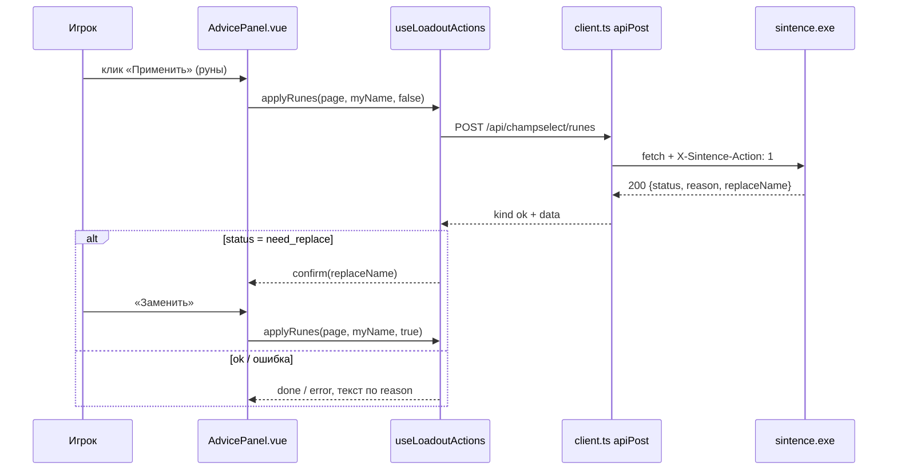
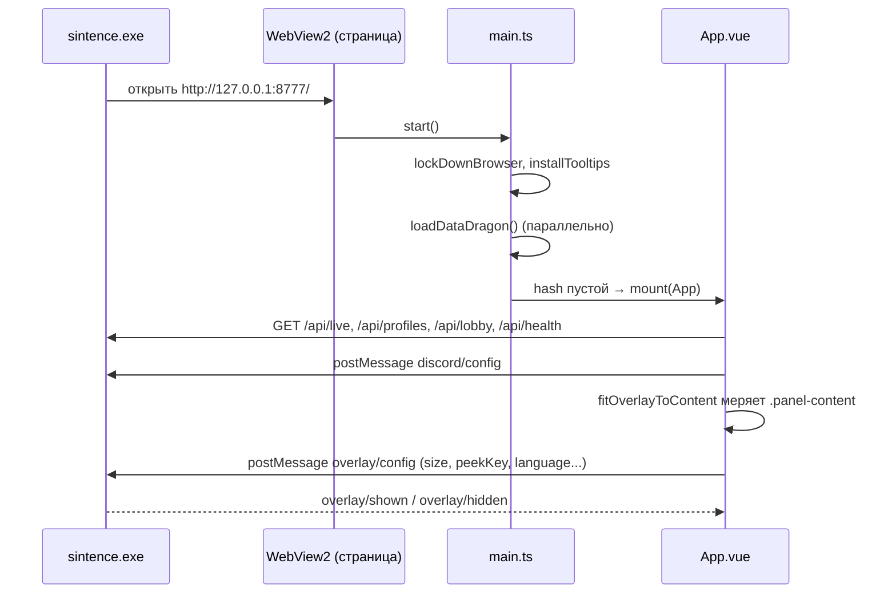
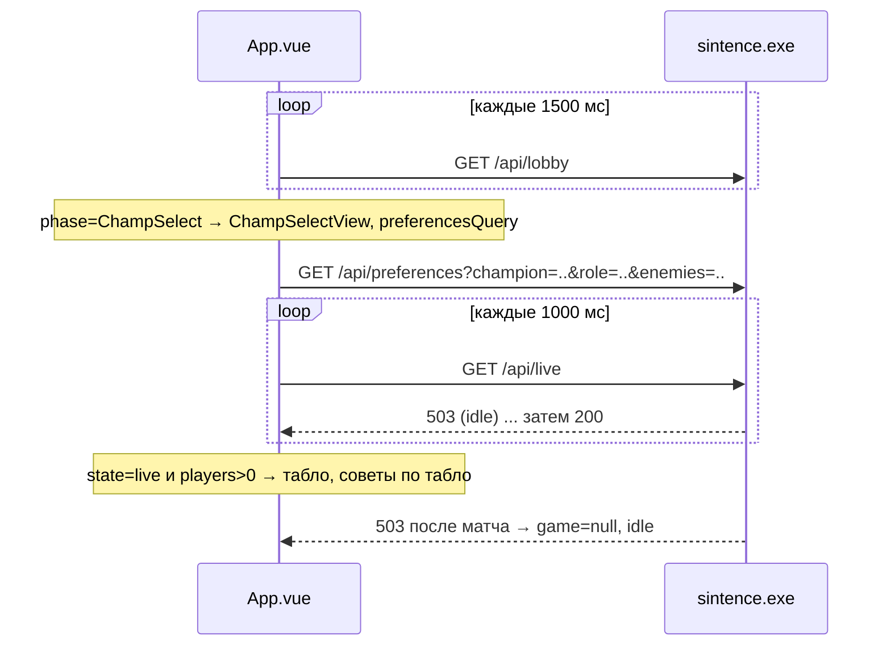

# 19. Как интерфейс общается с C++

Интерфейс (`sintence-web`, Vue 3) и `sintence.exe` связаны двумя каналами:
HTTP-запросами к локальному серверу `127.0.0.1:8777` (данные) и сообщениями
`chrome.webview.postMessage` (управление окном). Здесь описана **сторона интерфейса**:
кто, что и как часто спрашивает, как разбирает ответ и что показывает при сбоях.
Сторона C++ — [5. Локальный API](05-lokalny-api.md), сообщения окна со стороны C++ —
[20. Окно оверлея](20-overlay-okno.md), поля ответов — страницы 16–18.

## Файлы участка

| Файл (от `sintence-web/`) | Роль | Строк |
|---|---|---|
| `src/api/client.ts` | единственный слой запросов: транспорт, `apiGet`, `apiPost`, разбор zod | 146 |
| `src/api/schemas.ts` | zod-схемы всех ответов, типы через `z.infer` | 980 |
| `src/composables/usePoll.ts` | общий опрос с учётом видимости панели | 103 |
| `src/composables/use*.ts` | опросы и действия по эндпоинтам (14 файлов) | 37–275 |
| `src/overlay/host.ts` | канал `chrome.webview`: отправка и приём сообщений оверлея | 269 |
| `src/overlay/visibility.ts` | признак «панель видна» для опросов | 29 |
| `src/overlay/config.ts`, `bounds.ts`, `scale.ts` | настройки окна, запомненное положение, масштаб rem | 42 / 124 / 23 |
| `src/settings/*.ts` | клавиши, Discord, окно статистики — хранение в `localStorage` | 147 / 28 / 56 |
| `src/lockdown.ts` | гашение «браузерного» поведения на стороне страницы | 72 |
| `src/main.ts` | старт: lockdown, моки, Data Dragon, выбор корня по хешу | 41 |
| `src/mock/scenarios.ts` | моковый транспорт и сценарии `dev:mock` | 885 |
| `vite.config.ts` | `base: './'`, порт 5173, прокси `/api` | 23 |
| C++: `sintence-app/src/app/live_api_server.h`, `main.cpp` | список эндпоинтов, порт и переменные окружения | 188 / — |

## 1. Слой запросов: `src/api/client.ts`

### Транспорт

```typescript
export type Transport = (path: string, init?: RequestInit) => Promise<RawResponse>
```
(`api/client.ts:22`). `RawResponse` — `{status, body}`, где `body` — уже разобранный JSON
или `null` (`api/client.ts:10-13`). Транспортов два:

| Транспорт | Где | Что делает |
|---|---|---|
| `httpTransport` | `api/client.ts:47` | `fetch(API_BASE + path)` с `cache: 'no-store'` |
| `mockTransport` | `mock/scenarios.ts:562` | отвечает из памяти по текущему сценарию |

Подмена — `useTransport(next)` (`api/client.ts:74`), её зовёт только `main.ts:23` в режиме моков.

`API_BASE` — `import.meta.env.VITE_API_BASE` без хвостового `/`, по умолчанию пусто
(тот же origin) (`api/client.ts:40`). `apiUrl(path)` даёт полный адрес для ``
(картинки скинов `/api/skins/*.webp`, `data/icons.ts:89`).

### Заголовок `X-Sintence-Action`

Ставится **только для POST** (когда передан `init`): `Content-Type: application/json`,
`X-Sintence-Action: 1`, тело — `JSON.stringify(init.body)` (`api/client.ts:51-59`). GET идут
без заголовков. Без него C++ отвечает 403; проверка в C++ (`TrustedWrite`, Host, Origin) —
[5](05-lokalny-api.md). POST в коде шлют:

| Эндпоинт | Кто | Ссылка |
|---|---|---|
| `POST /api/champselect/runes` | `useLoadoutActions.applyRunes` | `composables/useLoadoutActions.ts:50` |
| `POST /api/champselect/spells` | `useLoadoutActions.applySpells` | `composables/useLoadoutActions.ts:74` |
| `POST /api/update/check` | `useUpdateActions.check` | `composables/useUpdateActions.ts:42` |
| `POST /api/update/apply` | `useUpdateActions.apply` | `composables/useUpdateActions.ts:53` |
| `POST /api/autostart` | `useAutostart.set` | `composables/useAutostart.ts:37` |
| `POST /api/spectate` | `spectate()` | `profile/liveGame.ts:119` |

### Результат: `ApiResult<T>`

Discriminated union, вызывающий обязан обработать каждый вариант (`api/client.ts:24-34`):

| `kind` | Когда | Поля |
|---|---|---|
| `ok` | статус 200 (GET) или любой 2xx (POST) и тело прошло схему | `data` |
| `status` | другой статус | `status`; для POST ещё `error` и `code` из тела, если это строки |
| `invalid` | статус успешный, но тело не прошло схему | `path`, `issues` (до 5 строк) |
| `network` | транспорт бросил исключение (exe не отвечает) | — |

Разница GET и POST:
- `apiGet` считает успехом **только 200** (`api/client.ts:101`). Поэтому 202 таймлайна
  приходит как `{kind:'status', status:202}` и обрабатывается в `useTimeline`.
- `apiPost` считает успехом **любой 2xx** — `/api/update/check` отвечает 202
  (`api/client.ts:131-132`). Тело ошибки POST читается как `{error?, code?}` (`api/client.ts:133-141`).
- Тело не JSON (пустой 503) — `body = null`, статуса достаточно (`api/client.ts:63-67`).

### Валидация zod

`schema.safeParse(raw.body)`; при неудаче замечания превращаются в строки
`«players.3.items.0.itemId: expected number»` (`api/client.ts:79-84`). В консоль
`console.error('[sintence] <path>: ответ не совпал со схемой', ...)` пишется **один раз** на
пару «путь + замечания» (`Set reported`, `api/client.ts:88-112`) — опрос идёт раз в секунду.
`apiPost` в консоль не пишет (`api/client.ts:144`).

Схемы нестрогие к лишним полям (`z.object`, не `strictObject`), новые поля объявляются с
`.default(...)` — старый exe их не присылает (`api/schemas.ts:14-16`). Подробно — страницы 16–18.

## 2. Опросы: `usePoll`

`createPoller(fn, {visibleMs, hiddenMs, visible})` (`composables/usePoll.ts:30`):

- один запрос за раз; внеочередной `trigger()` во время запроса откладывается и выполняется
  один раз после (`usePoll.ts:56-74`);
- ритм — `setTimeout` **после завершения** запроса, а не `setInterval` (`usePoll.ts:45-54`);
- интервал: `visibleMs`, если `visible` истинно, иначе `hiddenMs`; `null` — не опрашивать
  (`usePoll.ts:38`, `usePoll.ts:49`);
- скрыта → видна: сразу внеочередной опрос (`usePoll.ts:81`);
- исключение в `fn` глотается (`.catch(() => {})`, `usePoll.ts:67`);
- `usePoll` стартует в `onMounted`, останавливается в `onUnmounted` (`usePoll.ts:98-103`);
  `stop()` — насовсем (используют при 501).

Источник видимости по умолчанию — `panelVisible` (`overlay/visibility.ts:26`):
`document.visibilityState === 'visible'` **и** последнее сообщение окна — не `overlay/hidden`.
Комментарий объясняет зачем: каждый запрос `/api/live` C++ пересылает в процесс игры
(`overlay/visibility.ts:11-12`). Окно профиля использует `pageVisible` — только видимость
документа (`overlay/visibility.ts:29`).

### Таблица всех опросов

| Кто (composable / компонент) | Эндпоинт | Видна, мс | Скрыта, мс | Остановка / особенности | Ссылка |
|---|---|---|---|---|---|
| `useLiveGame` в `App.vue` | `GET /api/live` | 1000 | 5000 | не останавливается | `App.vue:34`, `useLiveGame.ts:19` |
| `useProfiles` в `App.vue` | `GET /api/profiles` | 3000 | 30 000 | 501 → `enabled=false`, `stop()` | `App.vue:35`, `useProfiles.ts:29-32` |
| `useLobby` в `App.vue` | `GET /api/lobby` | 1500 | 5000 | 501 или 404 → `stop()` | `App.vue:38`, `useLobby.ts:24-29` |
| `usePreferences` в `App.vue` | `GET /api/preferences[?champion=&name=&role=&enemies=]` | 5000 | `null` | 501 → `stop()`; смена параметров → `trigger()` | `App.vue:81`, `usePreferences.ts:37-40,59-61` |
| `useHealth` в `App.vue` | `GET /api/health` | 10 000 | 30 000 | не останавливается | `App.vue:84`, `useHealth.ts:15` |
| `useHealth` в `ProfileApp.vue` | `GET /api/health` | 15 000 | 15 000 | видимость — `pageVisible` | `profile/ProfileApp.vue:450` |
| `useHealth` в `SettingsPanel.vue` | `GET /api/health` | 5000 | `null` | только пока панель настроек открыта | `profile/SettingsPanel.vue:46` |
| `useCounters` ×2 в `ChampSelectView.vue` | `GET /api/counters?role=&enemies=` | 5000 | `null` | `query()` = null → не спрашивает; смена → `trigger()` | `components/ChampSelectView.vue:137,164` |
| `useModeChampions` | `GET /api/mode-champions?mode=&champions=` | 5000 | `null` | то же | `components/ChampSelectView.vue:181` |
| `useBadges` (модуль, одна загрузка на страницу) | `GET /api/badges` | 600 000 | — | пока не получено и 503/сеть — 30 000 | `useBadges.ts:18,21,33` |
| `useMatchHistory` (окно профиля) | `GET /api/profile`, `GET /api/matches` | 2000 (идёт загрузка) / 30 000 | — | свой `setTimeout`, см. ниже | `useMatchHistory.ts:32-38` |
| `useTimeline` (`MatchDetail.vue`) | `GET /api/matches/{id}/timeline` | 1500 пока 202 | — | 200 → стоп; 502 → `failed`; прочее → `unavailable` | `useTimeline.ts:14,34-38` |
| `StatsApp.vue` (`#/stats`) | `GET /api/live` | 1000 | 5000 | видимость — `shown` (что страница попросила у окна) | `stats/StatsApp.vue:66` |
| `StatsApp.vue` | `GET /api/profiles` | 30 000 | 30 000 | — | `stats/StatsApp.vue:69` |
| `AnalyticsPage.vue` | `GET /api/profile?byQueue=1`, `/api/matches` | 2000 / 30 000 | — | ошибка: 501/503 → 30 000, иначе 4000 | `profile/AnalyticsPage.vue:130-131,184-187` |
| `FriendsColumn.vue` | `GET /api/friends` | 15 000 (`setInterval`) | — | окно не видно → не опрашивает | `profile/FriendsColumn.vue:33-38` |
| `LiveGamePanel.vue` | `GET /api/active-game/cards` | 3000 | — | все готовы или 404 → стоп | `profile/LiveGamePanel.vue:88-97` |
| `LadderPage.vue` | `GET /api/ladder` | 5000, пока есть `refreshing` | — | не дольше 120 000 мс | `profile/LadderPage.vue:57-58,84` |
| `LadderPage.vue` (друзья) | `GET /api/ladder/friends` | 3000, пока `done < total` | — | вкладка не «друзья» → ответ игнорируется | `profile/LadderPage.vue:192,209` |

Разовые запросы без опроса: `GET /api/active-game` при каждом открытии профиля
(`profile/ProfileApp.vue:190`), `/api/meta` (`profile/MetaPage.vue:66`), `/api/trends`
(`profile/trends/TrendsPage.vue:62`), `/api/averages` (`profile/AnalyticsPage.vue:260`),
`/api/players` с задержкой 180 мс (`profile/PlayerSearch.vue:18,90`), `/api/ladder/search`
через 250 мс (`profile/LadderPage.vue:111,136`), `/api/benchmarks` при смене ранга или роли
(`stats/StatsApp.vue:85`), `/api/skins` один раз, после ошибки — не раньше чем через 60 с
(`data/icons.ts:66-75`), `/api/autostart` при открытии настроек (`useAutostart.ts:20`),
`/api/champion-roles` (`profile/LiveGamePanel.vue:43`).

### `useMatchHistory`: свой цикл

Не использует `usePoll` (`useMatchHistory.ts:157-217`):
- профиль пришёл → список `/api/matches` перечитывается, только если изменился ключ
  `riotId|queue|champion|depth|stored` (`useMatchHistory.ts:146-152`); страницы по 100
  (`PAGE`, `useMatchHistory.ts:39`);
- следующий опрос: `FAST_MS = 2000`, если `progress.running` или список не дочитан, иначе
  `SLOW_MS = 30000` (`useMatchHistory.ts:154`);
- 501 → `disabled`, повтор через 30 000; 400 «мой профиль» → `noClient`, повтор через
  1000 мс первые 10 с режима, потом 4000 (`EAGER_MS`, `EAGER_WINDOW_MS`, `PROBE_MS`,
  `useMatchHistory.ts:36-38,104-106,210-211`);
- при 400 и запомненном `sintence.ownRiotId` показывается профиль по нему (`ownFromMemory`)
  (`useMatchHistory.ts:179-197`);
- устаревшие ответы отбрасываются счётчиком `generation` (`useMatchHistory.ts:84,161`);
- «Обновить» (`reload`) добавляет `refresh=1` к следующему `/api/profile` (`useMatchHistory.ts:132-138,244-247`).

## 3. Проверка версии контракта: `useHealth`

```typescript
export const EXPECTED_API_VERSION = 5
```
(`composables/useHealth.ts:10`). На каждом опросе `/api/health`
(`useHealth.ts:27-39`):

| Ответ | `problem` | Текст `mismatch` (ru) |
|---|---|---|
| 200, `apiVersion === 5` | `null` | нет |
| 200, другая версия | число из ответа | «sintence.exe говорит на версии контракта N, интерфейс ждёт 5» (`i18n/ru.ts:281`) |
| 404 | `'old'` | «sintence.exe старой версии: пересобери его» (`i18n/ru.ts:280`) |
| сеть, 5xx, invalid | без изменений | — |

Показ: оверлей рисует `<footer>` с `mismatch`, только если он не пуст (`App.vue:388-390`);
другого подвала нет — решение заказчика (`App.vue:82-83`). Окно профиля берёт из health
только `update` (`profile/ProfileApp.vue:450-452`), настройки — `update` и `account`
(`profile/SettingsPanel.vue:60-71`).

## 4. Состояния «нет сервера / нет матча / нет пака»

### Оверлей (`App.vue`)

`useLiveGame` даёт `FeedState` (`composables/useLiveGame.ts:12`):

| Ответ `/api/live` | `state` | `game` | Экран |
|---|---|---|---|
| до первого ответа | `loading` | null | «Подключаюсь к игре» / «Спрашиваю игровой клиент на 127.0.0.1:2999» |
| 200 по схеме | `live` | снимок | табло |
| 503 | `idle` | null | «Матч не идёт» / подсказка про Practice Tool |
| другой статус | `error` | null | «Sintence не отвечает» |
| `invalid` | `invalid` | null | «Ответ сервера не прошёл проверку» + `/api/live: <замечания>` |
| `network` | `error` | **не сбрасывается** | «Sintence не отвечает» |

Тексты — `i18n/ru.ts:298-304`, выбор — `App.vue:269-290`. Лобби главнее пустого экрана:
`lobbyActive` истинно в `ChampSelect` с участниками или в фазах `GameStart/InProgress/Reconnect`
без табло (`App.vue:43-55`).

Остальное молча:
- профили 501 → карточки без профилей, опрос остановлен; 503 — прошлые профили остаются
  (`useProfiles.ts:34-37`);
- пак не приехал (`/api/preferences` 501) — `enabled=false`, `you` остаётся `null`,
  `AdvicePanel` не рисуется (`App.vue:326`); 503/прочее — советы очищаются
  (`usePreferences.ts:43-49`); сеть — прошлые советы остаются (`usePreferences.ts:42`);
- контрпики и скамейка: 501/503 — блока нет (`useCounters.ts:12,30`).

### Окно профиля

`HistoryState`: `loading`, `ok`, `disabled` (501), `noClient` (400), `offline`, `invalid`
(`useMatchHistory.ts:24-30`); тексты `t.profile.states` (`i18n/ru.ts:448-455`), показ —
`profile/ProfileApp.vue:562`. Ошибки внутри 200-ответа идут кодами `errorCode`
(`player_not_found`, `riot_error` + `riotStatus`, `no_riot_id`), незнакомый — текст `error`
как есть (`profile/ProfileApp.vue:457-465`). Учётная запись: «Настройки» пишут только о
`blocked` и `error` (`profile/SettingsPanel.vue:67-71`).

## 5. Действия по клику: руны и заклинания

`useLoadoutActions` (`composables/useLoadoutActions.ts`) — только функции, которые зовёт
кнопка; вызовов по событию нет (политика Riot, `useLoadoutActions.ts:6-10`).

- Имя страницы: `` `Sintence ${championName}`.slice(0, 25) `` — по префиксу C++ узнаёт свою
  страницу (`useLoadoutActions.ts:36-38`).
- Тело рун: `{name, primaryStyleId, subStyleId, perkIds, replace}`, где
  `perkIds = [keystoneId, ...primaryIds, ...secondaryIds, ...shardIds]` (`useLoadoutActions.ts:40-58`).
  Кнопка видна, только если страница полная: ключевая + 3 + 2 + 3 осколка
  (`components/AdvicePanel.vue:168-177`).
- Тело заклинаний: `{spell1Id, spell2Id}` (`useLoadoutActions.ts:76`).
- Ответ — `ActionResultSchema`, всегда 200 со `status` (`api/schemas.ts:471-482`).
  `need_replace` → состояние `confirm` с `replaceName`, кнопка «Заменить» повторяет запрос с
  `replace: true` (`useLoadoutActions.ts:68`, `components/AdvicePanel.vue:332-337`).
- Не-`ok` HTTP → локальные коды `forbidden` (403) или `offline` (`useLoadoutActions.ts:61-63`).
- Текст исхода: `t.actions.reasons[reason]`, плюс `(clientMessage)`; незнакомый код — `message`
  (`useLoadoutActions.ts:22-28`, словарь `i18n/ru.ts:118-136`).
- Смена соперника или варианта рун → `reset()` (`components/AdvicePanel.vue:96-104`).



Самообновление (`useUpdateActions`): `check` → 202 + `update`, показывается сразу (`checked`);
`apply` → 200 `{status:"applying"}` или ошибка. Текст отказа: `code` из словаря
(`t.update.codes`) → `error` → 403 «forbidden» → 404 «noButton» → «статус N»
(`useUpdateActions.ts:19-33`).

## 6. Сообщения `chrome.webview` (сторона страницы)

Канал есть только внутри WebView2; тип объявлен в `src/vite-env.d.ts:15-23`. В браузере
все функции молчат (`overlay/host.ts:18-20`, `insideOverlay` — `host.ts:42`). Таблица со
стороны C++ — [20](20-overlay-okno.md).

### Страница → окно

| `type` | Payload | Кто шлёт | Ссылка |
|---|---|---|---|
| `overlay/config` | `width, height` (физ. px), `maxScreenShare, anchor, offsetY, background, peekKey{vk,ctrl,shift,alt}, peekMode, language, userBounds, autoShow` | `sendOverlayConfig` | `overlay/host.ts:71-88` |
| `discord/config` | `enabled, language` | `sendDiscordConfig` | `overlay/host.ts:94-96` |
| `overlay/hide` | — | кнопка «—» | `overlay/host.ts:164` |
| `overlay/close` | — | кнопка «×» | `overlay/host.ts:170` |
| `overlay/drag` | — | `pointerdown` по шапке | `overlay/host.ts:176`, `App.vue:168-173` |
| `overlay/resize` | `edge` | полосы слева/справа | `overlay/host.ts:181`, `App.vue:177` |
| `profile/open` | `riotId` | щелчок по чемпиону в оверлее | `overlay/host.ts:200-208` |
| `profile/view` | `view` (`home`, `search`, имя вкладки) | окно профиля, для Discord | `profile/ProfileApp.vue:136-145` |
| `stats/config` | `pos` | окно статистики при монтировании | `stats/StatsApp.vue:241` |
| `stats/show`, `stats/hide` | — | решение о показе на каждом опросе | `stats/StatsApp.vue:53,176` |
| `stats/drag` | — | шапка окна статистики | `stats/StatsApp.vue:182` |
| `stats/size` | `width, height` (физ. px) | ResizeObserver | `stats/StatsApp.vue:207` |

Когда уходит `overlay/config`: при каждой смене мерки панели (`fitOverlayToContent`,
`host.ts:111-161`), по событию `storage` для ключей клавиш, положения, автопоказа,
режима peek, при смене языка (`watchHotkeys`, `host.ts:239-266`). `discord/config` — при
загрузке (`host.ts:261`), по `storage` и при смене языка.

### Окно → страница

| `type` | Поля | Кто принимает | Действие |
|---|---|---|---|
| `overlay/shown`, `overlay/hidden` | — | `visibility.ts:21-24`, `App.vue:196` | признак видимости; закрыть карточку способностей |
| `overlay/bounds` | `x, y, width, height, moved, resized, dpi` | `App.vue:198` → `rememberBounds` | запомнить в `localStorage['sintence.overlayBounds']` (`host.ts:187-195`) |
| `profile/open` | `riotId` | `onProfileOpenRequest` в `ProfileApp.vue:228` | открыть профиль |
| `stats/lang` | `lang` | `StatsApp.vue:213` | `applyHostLang` (без записи в хранилище) |
| `stats/interactive` | `on` | `StatsApp.vue:217` | мышь в окне только с Ctrl |
| `stats/bounds` | `x, y` | `StatsApp.vue:221` | `saveStatsPos` |





## 7. Режимы разработки и сборка

| Режим | Команда / переменная | Откуда страница | Куда `/api` |
|---|---|---|---|
| моки | `npm run dev:mock` (`vite --mode mock`) | Vite :5173 | `mockTransport`, exe не нужен |
| живые данные | `npm run dev` | Vite :5173 | прокси на `http://127.0.0.1:8777`, `changeOrigin: true` |
| Vite в окне exe | `SINTENCE_UI_URL=http://localhost:5173` у exe | Vite | прокси Vite |
| dist с диска | `SINTENCE_WEB_DIR=<dist>` у exe | файлы с диска через сервер exe | тот же origin |
| рабочий | `npm run build`, затем сборка exe | вшитый `dist` | тот же origin |

- `dev:mock`: файл `.env.mock` в репозитории не найден; режим `mock` задаёт Vite, а
  `import.meta.env.VITE_API_MODE === 'mock'` проверяется в `main.ts:18`. README описывает
  `VITE_API_MODE=mock` как то, что «делает `npm run dev:mock`» (README.md:223) — механизм см.
  «Не проверено». В обычной сборке ветка с моками выкидывается (`main.ts:15-17`).
- Прокси: `changeOrigin` нужен, потому что exe проверяет `Host` у действий и ждёт
  `127.0.0.1:8777` (`vite.config.ts:18-20`).
- `base: './'` — относительные пути ассетов (`vite.config.ts:9`), `outDir: 'dist'`.
- Порт exe — `SINTENCE_PORT`, мусор → 8777 (`main.cpp:136-148`). Интерфейс порт не знает:
  ходит на тот же origin, отладочную копию на другом порту в `npm run dev` прокси не найдёт
  (цель прокси жёстко 8777, `vite.config.ts:20`).
- Вшивание: CMake-переменная `SINTENCE_WEB_DIR` (по умолчанию `../sintence-web/dist`),
  `cmake/EmbedApp.cmake` генерирует `embedded_app.cpp` с файлами байтами при каждой сборке
  (`sintence-app/src/CMakeLists.txt:118-145`, `app/embedded_app.h:8-25`). Нет `dist` и нет
  переменных — exe показывает окно-ошибку «собран без интерфейса» (`main.cpp:255-258`).
  Подробно — [29](29-sborka-ci-reliz.md).

```powershell
cd sintence-web
npm run dev                         # Vite + прокси
$env:SINTENCE_UI_URL = "http://localhost:5173"
..\sintence-app\build\src\Release\sintence.exe
```

## 8. Язык и коды ошибок

- Язык: `localStorage['sintence.lang']`, иначе `navigator.language` (`ru*` → ru, прочее en)
  (`i18n/index.ts:12-32`). Смена в одном окне → событие `storage` в других (`i18n/index.ts:52-60`).
  `persistLang()` пишет системный язык в хранилище, если там пусто, — оверлей зовёт при
  монтировании, чтобы окна говорили на одном языке (`i18n/index.ts:73-80`, `App.vue:188`).
- В C++ язык уходит полем `language` в `overlay/config` и `discord/config` (`host.ts:83,95`).
- Коды из exe → текст из словаря, незнакомый код → текст как есть: `reason` действий,
  `code` ошибок обновления, `errorCode` профиля (см. разделы 4–5).

## 9. Lockdown на стороне страницы (`src/lockdown.ts`)

Вызывается первым в `start()` (`main.ts:12`). Всё — в фазе capture (`lockdown.ts:17`):

| Событие | Что гасится | Ссылка |
|---|---|---|
| `keydown` Tab / Shift+Tab | везде, и в полях ввода | `lockdown.ts:24-27` |
| `keydown` Ctrl/Cmd+A | вне полей ввода | `lockdown.ts:29-31` |
| `wheel` с Ctrl | масштаб (`passive: false`) | `lockdown.ts:37-43` |
| `mousedown` button 1, `auxclick` | автопрокрутка, открытие ссылки средней кнопкой | `lockdown.ts:46-53` |
| `selectstart`, `dragstart` | вне редактируемых элементов | `lockdown.ts:56-69` |
| `dragover`, `drop` | всегда | `lockdown.ts:70-71` |

Остальное (F12, F5, Ctrl+F/P/S/U, масштаб) выключает C++ — `app/webview_lockdown.cpp`
(`lockdown.ts:2-4`). CSS дополняет: `user-select: none`, `-webkit-user-drag: none` (`styles.css:38,44-47`).

## Как менять

1. **Новый GET-эндпоинт с опросом.** Схема в `api/schemas.ts` (новые поля — `.default`),
   composable по образцу `useProfiles.ts`: `apiGet(path, Schema)`, `usePoll(poll, {visibleMs, hiddenMs})`,
   решение на 501 (`poller.stop()`), 503 и `network`. Маршрут в `mock/scenarios.ts`
   (каждому сценарию или общий в `mockTransport`).
2. **Новое действие по клику.** `apiPost(path, body, Schema)` — заголовок поставится сам;
   C++ должен защитить путь как `/api/champselect/*` ([5](05-lokalny-api.md)). Мок — в `mockAction`
   (`mock/scenarios.ts:531`). Никогда не вызывать из `watch`.
3. **Сменить период опроса.** Аргументы при вызове composable в `App.vue`/компоненте
   (значения по умолчанию в самих composable — запасные).
4. **Ломающее изменение контракта.** Поднять `kApiVersion` в C++ и `EXPECTED_API_VERSION`
   (`useHealth.ts:10`) в одном заходе; в моках — `apiVersion` в `health()` (`mock/scenarios.ts:81`).
5. **Новое сообщение окну.** Функция в `overlay/host.ts` через `webview?.postMessage`,
   приём — расширить `HostMessage` (`host.ts:34`) и обработчик в `App.vue`; сторона C++ — [20](20-overlay-okno.md).

## Подводные камни

- `apiGet` считает 202 «не успехом» — так задумано для таймлайна; эндпоинт, который отвечает
  200 только иногда, обязан обрабатывать `kind:'status'` (`api/client.ts:101`).
- `apiGet` не возвращает `error`/`code` из тела — только `apiPost` (`api/client.ts:102`).
  Коды 503 вроде `meta_unavailable` интерфейс различает лишь по статусу.
- При `network` `useLiveGame` не обнуляет `game` (`useLiveGame.ts:44-46`), но `state='error'`
  и табло не рисуется (`App.vue:338`).
- `useBadges` и `loadDataDragon` — модульные синглтоны: первый вызов на странице запускает
  загрузку навсегда, таймер не снимается (`useBadges.ts:23-41`).
- Окно статистики опрашивает `/api/live` со своим источником видимости `shown`; пока окно
  скрыто — раз в 5 с, даже если игра не идёт (`stats/StatsApp.vue:66`).
- Цель прокси Vite жёстко `127.0.0.1:8777` (`vite.config.ts:20`): `SINTENCE_PORT` у exe её не меняет.
- Строки `t.overlay.feed`, `profilesOff`, `packMissing` в словаре есть, но в `src` вне `i18n`
  не используются (grep) — UI о выключенном паке молчит.

## Тесты

Автотестов слоя запросов и composable нет: в `package.json` нет тест-раннера, есть только
`vue-tsc` и скрипты `check:*` на чистые функции (`data/`, `stats/compare.ts`,
`profile/analytics.ts`, `profile/trends.ts`) — см. [27](27-sintence-web-podrobno.md).
Поведение при 501/503/сети/invalid проверяется вручную сценариями `dev:mock`
(`disabled`, `idle`, `offline`, `invalid`, `noclient`, `clientstart`).

## Не проверено

- Каким именно образом `vite --mode mock` выставляет `VITE_API_MODE=mock`: файла
  `.env.mock` в выводе `ls` корня `sintence-web` не видно (скрытые файлы не перечислялись).
- Полный список сообщений, которые принимает C++, и его проверки границ — страница 20.
- Работает ли `npm run dev` против exe на порту, отличном от 8777, без правки `vite.config.ts`
  через `VITE_API_BASE` (CORS для GET в C++ не читался).
