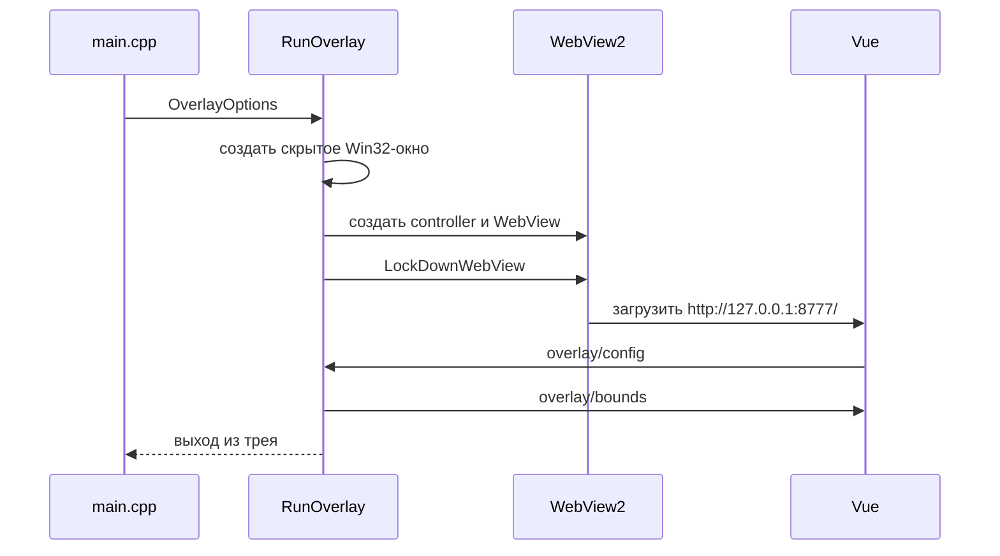

# 20. Окно оверлея и WebView2

Оверлей — нативное окно Windows, внутри которого работает страница Vue. C++ отвечает
за окно, фокус, клавиши, положение и жизненный цикл. Дизайн, размеры содержимого и
настройки пользователя принадлежат `sintence-web`.

Общий канал данных описан на [19. Как интерфейс общается с C++](19-interfeys-i-cpp-vzaimodeistvie.md).

## Файлы участка

| Файл | Роль |
|---|---|
| `src/app/overlay_window.h/.cpp` | окно оверлея, Win32-сообщения и WebView2 |
| `src/app/profile_window.cpp` | отдельное окно профиля |
| `src/app/stats_window.cpp` | необязательное окно статистики |
| `src/app/tray_icon.cpp` | меню и значок в трее |
| `src/app/webview_lockdown.cpp` | запрет браузерных действий |
| `src/core/overlay_bounds.*` | чистая проверка размера и положения |
| `src/core/hotkey.*` | разбор и проверка сочетаний клавиш |
| `sintence-web/src/overlay/*` | размеры, bounds, host и видимость |

## Жизненный цикл

`main.cpp` собирает `OverlayOptions` и вызывает `RunOverlay`.

Окно создаётся скрытым. После загрузки страницы его видимостью управляют состояние
контента, peek, трей и сообщения страницы. Второй запуск с тем же портом не создаёт
второе приложение: `AcquireSingleInstance` просит первую копию показать профиль и
завершается.

## `OverlayOptions`

Это начальные значения до первого сообщения интерфейса:

- `url` — локальный URL страницы;
- `width`, `height` — начальный размер;
- `profile_url` — маршрут `#/profile` для окна профиля;
- `port` — идентификатор единственной копии;
- `user_data_dir` — кеш и `localStorage` WebView2;
- `has_content` — есть ли выбор чемпиона, загрузка или матч;
- `profile_hidden` — не показывать окно профиля после автоперезапуска;
- `discord_config` — callback настройки статуса Discord.

После первого `overlay/config` размер и положение берутся из интерфейса. Поэтому
изменение ширины панели обычно не требует правки C++.

## Сообщения страницы

| Сообщение | Действие C++ |
|---|---|
| `overlay/config` | проверить границы и применить размер, фон, клавишу, bounds, autoShow |
| `overlay/drag` | начать перенос за шапку |
| `overlay/resize` | начать растягивание за край/угол |
| `overlay/hide` | спрятать панель |
| `overlay/close` | запретить автоматический показ до конца текущего контента |
| `discord/config` | включить или выключить Rich Presence |

Перенос и растягивание запускаются через `PostMessage`, а не прямо в COM callback
WebView2. Цикл tracking живёт в оконной процедуре, где доступны мышь, таймер и
Win32-сообщения.

Завершённые bounds отправляются обратно как `overlay/bounds`. Страница сохраняет их
в `localStorage` и при следующем запуске передаёт как `userBounds`.

## Фокус и порядок поверх окон

Оверлей намеренно не забирает фокус у игры:

- `WM_MOUSEACTIVATE` возвращает `MA_NOACTIVATE`;
- показ по peek выполняется без активации;
- Tab и PgDn не съедаются;
- клавиатура остаётся у игры;
- при клике по браузеру или клиенту League панель уходит под активное окно;
- когда активна игра или сам оверлей, панель возвращается поверх.

Это не работает поверх эксклюзивного fullscreen: ограничение принадлежит Windows.
Используй Borderless.

## Peek и клавиатурный hook

По умолчанию peek — `Ctrl+X`, но значение приходит из `overlay/config`. Низкоуровневый
`WH_KEYBOARD_LL` выбран вместо `RegisterHotKey`: игра может отключить системные горячие
клавиши через Raw Input с `RIDEV_NOHOTKEYS`, а низкоуровневый hook продолжает получать
события.

Hook не внедряется в процесс League. Он живёт в собственном процессе Sintence и только
пересылает внутреннее сообщение окну. Сочетание проверяется точно по модификаторам.
Режимы:

- `toggle` — нажатие переключает видимость;
- `hold` — панель видна, пока сочетание зажато.

Настройки и проверка сочетаний находятся в `core/hotkey`, поэтому их можно тестировать
без окна.

## Автопоказ и закрытие

`has_content` сглаживается `ContentDebounce`: появление содержимого действует сразу,
а исчезновение ждёт тишину. Это не даёт панели мигать во время переходов между фазами.

Если `autoShow` включён и контент появился, окно показывается без фокуса. Кнопка
«Закрыть до конца матча» отправляет `overlay/close`; автоматический показ блокируется,
но peek и трей всё ещё могут открыть панель. Когда контент исчезает, блокировка
сбрасывается для следующего матча.

## Защита WebView2

`LockDownWebView` отключает:

- контекстное меню и status bar;
- DevTools;
- zoom и pinch zoom;
- стандартные browser accelerator keys: F5, Ctrl+R, Ctrl+F, Ctrl+P, Ctrl+S, F12;
- системные диалоги страницы;
- autofill и сохранение паролей;
- swipe navigation;
- внешние drop-файлы;
- новые окна и переходы на другой origin;
- загрузки файлов.

Это не механизм отладки. Интерфейс отлаживается в обычном браузере через `dev:mock`
или Vite. Встроенное окно должно показывать только собственную страницу.

## Почему не прозрачное окно

Попытка сделать цветовой ключ у layered-window пропускала клики сквозь прозрачные
пиксели в игру. Для панели важнее, чтобы все её элементы принимали мышь, поэтому
сейчас окно прямоугольное и непрозрачное. Настоящая попиксельная альфа потребовала бы
другого графического пути и не является обычной правкой CSS.

## Как менять окно

- Изменение расположения/размера/фона/клавиши — сначала в `sintence-web/src/overlay`.
- Проверка границ — в `core/overlay_bounds`, с тестом чистой функции.
- Новая команда окна — сообщение в `overlay/host.ts`, тип в `HostMessage`, обработчик
  в `App.vue` или C++.
- Новое Win32-поведение — `overlay_window.cpp`; не переносить туда бизнес-расчёты.
- После изменения интерфейса перезапусти exe: встроенный WebView2 держит старую страницу.

Проверить визуальную часть можно в браузере; нативные фокус, z-order и hook требуют
живого окна и игры.
