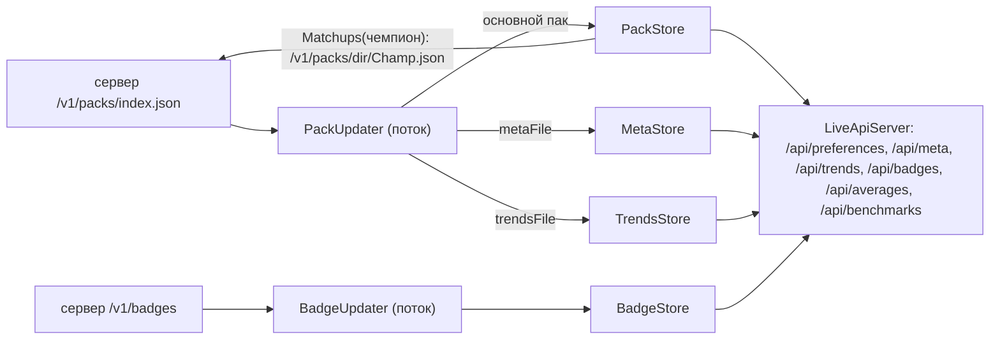

# 23. Пак предпочтений, мета, тренды, плашки

Здесь описано, как приложение получает с сервера готовую статистику и хранит её в памяти:
- пак предпочтений: руны, прокачка, предметы и заклинания по матчапам;
- файл меты (вкладка «Мета»);
- файл трендов (вкладка «Динамика»);
- правила плашек стиля игры.

Копий на диске нет. Нет сервера — нет и этих данных (`data/pack_store.h:70-72`).
Общая картина описана в [4. Путь данных](04-put-dannyh.md), сервер — в [7. Сервер](07-server.md).

## Файлы участка

| Файл | Роль | Строк |
|---|---|---|
| `data/preference_pack.h` / `.cpp` | разбор пака, `Lookup`, `MainRole`, средние по рангу, режимы | 299 / 671 |
| `data/pack_store.h` / `.cpp` | `PackStore` (действующий пак и кеш матчапов), `PackUpdater` (фоновый поток) | 107 / 238 |
| `data/meta_store.h` / `.cpp` | разбор файла меты, ответ `/api/meta`, `MetaStore` | 55 / 95 |
| `data/trends_store.h` / `.cpp` | проверка файла трендов, ответ `/api/trends`, `TrendsStore` | 63 / 64 |
| `data/badge_store.h` / `.cpp` | `BadgeStore`, `BadgeUpdater` (`/v1/badges`) | 73 / 122 |
| `data/server_client.h` / `.cpp` | `PackIndex`, `ParsePackIndex` (index.json) | — |
| сервер: `sintence-data/crawler/build_pack.py` | собирает пак и index.json | 1163 |
| сервер: `crawler/build_meta.py`, `build_trends.py` | файлы меты и трендов, дописывают поля в index.json | 250 / 333 |

## Кто что создаёт

В `app/main.cpp:224-239` создаются `PackStore packs`, `MetaStore meta`, `TrendsStore trends`
и `BadgeStore badges`. Если задан адрес сервера (`server_config`), к ним добавляются
`PackUpdater(*server_config, packs, &meta, &trends)` и `BadgeUpdater(*server_config, badges)`.
Хранилища читает `LiveApiServer`: `packs` передаётся в конструктор, `meta` и `trends` —
через `SetMetaStore` и `SetTrendsStore` (`app/main.cpp:368-369`).



## Формат index.json

Сервер пишет файл в `build_pack.py:1129-1140`. Поля `metaFile`, `metaBytes`, `metaSha256`
дописывает `build_meta.py:236-240`, но только если патч в index.json совпадает с патчем меты.
Поля `trendsFile`, `trendsBytes`, `trendsSha256` дописывает `build_trends.py`.
C++ разбирает index.json в `data/server_client.cpp:303-317`.

| Поле | Тип | Смысл | Читает C++ | Если поля нет |
|---|---|---|---|---|
| `file` | string | имя основного пака, `ru-16.19.json` | `PackIndex::file` | весь index.json отклоняется (`nullopt`), `server_client.cpp:308-311` |
| `sha256` | string | хеш основного пака | `PackIndex::sha256` | `""`: пак качается заново при каждом опросе (`pack_store.cpp:153`) |
| `metaFile`, `metaSha256` | string | файл меты и его хеш | да | `""`: меты нет («старый сервер»), `pack_store.cpp:173-178` |
| `trendsFile`, `trendsSha256` | string | файл трендов и его хеш | да | `""`: трендов нет, `pack_store.cpp:203-205`, `trends_store.cpp:52` |
| `schemaVersion`, `region`, `patch`, `bytes`, `generatedAt`, `matchupDir`, `matchupBytes`, `metaBytes`, `trendsBytes` | — | служебные | **не читаются** | — |

## Формат основного пака (schemaVersion 4)

Сервер собирает основной пак в `build_pack.py:1072-1122`. Читает его
`PreferencePack::LoadFromJson` (`preference_pack.cpp:282-380`). В основной пак попадают
только бакеты с оппонентом `ANY`. Бакеты против конкретного оппонента уходят в файлы
матчапов (`split`, `build_pack.py:879-893`).

| Путь | Тип | Смысл | Как читает C++ | Если нет / неверно |
|---|---|---|---|---|
| `schemaVersion` | int | версия формата, должна быть 4 | `preference_pack.cpp:290` (`kSchemaVersion = 4`, стр. 24) | весь пак отклоняется (`nullopt`) |
| `buckets` | object | ключ → бакет | `:293`, `:311-338` | не объект — весь пак отклоняется |
| `patch` | string | патч, `"16.19"` | `:298` → `Patch()`, копируется в каждый бакет | `""` |
| `region` | string | `"RU"` | `:299` → `Region()` | `""` |
| `matchups.dir` | string | каталог матчапов, `ru-16.19-<время>` | `:303-309` | `""` → `MatchupFile` всегда `nullopt` |
| `matchups.champions` | string[] | чемпионы, у которых есть файл матчапов | `:306` | пусто → матчапы не качаются |
| `benchmarks` | object | корзина → роль → минуты | `ParseBenchmarks`, `:149-189` | пусто, это не ошибка |
| `rankAverages` | object | корзина → роль → средние | `ParseRankAverages`, `:191-233` | пусто |
| `tierAverages` | object | ранг (IRON…CHALLENGER) → роль → средние | `:378` | пусто |
| `modes` | object | режимы без линий | `:342-374` | пусто |
| `generatedAt`, `ddragon`, `minGames`, `totals` | — | служебные; `totals` нужен сайту | **не читаются** (`build_pack.py:632-634`: «Приложение поле не читает») | — |

### Ключ бакета и бакет

Ключ имеет вид `"Vladimir|MIDDLE|Yasuo|EMERALD"`, то есть чемпион|роль|оппонент|корзина.
`SplitKey` требует ровно 4 части (`preference_pack.cpp:67-83`). Бакет с другим ключом,
бакет не-объект, а также бакет с пустым чемпионом или ролью пропускаются (`:313-326`).
Внутри бакета полей чемпиона и роли нет: они есть только в ключе (`:20-21`).

| Поле бакета | Тип | C++ (`ParseBucketBody`, `:236-245`) | Если нет |
|---|---|---|---|
| `games` | int | `PreferenceBucket::games` | 0 |
| `winrate` | double | `winrate` | 0.0 |
| `runePages` | variant[] | `rune_pages` | пусто |
| `skillOrders` | variant[] | `skill_orders` | пусто |
| `itemChains` | variant[] | `item_chains` | пусто |
| `summonerSpells` | variant[] | `summoner_spells` | пусто |
| `starterItems` | variant[] | `starter_items` | пусто (старые паки) |
| `boots` | variant[] | `boots` | пусто (старые паки) |

### Корзины и пороги

| Что | Значение | Где |
|---|---|---|
| Корзины рангов | IRON, BRONZE → BRONZE; SILVER, GOLD → GOLD; PLATINUM, EMERALD → EMERALD; DIAMOND…CHALLENGER → DIAMOND; иначе ALL | `TierBucket`, `preference_pack.cpp:263-280`; на сервере `TIER_BUCKET`, `build_pack.py:76-82` |
| Куда попадает одно наблюдение | в 4 бакета: {ANY, оппонент} × {ALL, корзина} | `build_pack.py:528-536` |
| Минимум игр в бакете | 20 (`--min-games`, по умолчанию); бакет с меньшим числом игр в пак не попадает | `build_pack.py:1057`, `render`: `:617-618` |
| Минимум игр у варианта | 5 (`MIN_VARIANT_GAMES`) | `build_pack.py:104` |
| Вариантов на список | не больше 3 (`TOP_VARIANTS`) | `:103` |
| Длина прокачки | 5 повышений (`MAX_SKILL_STEPS`) | `:109` |
| Ядро предметов | 3 (`MAX_CHAIN`); после ядра до 3 `nextItemIds` | `:110`, `:115` |
| Минимум игр в звене цепочки | 3 (`MIN_CHAIN_STEP_GAMES`) | `:130` |
| `maxOrder` | только в играх, где было не меньше 8 повышений | `:125` |

### Вариант (элемент любого списка)

Читается в `ParseVariants`, `preference_pack.cpp:107-137`. Если у варианта нет ни
`steps`, ни `itemIds`, ни `spellIds`, ни `page`, он пропускается (`:129-133`).

| Поле | Тип | Где бывает | C++ | Если нет |
|---|---|---|---|---|
| `games` | int | везде | `games` | 0 |
| `share` | double | везде: доля игр бакета | `share` | 0.0 |
| `winrate` | double | везде: голая доля побед | `winrate` | 0.0 |
| `winrateLow` | double | везде: нижняя граница интервала Вильсона (z = 1.96, `build_pack.py:224-232`) | `winrate_low` | 0.0 |
| `steps` | string[] | `skillOrders`: `["Q","E","Q","W","Q"]` | `steps` | пусто |
| `maxOrder` | string[] | `skillOrders`, необязательное | `max_order` | пусто |
| `itemIds` | int[] | `itemChains`, `starterItems`, `boots` (один id) | `item_ids` | пусто |
| `nextItemIds` | int[] | `itemChains`, необязательное | `next_item_ids` | пусто |
| `spellIds` | int[] | `summonerSpells`: пара отсортирована (`build_pack.py:549`) | `spell_ids` | пусто |
| `page` | object | `runePages` | `ParsePage`, `:85-105` | `nullopt` |

Поля `page`: `keystoneId`, `primaryTreeId`, `primaryIds` (3), `secondaryTreeId`,
`secondaryIds` (2), `shardIds`. Если нет `keystoneId` (0) или пуст `primaryIds`,
страница считается отсутствующей (`:99-103`).

Пример из теста (`tests/test_preference_pack.cpp:47-79`, файл матчапов):

```json
"Vladimir|MIDDLE|Yasuo|EMERALD": {
  "games": 74, "winrate": 0.541,
  "runePages": [{"games": 51, "share": 0.689, "winrate": 0.56, "winrateLow": 0.4231,
    "page": {"keystoneId": 8010, "primaryTreeId": 8000, "primaryIds": [8009, 9105, 8299],
             "secondaryTreeId": 8200, "secondaryIds": [8226, 8210], "shardIds": [5008, 5008, 5011]}}],
  "skillOrders": [{"steps": ["Q","E","Q","W","Q"], "games": 44, "share": 0.594, "winrate": 0.57, "winrateLow": 0.4222}],
  "itemChains": [{"itemIds": [4633, 3116, 3157], "games": 29, "share": 0.392, "winrate": 0.62, "winrateLow": 0.4383}],
  "summonerSpells": [{"spellIds": [4, 12], "games": 40, "share": 0.54, "winrate": 0.55, "winrateLow": 0.4}]
}
```

### benchmarks

Структура: `{"GOLD": {"MIDDLE": [{"m":1,"n":812,"cs":..,"gold":..,"level":..,"kp":..,"vision":..}]}}`.
Строка без целых `m`/`n`, с `m < 1` или с `n <= 0` пропускается. Остальные поля по
умолчанию 0. Минуты сортируются по возрастанию (`preference_pack.cpp:171-185`).
Сервер пишет минуту, только если за ней не меньше 30 игр (`MIN_BENCHMARK_GAMES`,
`build_pack.py:648`). `Benchmarks(tier, role)` сначала ищет корзину `TierBucket(tier)`
(тогда `fallback=false`), потом ALL (`fallback=true`). Если нет и там, ответ пустой (`:572-597`).

### rankAverages и tierAverages

Структура: `{корзина|ранг: {роль: {"n", "goldPerMin", "csPerMin", "visionPerMin", "kp",
"deaths", "kda", "damagePerMin", "top": {...те же 7 полей}}}}`. Запись без целого `n`
пропускается. Значение `null` или не число превращается в `nullopt`. `top` необязателен
(`preference_pack.cpp:191-233`). На сервере группа попадает в файл при `n >= 30`, а `top` —
это 75-й процентиль (у смертей 25-й), `build_pack.py:678-803`.

Выбор средних, `RankAverages(tier)` (`:599-651`):
1. Если `tier` — точный ранг из `IRON…CHALLENGER` и `tierAverages` не пуст, для каждой из
   5 ролей ищется сам ранг, затем ранги ниже, вплоть до IRON (`:618-631`).
   `fallback=true`, если строка взята не из своего ранга.
2. Если роль не нашлась ни в одном ранге, она берётся из `BucketAverages`: корзина ранга
   или ALL, `fallback=true` (`:632-638`).
3. В поле `bucket` записывается источник, из которого взято больше всего ролей (`:641-647`).
4. Если ранг неизвестен или `tierAverages` пуст, выбор идёт только по `BucketAverages`
   (`:653-669`).

Если в паке нет средних, `/api/averages` берёт их с сервера `GET /v1/rank-averages`
(разбор — `RankAveragesFromJson`, `:458-467`). Кеш держится 1 час, после ошибки сервера
повтор через минуту (`app/live_api_server.cpp:810-838`).

### modes (ARAM, MAYHEM)

Структура: `{"classes": {чемпион: класс}, "ARAM": {"queueId", "totals", "buckets":
{"Ahri|TANK|ALL": бакет}}}` (`build_pack.py:849-876`). Ключ бакета режима состоит из
3 частей. Чемпион в ключе приводится к нижнему регистру (`preference_pack.cpp:367-371`).
`LookupMode` проверяет сначала `champion|класс|ALL`, потом `champion|ANY|ALL`, и пропускает
бакеты без вариантов (`:382-401`). `EnemyClasses` возвращает классы, которых у врагов
не меньше двух (`:429-456`).

## Файл матчапов чемпиона

Путь: `/v1/packs/<matchups.dir>/<Чемпион>.json`. Формат тот же: заголовок
(`schemaVersion`, `region`, `patch`, `generatedAt`, `ddragon`, `minGames`), `champion`
и `buckets`, в которых только конкретные оппоненты (`build_pack.py:914-919`).
Блоков `matchups`, `benchmarks` и `modes` в файле нет. Разбирается тем же
`LoadFromJson`, так что schemaVersion 4 обязателен.

`MatchupFile(champion)` (`preference_pack.cpp:479-487`) возвращает `nullopt`, если:
- `dir` пуст или содержит `/` либо `..`;
- имя чемпиона не из 1–32 букв и цифр (`IsChampionKey`, `:28-38`);
- чемпиона нет в `matchups.champions`.

## Lookup: лестница отката

`Lookup(champion, role, opponent, tier, matchups)` (`preference_pack.cpp:518-570`):

1. Если `champion` или `role` пусты, сразу `nullptr` (`:523-525`).
2. `bucket_tier = TierBucket(tier)` (`:527`).
3. `exact` — бакеты файла матчапов, если он передан, иначе бакеты самого пака (`:540`).
4. Если `opponent` не пуст и не `ANY`, кандидаты такие: `exact[ch|role|opp|bucket_tier]`,
   затем, если корзина не ALL, `exact[ch|role|opp|ALL]` (`:542-547`).
5. Затем всегда проверяется свой пак: `ch|role|ANY|bucket_tier`, а если корзина не ALL,
   ещё `ch|role|ANY|ALL` (`:548-551`).
6. Кандидаты проверяются по порядку. Если бакета нет, проверяется следующий. Бакет
   **без вариантов** тоже пропускается (`HasVariants`, `:256-259`). Вариантами здесь
   считаются только `runePages`, `skillOrders` и `itemChains`, без заклинаний, стартовых
   предметов и сапог. Возвращается первый подходящий бакет, иначе `nullptr` (`:558-569`).

Что именно нашлось, видно по полям `opponent` и `tier` бакета. В `/api/preferences` поле
`exact = bucket->opponent == enemy.key` (`app/live_api_server.cpp:213`).

**MainRole** (`:489-492`): роль с наибольшим `games` среди бакетов `ch|*|ANY|ALL`.
Считается при загрузке (`:331-336`). Нужна, когда клиент отдаёт `position` `NONE` или `""`.
Используется в `BuildPreferences` (`app/live_api_server.cpp:174-176`, `role_source = "pack"`).
`RoleGames` (`:494-503`) возвращает игры по 5 ролям, `Opponents` (`:505-516`) — все бакеты
против конкретных оппонентов.

## PackStore

| Метод | Что делает | Потоки |
|---|---|---|
| `Current()` | `shared_ptr<const PreferencePack>`, `nullptr` — пака нет | под `mutex_`, `pack_store.cpp:31-34` |
| `Set(pack, version)` | новый пак, версия (`sha256` из index.json), **очищает кеш матчапов** | `:36-42` |
| `Version()` | текущий sha256 | `:94-97` |
| `SetLoader(fn)` | откуда брать файлы матчапов | `:44-47` |
| `Matchups(champion)` | файл матчапов к текущему паку или `nullptr` | `:49-92` |

Подмена на ходу устроена так. Запрос, взявший `Current()`, держит свой `shared_ptr` и
дорабатывает со старым паком (тест `test_server_client.cpp:106-118`).

`Matchups` по шагам:
1. Под мьютексом заглянуть в кеш. Если пак загружен, вернуть его. Если запись — неудача
   младше `kMatchupRetry` (1 мин, `:23`), вернуть `nullptr` без запроса (`:55-60`).
2. Если нет пака, загрузчика или `MatchupFile`, вернуть `nullptr` **без записи в кеш** (`:64-70`).
3. Загрузить файл **без блокировки** в вызывающем потоке, то есть в обработчике HTTP (`:72-81`).
   Таймаут загрузчика 10 с (`kMatchupTimeoutSeconds`, `:22`, `:104-113`).
4. Если пока качали, сменился пак, вернуть `nullptr` и ничего не кешировать (`:84-86`).
5. Если в кеше уже 32 чемпиона (`kMaxCachedChampions`, `:27`), очистить кеш **целиком** (`:87-89`).
6. Записать `{loaded, now}`: при неудаче `loaded == nullptr`, это и есть отметка для повтора (`:90`).

## PackUpdater

Конструктор задаёт загрузчик матчапов: лямбда держит копию `ServerConfig` и делает
`ServerGet("/v1/packs/"+path, 10)`. После этого запускается поток `Run` (`pack_store.cpp:99-115`).
Деструктор ставит `stop_`, будит поток и делает `join` (`:117-124`).

| Константа | Значение | Строка |
|---|---|---|
| `kRefresh` | 30 мин, если всё хорошо и пак есть | `:16` |
| `kRetry` | 1 мин, если `Refresh` неудачен или пака ещё нет | `:17`, `:130` |
| `kTimeoutSeconds` | 30 с на index.json, пак, мету и тренды | `:18` |

`Refresh()` (`:137-170`):
1. `GET /v1/packs/index.json`. Не 200 — запись в журнал (нет токена, нет связи или код), `false`.
2. `ParsePackIndex`. Не разобрался — `false`.
3. `RefreshMeta`, затем `RefreshTrends`. Их ошибки на результат не влияют.
4. Если `sha256` не пуст и равен `store_.Version()`, вернуть `true` (пак тот же).
5. `GET /v1/packs/<file>`, затем `LoadFromJson`. При ошибке `false`, при успехе `store_.Set(pack, sha256)`.

Хеш тела **основного пака не проверяется**: он лишь сравнивается с версией из
index.json. Sha256 тела проверяется только у меты и трендов (`:189`, `:223`).

`RefreshMeta` (`:172-200`) пропускает работу, если нет `meta_`, `metaFile` или `metaSha256`,
либо версия совпадает. Имя файла с `/`, `\` или `..` отклоняется. Дальше `GET`, сверка
`Sha256Hex(body)` с `metaSha256`, `ParseMetaFile`, `meta_->Set`. Ограничителя повторов
у меты нет: после неудачи она снова качается при следующем `Refresh`.
`RefreshTrends` (`:202-236`) работает так же, но с `TrendsStore::ShouldFetch` и `MarkFailed`.

## MetaStore и формат файла меты

Файл `meta-<патч>-<generatedAt>.json` (`build_meta.py:187-195`, `:144-184`):

```text
{schemaVersion: 1, patch, generatedAt,
 groups: {ALL|BRONZE|GOLD|EMERALD|DIAMOND: {matches, banMatches,
   rows: [{championId, role, tier(1..4), games, winrate, pickrate, banrate|null,
           counters: [{championId, games, winrate}], allies: [{championId, role, games, winrate}]}]}}}
```

Пример собран из кода сборщика.

`ParseMetaFile` (`meta_store.cpp:22-55`): если это не объект, нет `patch` (string) или
`groups` (object), результат `nullopt`. `schemaVersion` C++ **не проверяет**. Для каждой
из 5 групп (`kGroups`, `:12-13`) сразу собирается готовое тело ответа
`{patch, generatedAt, tier, matches, banMatches, rows}`. Если группы нет: `matches 0`, `rows []`.
Строки `rows` передаются как есть, без разбора.

`BuildMetaResponse(meta, tier)` (`:57-76`):
- пустой `tier` → `ALL`;
- неизвестный `tier` → `400 {"error":"bad_tier"}`;
- меты нет → `503 {"error":"meta_unavailable"}`.

`MetaStore` хранит `Current`, `Version` и `Set` под мьютексом и `shared_ptr` (`:78-93`).

## TrendsStore и формат трендов

Файл `trends-<generatedAt>.json` (`build_trends.py:242-247`):
`{schemaVersion: 1, region, generatedAt, patches: [{patch, generatedAt, releasedAt, droppedAt,
matches, pace, averages, champions, global}]}`. Пример собран из кода. Подробности полей
внутри `patches` описаны в контракте `references/trends-contract.md`; этот контракт здесь не читался.

| Функция | Поведение | Строка |
|---|---|---|
| `ParseTrendsFile` | не объект, `schemaVersion != 1`, `patches` не массив или пуст → `nullopt`; тело сохраняется **как есть** | `trends_store.cpp:9-23` |
| `BuildTrendsResponse` | `nullptr` → `503 {"error":"trends_unavailable"}`, иначе 200 и тело | `:25-30` |
| `ShouldFetch(v, now)` | `false`, если `v` пуст или равен текущей версии; если `v` уже падала, ждать `kTrendsRetry` = 1 мин | `:50-56`, `.h:38` |
| `MarkFailed(v, now)` | запомнить неудачную версию | `:58-62` |
| `Set` | новый файл, сбросить `failed_version_` | `:42-48` |

## BadgeStore и BadgeUpdater

Правила плашек C++ **не разбирает и не оценивает**: это делает интерфейс
(`badge_store.h:14-21`, ARCHITECTURE.md §14). Формат с сервера:
`{schema: 1, version, updatedAt, baselines: {роль: {метрика: число}}, rules: [...]}`
(`sintence-data/crawler/badges_default.json`).

| Что | Поведение | Строка |
|---|---|---|
| `ParseBadgeConfigVersion` | объект, `schema == 1` (int), `rules` — массив; `version` (int) или 0; иначе `nullopt` | `badge_store.cpp:25-41` |
| `BadgeStore::Set` | не прошло проверку → `false`, прежнее тело остаётся | `:48-58` |
| `Version()` | -1, пока ничего не принято | `.h:45` |
| Периоды | 10 мин (`kRefresh`), 1 мин, пока тела нет или была ошибка (`kRetry`), таймаут 30 с | `:16-18`, `:79-88` |
| `Refresh` | тело совпало с текущим → `true` без разбора; одинаковые ошибки подряд пишутся в журнал один раз (`last_error_`) | `:90-120` |
| `/api/badges` | `BadgeStore` нет → 501, тела нет → 503, иначе тело как есть | `app/live_api_server.cpp:1418-1430` |

## Тесты

| Файл | Что проверяет |
|---|---|
| `tests/test_preference_pack.cpp` | страница рун целиком; ключ бакета; цепочки по порядку; лестница отката (без матчапов, без корзины, неизвестный ранг); `MatchupFile`; чужая схема; пустой пак; `TierBucket`; пропуск бакета без вариантов; вариант «ни о чём» и кривой ключ; `MainRole`; `PackStore::Matchups`: кеш, сброс при смене пака, нет повтора после неудачи; benchmarks; режимы; `ChampionClass`; `EnemyClasses` |
| `tests/test_preference_pack_averages.cpp` | разбор `rankAverages` с null; откат на ALL; ранг → ранг ниже → корзина; `top`; `RankAveragesFromJson` |
| `tests/test_server_client.cpp:45-60, 100-135` | `ParsePackIndex`; подмена пака на ходу; чтение из нескольких потоков |
| `tests/test_meta_store.cpp` | поля меты в index.json; разбор групп; 400/503; `MetaStore` |
| `tests/test_trends_store.cpp` | поля трендов; отказ по схеме; 503/200; повтор не чаще минуты |
| `tests/test_badge_store.cpp` | годная конфигурация, мусор, чужая схема, прежнее тело не затирается |

**Тестами не покрыто:**
- `PackUpdater` целиком (сеть, сверка sha256, периоды) и `BadgeUpdater`;
- вытеснение кеша матчапов при 32 чемпионах;
- гонка «пак сменился, пока качали матчапы».

## Как менять: новое поле в паке

1. **Сервер.** Добавить поле в `render` (`build_pack.py:612-627`) или в заголовок пака
   (`:1111-1118`). Новое необязательное поле схему не меняет (`build_pack.py:62-66`).
   `SCHEMA_VERSION` поднимать только при несовместимом изменении. Помнить, что C++
   отклоняет пак любой другой версии целиком (`preference_pack.cpp:290`).
2. **Читатель.** Добавить поле в `PreferenceVariant` или `PreferenceBucket`
   (`preference_pack.h:51-106`) и разбор в `ParseVariants` / `ParseBucketBody`
   с безопасным значением по умолчанию: старый пак поля не знает.
3. **Тест-договор.** Добавить поле в фикстуры `tests/test_preference_pack.cpp:20-79`.
4. **API.** Вывести поле в `VariantsToJson` / `BucketToJson` (`app/live_api_server.cpp:71-124`).
5. **UI.** Обновить zod-схему в `sintence-web` в том же заходе. Если поле удаляется или
   меняется его тип, поднять `kApiVersion` (см. [5. Локальный API](05-lokalny-api.md)).

## Подводные камни

- Тело основного пака не сверяется с sha256 из index.json (`pack_store.cpp:156-168`).
  Хеш работает только как метка версии.
- Если в index.json нет `sha256`, пак перекачивается каждые 30 минут (`pack_store.cpp:153`).
- `HasVariants` не учитывает `summonerSpells`, `starterItems` и `boots`
  (`preference_pack.cpp:256-259`). Бакет, где есть только заклинания, лестница пропустит.
- `Matchups` качает файл в потоке HTTP-обработчика до 10 с (`pack_store.cpp:22`, `:72-81`).
  Два одновременных запроса скачают файл дважды (`:72-73`).
- Чемпион без файла матчапов в кеш не попадает, и `MatchupFile` вычисляется заново при
  каждом вызове (`pack_store.cpp:67-70`). Это дёшево, но неочевидно.
- Ключи бакетов основного пака чувствительны к регистру, а ключи режимов нет
  (`preference_pack.cpp:367-371`).
- Мета при ошибке повторяется при каждом `Refresh`, без паузы, как у трендов
  (`pack_store.cpp:172-200`).
- `build_pack.py` переписывает index.json **без** полей меты и трендов (`:1129-1140`).
  До следующего прогона `build_meta.py` / `build_trends.py` приложение их не видит
  и держит прежние в памяти.

## Не проверено

- Порядок запуска `build_pack`, `build_meta` и `build_trends` в `maintain.py` и сколько длится
  окно, когда index.json без `metaFile`. Видно только, что `maintain.py` их вызывает.
- Подробная схема `patches[]` в файле трендов (контракт `trends-contract.md` не читался).
- Ответ `/api/benchmarks` и `/api/averages` целиком (`app/live_api_server.cpp:1673-1800`
  прочитан частично). Это тема [17](17-kontrakt-sovety-spravochniki.md).
