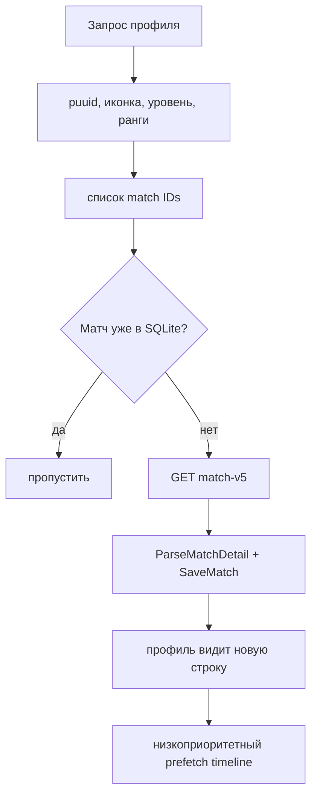

# 24. История матчей и SQLite в памяти

Окно профиля показывает данные из двух уровней:

1. сервер Sintence хранит кеш Riot и отдаёт профиль/список матчей;
2. приложение держит нужные разобранные матчи в SQLite `:memory:` до завершения запуска.

На диск пользователя история не сохраняется. Транспорт, локальный API и контракт
интерфейса описаны на [21. Клиент сервера Sintence](21-klient-servera-sintence.md) и
[18. Контракты API: профиль, история, лестница](18-kontrakt-istoriya-ladder-prochee.md).

## Файлы участка

| Файл | Роль |
|---|---|
| `src/core/match_history.h` | состояние загрузки и тип `MatchTimeline` |
| `src/core/match_store.h` | интерфейс хранилища |
| `src/data/history_service.*` | очереди фоновой загрузки |
| `src/data/sqlite_match_store.*` | реализация `MatchStore` на SQLite |
| `src/data/history_schema.sql` | общее подмножество SQL, встраивается в exe |
| `src/data/match_detail_json.*` | разбор match-v5 |
| `src/data/timeline_json.*` | разбор timeline |
| `src/app/live_api_server.cpp` | `/api/profile`, `/api/matches*` |
| `sintence-web/src/composables/useMatchHistory.ts` | опрос и отображение прогресса |

## Абстракция `MatchStore`

Окно и анализ не знают о SQLite. Они используют интерфейс:

- проверить и сохранить матч;
- загрузить матч по ID;
- получить последние матчи игрока с `offset` и `limit`;
- искать подсказки Riot ID по уже сохранённым участникам;
- проверить/загрузить/сохранить timeline;
- посчитать смерти до десяти минут.

Все методы потокобезопасны: HTTP-потоки читают, `HistoryService` пишет. Если хранилище
когда-нибудь сменится, окно профиля не должно измениться.

## Схема

`history_schema.sql` создаёт пять логических частей:

| Таблица | Назначение |
|---|---|
| `meta` | версия и служебные значения |
| `matches` | шапка матча и сырой match-v5 JSON |
| `participants` | десять разобранных участников |
| `timeline_deaths` | число смертей до 10-й минуты |
| `timelines` | сырой timeline для подробностей |

В `matches` сохраняются queue, режим, патч, время начала, длительность и `raw_json`.
В `participants` — Riot ID, команда, чемпион, роль, K/D/A, CS, золото, урон,
видение, предметы, заклинания и руны, которые разрешено показывать.

Сырой JSON хранится рядом с нормализованными колонками намеренно: если позже понадобится
поле, его можно достать из уже загруженного ответа, не запрашивая Riot снова.

Схема использует общее подмножество SQL. В SQLite допускаются локальные детали вроде
`INSERT OR REPLACE`, но структура не должна зависеть от SQLite JSON1 или специфических
типов. При изменении схемы нужно поднять `schema_version` в реализации хранилища.

## Источник истории

`HistoryService::Request(riot_id, depth, with_account, force, ids_queue)` запускает
загрузку асинхронно и возвращается сразу. Типичный порядок:

Профиль сначала пытается прийти целиком из кеша сервера. Это даёт интерфейсу быстрый
первый ответ, затем новые матчи докачиваются в локальное хранилище.

Повторный заказ того же или меньшего `depth` чаще раза в минуту игнорируется. Кнопка
«Обновить» передаёт `force = true`, но уже работающая загрузка второй раз не создаётся.
Для вкладки аналитики `ids_queue` хранится отдельный статус вроде `riot_id|q420`.

## Приоритеты очереди

Riot API общий для игры, профилей и истории. Поэтому `HistoryService` не должен
перехватывать лимит у активной игры:

1. timeline, который ждёт открытая панель подробностей;
2. профили игроков текущего лобби;
3. снимок профиля из кеша сервера;
4. новые матчи;
5. фоновый prefetch timeline для плашек.

Каждый тип работы лежит в своей очереди. Поток службы спит на `condition_variable` и
просыпается при новом заказе или остановке.

## Timeline

Timeline — второй тяжёлый запрос Riot для матча. Он нужен только для подробностей:

- порядок прокачки `Q/W/E/R`;
- покупки предметов по минутам;
- разница золота синей и красной команды;
- времена смертей.

`ParseMatchTimeline` сначала создаёт участников из `metadata.participants`, затем
привязывает события к `participantId`. Некорректный ID события пропускается. Покупки
с отменой не попадают в итоговый список.

При сохранении timeline приложение сразу вычисляет `timeline_deaths`, потому что
разбирать мегабайт JSON на каждом открытии профиля дорого. Сам сырой timeline остаётся
для подробностей.

Состояния HTTP:

- `200` — timeline уже есть;
- `202` — загрузка заказана или продолжается;
- `502` — попытки исчерпаны;
- `?retry=1` — снять отметку ошибки и заказать снова.

Фоновый prefetch не повторяет ошибки. Если пользователь открыл подробности, запрос
создаётся заново с обычной политикой повторов.

## `closed` и удаление данных

Если сервер возвращает специальный `404 erased`, `HistoryService` помечает профиль
закрытым, очищает его данные и больше не заказывает новые. Это не то же самое, что
«игрок не найден» или временная ошибка Riot. Интерфейс показывает «Профиль закрыт».

## Как добавить поле истории

1. Проверь, что поле разрешено политикой Riot и действительно нужно UI.
2. Добавь доменное поле в `core/match_detail.h` или `core/match_history.h`.
3. Разбери его в `match_detail_json`/`timeline_json` с безопасным default.
4. Добавь колонку и миграцию в SQLite, если поле нужно читать после сохранения.
5. Обнови `MatchStore`, сериализацию API, zod-схему и мок.
6. Добавь тест на старый JSON без поля и на корректный новый JSON.

Не записывай историю в произвольные файлы `%LOCALAPPDATA%`: по архитектуре там только
журнал, WebView2 и учётные данные Windows вне файлового каталога.
