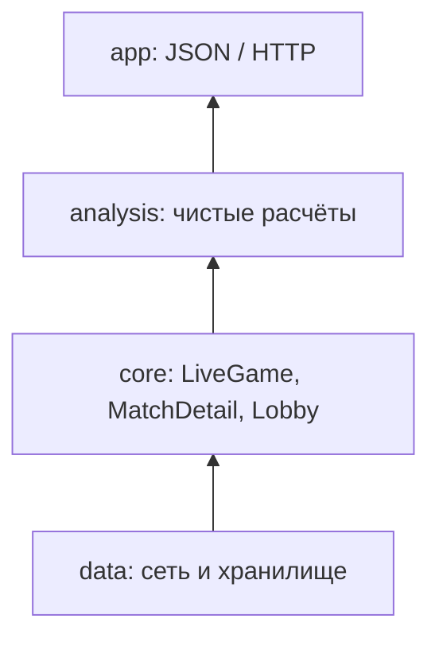

# 25. Анализ: чистые метрики над данными

`src/analysis` — слой расчётов между доменными типами `core/` и сборкой ответа в
`app/`. Он не знает о JSON, HTTP, SQLite, WebView2 и текущем времени. Поэтому его
можно тестировать обычными структурами и таблицами значений.

## Правило слоя



Если функция получает данные из `data` сама, пишет в журнал или вызывает `now()`, она
оказалась не в том слое. Передавай время, источники и уже загруженные данные аргументами.

## Модули

| Модуль | Что считает | Где используется |
|---|---|---|
| `profile_summary` | сводка по ролям и чемпионам | окно профиля |
| `playstyle` | метрики стиля по ролям и серия побед/поражений | плашки |
| `party` | общую пати по совпадениям в истории | карточки игроков |
| `hidden_mmr` | оценку уровня скрытого MMR | профиль и карточки |
| `content_debounce` | сглаженный признак «есть что показать» | автопоказ и обновление |

## `ProfileSummary`

`SummarizeProfile(matches, puuid)` проходит по матчам и пропускает те, где участник с
таким puuid отсутствует. Результат содержит:

- общее число игр и побед;
- группы по роли;
- группы по champion ID;
- K/D/A, CS и суммарную длительность по чемпиону.

Роли сортируются по числу игр. Чемпионы сортируются по числу игр, а при равенстве — по
имени, чтобы список не прыгал между обновлениями. `ProfileChampion::Kda()` считает
`(kills + assists) / max(deaths, 1)`, поэтому ноль смертей не даёт деления на ноль.

CS в минуту вычисляется интерфейсом из `cs` и длительности; C++ не должен дублировать
формулу в другом месте.

## `Playstyle`

Плашка не является захардкоженным условием C++. C++ собирает исходные метрики по ролям,
а правила и тексты приходят с сервера и оцениваются интерфейсом.

В набор входят, среди прочего:

- CS, золото, урон и полученный урон в минуту;
- vision, поставленные и уничтоженные wards;
- kills, deaths, assists, KDA и kill participation;
- урон по постройкам, solo kills и ранние takedowns;
- lane lead, ранние смерти и победы;
- серия побед/поражений и главные чемпионы.

Сборщик должен отличать сумму и число игр. Среднее — это `sum / games`, а не среднее
от уже округлённых строк UI. Матчи-коротышки/remake исключаются по правилам модуля.

Подробнее о формате полей и правилах плашек — [17. Контракты API: советы, мета,
справочники](17-kontrakt-sovety-spravochniki.md).

## `party`

`FindParties` получает кандидатов из текущего лобби, puuid своей пати и историю матчей.
Для пары игроков проверяется, встречались ли они в одной команде в сохранённых матчах.
Группа появляется только если подтверждены минимум два кандидата из своей пати; одиночный
случайный общий матч не должен превращать каждого игрока в «напарника».

Это аналитика поверх уже известных данных. Модуль не делает запросы Riot и не решает,
можно ли показывать скрытого игрока: ограничения приватности применяются на границе
разбора и сериализации раньше.

## `hidden_mmr`

Оценка строится только на соло-очереди `420`. Сначала выбираются последние игры игрока,
затем из них извлекаются другие puuid, встречавшиеся в тех же матчах. `RankScore`
переводит ранг и LP в число:

- обычные тиры идут снизу вверх по tier и division;
- Master/Grandmaster/Challenger используют базу apex и LP;
- неизвестный ранг даёт `-1` и не участвует как достоверное наблюдение.

`EstimateHiddenMmr` требует минимальное количество подходящих игр и использует свежие
ранги из `LadderRanks`. Если данных мало, возвращается `nullopt`; это честнее, чем
рисовать точное значение по одной случайной игре. Свой фактический ранг передаётся
отдельно и не заменяется оценкой.

Скрытый MMR не раскрывает скрытое состояние противника и не превращает старые матчи в
новые данные о текущем матче. Это агрегат для игрока, который открыл свой профиль или
видит разрешённую карточку.

## `ContentDebounce`

Функция `Update(raw, now)` получает время снаружи. При появлении контента значение
включается сразу. После исчезновения требуется непрерывная тишина заданного периода.
В тестах можно передать искусственные `time_point`, поэтому тесты не спят реальные
секунды.

Этот же признак используется несколькими службами:

- автопоказ оверлея;
- запрет самообновления посреди игры;
- состояние heartbeat;
- частота опроса профиля/табло.

Не создавай второй похожий debounce в интерфейсе или `main.cpp`: разные пороги дадут
рассинхрон между окном и обновлением.

## Как добавлять метрику

1. Выбери источник в `core/`: поле должно реально существовать в данных.
2. Определи поведение при отсутствии значения и нулевом знаменателе.
3. Напиши чистую функцию в `analysis/` и тесты границ.
4. Подключи результат в сериализацию `/api`, не смешивая расчёт с JSON.
5. Если метрика видна пользователю, добавь тип/схему/мок во фронтенд.
6. Проверь политику Riot: метрика не должна восстанавливать скрытое состояние.

### Что не делать

- не считать «заработанное золото» из `current_gold`: Live Client отдаёт золото на руках;
- не брать чужие руны или порядок прокачки из истории для карточки врага;
- не считать одну метрику отдельно в C++ и Vue с разными формулами;
- не использовать сеть и файловое хранилище из `analysis`.

## Тестирование

Для чистого анализа подходят таблицы входов:

```cpp
TEST_CASE("ноль смертей даёт конечный KDA") {
    sintence::ProfileChampion champion{.kills = 3, .deaths = 0, .assists = 6};
    CHECK(champion.Kda() == doctest::Approx(9.0));
}
```

Файлы `tests/test_profile_summary.cpp`, `test_hidden_mmr.cpp`, `test_ladder_friends.cpp`
и тесты `party` должны проверять правила и границы, а не повторять текст JSON-ответа.
