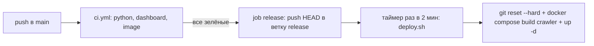

# 28. Сервер sintence-data: устройство

Справочник по репозиторию `sintence-data`: службы, маршруты шлюза, таблицы базы, лимит
ключа Riot, сбор матчей, сборка пака, пульт и выкладка. Обзор для новичка — на
[странице 7](07-server.md), здесь — подробности со ссылками на код. Пути — от корня
`sintence-data/`.

> **Push в `main` репозитория `sintence-data` — это выкладка на сервер.** CI на зелёных
> проверках сдвигает ветку `release`, сервер забирает её сам за ≤ 2 минуты
> (`.github/workflows/ci.yml:1-4`, `deploy/sintence-deploy.timer:5-6`). Без согласования
> с заказчиком не пушить.

## Файлы участка

| Файл | Роль | Строк |
|---|---|---|
| `compose.yaml` | службы docker compose, тома, порты | 194 |
| `Dockerfile` | один образ на все Python-службы + сборка пульта | 23 |
| `api/server.py` | шлюз приложения `/v1/*` | 1454 |
| `crawler/db.py` | подключение, миграция, секции, `meta`, журнал (импортируется как `store`) | 171 |
| `crawler/schema.sql` | схема PostgreSQL | 317 |
| `crawler/limits.py` | общий лимит ключа Riot (`SharedLimiter`) | 118 |
| `crawler/riot_client.py` | клиент Riot: повторы, свой `RateLimiter` | 242 |
| `crawler/crawl.py` | служба сбора матчей | 654 |
| `crawler/crawl_plan.py` | окно патча и выбор игрока | 377 |
| `crawler/maintain.py` | служба обслуживания: место, пак, сроки | 378 |
| `crawler/build_pack.py` | сборка пака предпочтений | 1163 |
| `crawler/build_meta.py`, `build_trends.py` | мета вкладки «Мета», динамика по патчам | 250, 333 |
| `crawler/ladder.py` | служба «Топ игроков» и таблица `ranks` | 563 |
| `crawler/app_users.py` | токены, heartbeat, онлайн | 162 |
| `crawler/badges.py`, `badges_default.json` | плашки стиля игры | 826, 99 |
| `crawler/privacy.py` | сроки хранения, удаление игрока | 454 |
| `crawler/pack_progress.py` | ход сборки пака для пульта | 100 |
| `crawler/skins.py` | скины без фона | 231 |
| `crawler/import_sqlite.py` | разовый перенос старой SQLite | 93 |
| `dashboard/server.py` | пульт: HTTP API и раздача интерфейса | 1126 |
| `dashboard/metrics.py` | загрузка сервера, аналитика, PostgreSQL | 665 |
| `dashboard/web/` | интерфейс пульта (Vue 3 + Vite + TS) | — |
| `deploy/deploy.sh`, `sintence-deploy.timer/.service` | выкладка с ветки `release` | 47, 9, 13 |
| `deploy/backup.sh`, `pull-backups.ps1` | резервные копии | 149, 53 |
| `deploy/receive-release.sh`, `publish-release.sh` | приём и публикация exe приложения | 66, 102 |
| `deploy/Caddyfile` | HTTPS-прокси | 18 |
| `deploy/open-dashboard.ps1`, `upload-skins.sh` | ярлык пульта, загрузка скинов | 118, 40 |
| `.github/workflows/ci.yml` | проверки и сдвиг `release` | 83 |
| `tests/test_*.py` | тесты на настоящем PostgreSQL | 16 файлов |

Модуля `store.py` нет: имя `store` — это `crawler/db.py`, импортированный как
`import db as store` (`api/server.py:121`, `crawler/crawl.py:33`).

## Службы docker compose

Общий якорь `x-app` (`compose.yaml:29-47`): образ `sintence-data:latest` (собирает только
`crawler`, остальные берут готовый — `compose.yaml:25-28`), `restart: unless-stopped`,
env-файлы с ключом Riot и адресом базы, том `data:/data`, ждать `db` healthy, журнал
json-file 10 МБ × 3. Каждая служба — в своём slice systemd (`cgroup_parent`).

| Служба | Код | Что делает | Порты / тома |
|---|---|---|---|
| `db` | `postgres:18` | база; `shared_buffers=1GB`, `max_connections=40` (`compose.yaml:59-62`) | только `127.0.0.1:5432`; том `pgdata` |
| `crawler` | `crawler/crawl.py --service` | сбор матчей без срока; `stop_grace_period: 60s` — доделать матч | портов нет |
| `ladder` | `crawler/ladder.py --service` | скан ладдера RU раз в сутки, заполнение топа | портов нет |
| `maintain` | `crawler/maintain.py` | место на диске, пак, мета, динамика, сроки хранения | портов нет |
| `dashboard` | `dashboard/server.py --host 0.0.0.0` | пульт | только `127.0.0.1:8790`; `/sys/fs/cgroup` ro, копии ro, релизы ro, скины rw (`compose.yaml:99-117`) |
| `api` | `api/server.py` | шлюз приложения, порт 8800 внутри сети compose | не публикуется; релизы и скины ro (`compose.yaml:121-142`) |
| `proxy` | `caddy:2` + `deploy/Caddyfile` | HTTPS снаружи → `api:8800` | `80`, `443` — единственное открытое наружу |
| `backup` | `postgres:18` + `deploy/backup.sh` | `pg_dump` раз в сутки после 4:00 МСК, 7 копий, восстановление | том копий хоста |

Почему порты с `127.0.0.1`: Docker обходит ufw для опубликованных портов
(`compose.yaml:18-21`, `CLAUDE.md:13-15`). Внимание: у `dashboard` и `api` свой
`environment` заменяет общий целиком — переменные повторены (`compose.yaml:112-117`).

Caddy: сертификат Let's Encrypt на адрес сервера с профилем `shortlived`, `default_sni`
— потому что клиент по адресу не шлёт SNI (`deploy/Caddyfile:1-17`).

## Шлюз приложения: все маршруты `/v1/*`

Сервер — `ThreadingHTTPServer` на `0.0.0.0:8800` (`api/server.py:1411-1445`). Без
`SINTENCE_API_TOKEN` длиной 32+ шлюз не стартует (`api/server.py:1417-1418`).

### Авторизация (`Handler.authorized`, `api/server.py:793-822`)

1. Нет `Authorization: Bearer …` — 401 `{"error":"unauthorized"}`.
2. Совпал с общим токеном (`hmac.compare_digest`) — пользователь `legacy`.
3. Иначе sha256 токена ищется в кеше `TokenCache` (60 с, до 20 000 записей —
   `api/server.py:174-175`), промах — в `app_users`. Неизвестные тоже кешируются.
4. Неизвестный — 401; заблокированный — 403 `{"error":"blocked"}`.

Без токена работают только `GET /v1/health` и `POST /v1/register`
(`api/server.py:1003-1006`, `872-875`). Любое исключение обработчика — 500
`{"error":"internal"}` и строка в журнал (`api/server.py:1055-1057`, `889-891`).

### Таблица маршрутов

Колонка «Кто» — по данным [страницы 7](07-server.md) и комментариям шлюза; все вызовы
делает приложение (пульт ходит в свой `/api/*`, не в шлюз).

| Метод | Путь | Вход | Выход | Ссылка |
|---|---|---|---|---|
| GET | `/v1/health` | — | `{"ok":true,"time":<unix>}`, без токена | `api/server.py:1003-1005` |
| GET | `/v1/riot/<хост>/<путь>?…` | путь Riot из `ROUTES`, хост из `HOSTS` | ответ Riot как есть; заголовок `X-Sintence-Cache: hit\|miss`; 403 «метод не разрешён»; 404 erased | `1059-1139` |
| GET | `/v1/packs/index.json`, `/v1/packs/<файл>.json`, `/v1/packs/<каталог>/<чемп>.json` | имя внутри `PACKS_DIR`, только `.json` | файл; 404 «нет такого пака» | `1156-1162` |
| GET | `/v1/app/latest` | — | `latest.json` как есть (`Cache-Control: no-cache`); 404 «релизов нет» | `1164-1171`, `695-706` |
| GET | `/v1/app/sintence-X.Y.Z.exe` | имя по `RELEASE_FILE` | exe кусками по 256 КБ | `1172-1176`, `769-785` |
| GET | `/v1/skins/index.json` | — | `{"skins":{…},"edges":{…}}` | `1178-1181`, `136-167` |
| GET | `/v1/skins/<Чемп>_<N>.webp` | имя по `SKIN_FILE` | `image/webp`; 404 | `1182-1186` |
| GET | `/v1/history?riotId=&count=` | `Имя#TAG`, `count` 1…300 (по умолчанию 50) | профиль из кеша: `{puuid,riotId,ids,updatedAt,summoner,league,matches}`; 400 без `#`; 404 «профиль ещё не открывали»; 404 erased | `1188-1207`, `660-692` |
| GET | `/v1/players?q=&limit=` | часть ника, `limit` 1…20 (8) | `{"players":[{riotId,games}]}` | `1228-1238`, `1395-1405` |
| GET | `/v1/badges` | — | актуальная конфигурация плашек, `no-cache` | `1209-1218` |
| GET | `/v1/rank-averages` | — | `{patch, rankAverages, tierAverages}` новейшего патча, кеш в памяти 1 ч | `1033-1035`, `287-318` |
| GET | `/v1/users/active?riotIds=a#1,b#2` | 1…`ACTIVE_MAX` Riot ID до 64 символов с `#` | `{"active":[…]}`; 400 | `959-972` |
| GET | `/v1/users/me` | — | `{"showBadge":bool}` | `974-980` |
| POST | `/v1/users/me` | `{"showBadge":bool}` | то же; 400; 403 для `legacy` | `982-998` |
| GET | `/v1/ladder?tier=&offset=&limit=&me=` | ранг из `ladder.TIERS`, `limit` 1…50 (20) | страница топа + `me`; 400 `bad_tier`; устаревшие строки обновляются в фоне | `1220-1226`, `1263-1283` |
| GET | `/v1/ladder/search?q=` | от 2 символов | до 8 игроков топа, без Riot | `1241-1251` |
| GET | `/v1/ladder/player?riotId=` | `Имя#TAG` | `{"player":…\|null,"reason":""\|not_found\|unranked\|error}`; вне топа — у Riot, кеш 1 ч | `1254-1260`, `1331-1377` |
| POST | `/v1/register` | `{"appVersion"}` необязательно, тело ≤ 1 КБ | 201 `{token,userId}`; 503 регистрация закрыта; 429 + `Retry-After` (5 в час с адреса) | `893-914` |
| POST | `/v1/app/heartbeat` | `{appVersion,state,riotId}` ≤ 1 КБ | 204; 400 не объект; 413 | `932-957` |
| POST | `/v1/ranks` | `{"puuids":[…]}` 1…200 строк ≤ 100 символов, тело ≤ 32 КБ | `{ranks:{puuid:{tier,division,lp}},apex:{…},scannedAt}` | `916-930`, `719-740` |

Особенности:

- Регистрация берёт адрес из **последнего** элемента `X-Forwarded-For` (его дописывает
  Caddy) и держит счётчик только в памяти (`api/server.py:824-828`, `457-484`).
- Heartbeat: неизвестный `state` → `idle`; Riot ID без `#`, длиннее 64 или с управляющими
  символами не сохраняется (`api/server.py:549-558`). Переход `ingame` → другое
  сбрасывает кеш списка игр и ранга игрока (`game_ended`, `api/server.py:321-329`).
- Удалённый по запросу игрок — всегда 404 с телом `ERASED_BODY`; не 403 и не 451
  (`api/server.py:225-228`).
- Каждый запрос — строка в `api_requests` через очередь на 10 000 и фоновый поток раз
  в секунду (`api/server.py:372-415`); переполнение — строка теряется.

### Кеш ответов Riot

Ключ — `<короткий хост><путь>?<query>` (`api/server.py:1071`), тело сжато zlib уровня 6.
Сроки — из `ROUTES`, плюс поправка `cache_ttl` для списков игр: `count ≤ 10` — 30 мин,
иначе 10 мин (`api/server.py:245-263`). Новый матч игроков сбрасывает их списки игр
и ранги (`expire_owned`, `api/server.py:278-284`). Ответ, взятый до конца своей игры
пользователя, ещё 10 минут считается устаревшим (`GameEnds`, `api/server.py:332-358`).
Кешируются только ответы 200 с ненулевым сроком (`api/server.py:1119`).

## `ROUTES`: белый список Riot

Формат — список кортежей `(regex пути, срок кеша в секундах, имя метода для статистики)`
(`api/server.py:197-209`). Хост проверяется отдельно по множеству `HOSTS`
(`api/server.py:186-190`), принимается и `ru`, и `ru.api.riotgames.com` (`host_of`,
`561-564`).

| Путь | Срок | Имя |
|---|---|---|
| `/riot/account/v1/accounts/by-riot-id/{name}/{tag}` | 7 дней | аккаунт по Riot ID |
| `/riot/account/v1/accounts/by-puuid/{puuid}` | 7 дней | аккаунт по puuid |
| `/riot/account/v1/region/by-game/lol/by-puuid/{puuid}` | 30 дней | платформа игрока |
| `/lol/match/v5/matches/by-puuid/{puuid}/ids` | 60 с (+ `cache_ttl`) | список игр |
| `/lol/match/v5/matches/{ID}` | 30 дней | матч |
| `/lol/match/v5/matches/{ID}/timeline` | 30 дней | timeline |
| `/lol/summoner/v4/summoners/by-puuid/{puuid}` | 6 ч | иконка и уровень |
| `/lol/league/v4/entries/by-puuid/{puuid}` | 10 мин | ранги |
| `/lol/champion-mastery/v4/champion-masteries/by-puuid/{puuid}[/top]` | 6 ч | мастери |
| `/lol/spectator/v5/active-games/by-summoner/{puuid}` | 0 — не кешируется | игра сейчас |

Не из списка — 403 `{"error":"метод не разрешён"}` и имя «запрещённый метод» в
статистике (`api/server.py:1064-1067`).

**Как добавить метод** (правило `CLAUDE.md:16-18` — в том же заходе, что и код приложения):

1. Строка в `ROUTES`: якоря `^…$`, сегменты `[\w-]+`, честный срок кеша.
2. Если ответ про конкретного игрока и должен попадать в профиль — ветка в
   `remember_profile` (`api/server.py:608-653`).
3. Если в пути puuid — проверка удалённых сработает сама через `PUUID_IN_PATH`
   (`api/server.py:223`, `1076-1079`), если путь вида `/by-puuid/` или `/by-summoner/`.
4. Тест в `tests/test_api.py`.

## Таблицы базы

Схема применяется при каждом старте под блокировкой 4242 (`crawler/db.py:38-43`),
всё через `IF NOT EXISTS`/`ADD COLUMN IF NOT EXISTS`.

| Таблица | Ключевые столбцы | Смысл | Ссылка |
|---|---|---|---|
| `meta` | `key`, `value` | флаги и состояние (ниже) | `schema.sql:10-13` |
| `players` | `puuid`, `tier`, `division`, `taken_at`, `found_in`, `champion`, `role`, `added_at` | очередь обхода: `taken_at IS NULL` — ещё не спрашивали | `16-26`, `265-267` |
| `matches` | `patch`, `match_id`, `queue_id`, `duration_s`, `started_at`, `seed_tier`, `has_timeline` (0/1/2), `fetched_at`, `bans` | матчи; секции по патчу | `28-42`, `284` |
| `participants` | `patch`, `match_id`, `puuid`, `champion`, `champion_id`, `role`, `win`, K/D/A, `cs`, `items[]`, руны, `spell1/2`, `skills`, `purchases[]`, `vision`, `gold`, `damage` | 10 строк на матч; секции по патчу | `47-71`, `275-280` |
| `crawl_status` | одна строка: `state`, `progress` JSONB | что делает сбор | `74-80` |
| `crawl_log` | `at`, `source`, `line`, `level` | журнал пульта, ≤ 20 000 строк | `83-91`, `db.py:21` |
| `riot_calls` | `at`, `role` (`app`/`crawl`) | учёт лимита ключа | `96-100` |
| `riot_cache` | `key`, `body` (zlib), `fetched_at`, `expires_at`, `puuids[]` | кеш шлюза | `105-111`, `271-272` |
| `profiles` | `puuid`, `riot_id`, `search`, `summoner`, `league`, `ids[]`, `updated_at` | профили для `/v1/history` | `118-127` |
| `known_players` | `puuid`, `riot_id`, `search`, `games`, `seen_at` | подсказки ника | `131-137` |
| `ladder` | ранг, LP, победы, `riot_id`, `level`, `icon`, `champions[]`, `points[]`, `filled_at` | топ игроков | `141-158` |
| `ranks` | `puuid`, `tier`, `division`, `lp`, `seen_at` | все ранги RU для скрытого ММР | `163-170` |
| `api_requests` | `at`, `route`, `status`, `cache`, `ms`, `user_id` | статистика шлюза, 7 дней | `174-181`, `247` |
| `size_history` | `at`, `db_bytes`, `disk_used`, `disk_total` | прогноз места, 90 дней | `184-189`, `maintain.py:202` |
| `patches` | `released_at`, `first_fetched_at`, `reached_1000_at`, `first_pack_at`, `matches`, `dropped_at` | история патчей | `193-201` |
| `badge_configs` | `version` SERIAL, `config` JSONB, `saved_at`, `note` | версии плашек | `208-213` |
| `app_users` | `id`, `token_sha256`, `last_seen`, `app_version`, `state`, `state_at`, `state_since`, `blocked`, `note`, `riot_id`, `show_badge` | пользователи; строка `legacy` | `219-234`, `288` |
| `app_online_samples` | `at`, `online`, `champselect`, `ingame` | график онлайна | `238-243` |
| `erased_players` | `puuid_sha256`, `riot_id_sha256[]`, `source`, `removed` | удалённые — только хеши | `253-261` |
| `minute_stats` | `patch`, `tier`, `role`, `minute` 1…30, суммы | бенчмарки по минутам, без puuid | `293-306` |

Секция — таблица `matches_p16_19`; имя строится только через `db.check_patch`
(регэксп `^\d{1,3}\.\d{1,3}$`, `crawler/db.py:23`, `46-54`). Удаление патча — `DROP TABLE`
обеих секций плюс `DELETE` из `minute_stats` (`crawler/db.py:83-92`).

Ключи `meta`, встреченные в коде: `crawl_paused`, `disk_paused`, `restore_running`,
`ladder_fill` (паузы сбора, `crawl.py:65-66`), `ladder_priority`, `pack_requested`,
`pack_built_at`, `pack_progress`, `backup_requested`, `restore_requested`, `restored_at`,
`privacy_reapplied_at`, `riot_blocked_until`, `app_active_until`, `patch_floor:<патч>`,
`ladder_scan_at`, `registration_closed`, `minute_stats_vision_fixed`.

## Лимит ключа (`crawler/limits.py`)

Один ключ на сбор и шлюз — окна считаются по общей таблице `riot_calls` под
`pg_advisory_xact_lock(4244)` (`limits.py:50`, `72-73`).

| Константа | Значение | Смысл | Строка |
|---|---|---|---|
| `WINDOWS` | `(18, 1 с)`, `(95, 120 с)` | окна с запасом от 20/1 с и 100/2 мин | `29` |
| `CRAWL_RESERVE` | 30 | запросов окна 2 мин, оставляемых приложению в игре | `33` |
| `CRAWL_FREE_LIMIT` | 90 | потолок сбора в окне 2 мин без резерва | `36` |
| `RESERVE_HOLD_S` | 60 | сколько держится резерв | `40` |
| `STATE_FRESH_S` | 180 | heartbeat старше — приложение закрыто | `43` |
| `APP_GRACE_S` | 20 | сбор молчит после запроса приложения | `48` |

Алгоритм `try_acquire` (`limits.py:69-94`):

1. Если `riot_blocked_until` в будущем (кто-то получил 429) — ждать до него.
2. Роль `crawl`: если `app_active_until` в будущем — ждать (приложение недавно спрашивало;
   его ставит `mark_app_active`, `limits.py:116-118`).
3. Для `crawl` в окне 120 с лимит = `95 − 30`, если `app_needs_reserve`, иначе `min(95, 90)`.
4. Если в окне уже `limit` запросов — ждать, пока выйдет запрос, стоящий `limit`-м с конца.
5. Иначе вставить строку `(now, role)` и вернуть 0.

`app_needs_reserve` — есть пользователь в `champselect`/`ingame` со свежим heartbeat, и
либо приложение звало Riot в последние 60 с, либо состояние сменилось меньше 60 с назад
(`limits.py:105-113`). 429 → `block_for(Retry-After)` для всех (`limits.py:96-102`,
`api/server.py:1109-1111`). Старые строки `riot_calls` (старше 300 с) чистит `maintain`
каждую минуту (`maintain.py:337`).

## Краулер

### Цикл (`crawler/crawl.py:407-542`)

1. Пауза по флагам `meta` — сон 15 с (`crawl.py:433-443`).
2. `Planner.pick()` — игрок; очередь пуста — `queue-empty`, сон 60 с (`445-452`).
3. Игрок помечается `taken_at`; список игр очереди 420, `count=20` (`--per-player`),
   `startTime` = начало окна патча (`riot_client.py:195-198`, `crawl.py:606`).
4. По каждому id: уже есть в базе — `dup`; матч прошлого патча — `old`, и игрок
   **бросается** (список идёт от новых к старым, `crawl.py:479-484`, `519-520`); новый
   патч — `window.switch` и сбор переходит на него (`485-489`).
5. Сохранение: матч без 10 участников или короче 300 с — пропуск (`crawl.py:235-239`);
   участники-новички встают в очередь с рангом матча (`seed_tier`) и чемпионом
   (`286-290`). Затем timeline: прокачка (до 18 повышений), покупки (до 60, с учётом
   `ITEM_UNDO`), суммы по минутам в `minute_stats` один раз на матч (`294-356`).
6. Режимы ARAM (450) и Хаос (2400): после ранговых, до 10 матчей, если `mode_queue()`
   разрешает; роль участника пустая, в очередь обхода никто не добавляется
   (`crawl.py:256-263`, `524-538`).

Ошибка ключа (401/403) — не падение: служба ждёт 600 с и пробует снова (`crawl.py:545-563`).

### Окно патча (`PatchWindow`, `crawl_plan.py:107-174`)

Текущий патч — максимальный в `matches`. Начало окна —
`max(сейчас − days, floor, first − сутки)`, где `floor` — самый поздний матч прошлого
патча (хранится в `meta patch_floor:<патч>`), `first` — самый ранний матч текущего.
Патч — версия `gameVersion` match-v5 (первые две части), а не название в клиенте
(`crawl.py:84-86`).

### План: кого брать (`Planner`, `crawl_plan.py:177-365`)

Ячейка — «чемпион + основная роль + корзина ранга». Основная роль — от 15% игр чемпиона
(`MAIN_ROLE_SHARE`, `61`). Уровни добора — 20 → 50 → 150 → дальше удвоение
(`LEVELS`, `64`; `level()`, `264-281`): уровень растёт, когда набрано 90% ячеек.
Оценка группы игроков очереди (`338-340`):

```text
10 · нехватка корзины + 0.5 · нехватка ранга внутри корзины + 0.4 · нехватка ячейки чемпиона
```

Корзины — `TIER_BUCKET` (`build_pack.py:76-82`): IRON/BRONZE → BRONZE, SILVER/GOLD → GOLD,
PLATINUM/EMERALD → EMERALD, DIAMOND и выше → DIAMOND. Желаемые доли рангов в корзине —
`TIER_TARGETS` (`crawl_plan.py:75-80`). Ранг неизвестен — оценка −1 (берётся последним).
Счётчики перечитываются при смене патча и каждые 200 выборов (`crawl_plan.py:315-319`).

Режимы: добираются, пока их доля в патче < 25%; 3000 пустых списков подряд — очередь
режима глушится на час (`crawl_plan.py:96-100`, `237-260`).

### Удаление старых патчей (`maintain.py`)

| Правило | Значение | Строка |
|---|---|---|
| проверка места | раз в 600 с | `maintain.py:59` |
| свободно < 20% | удалять патчи от старых к новым | `57`, `133-151` |
| удалять нечего | `disk_paused=1` до 25% свободного | `58`, `147-150` |
| не удаляются | самый новый патч и патч `index.json` | `90-97` |
| срок хранения | раз в час удалить всё, кроме этих двух (если пак читается) | `109-114`, `339-346` |

## Сборка пака (`crawler/build_pack.py`)

Запуск — `maintain` отдельным процессом раз в 6 ч, при смене выбранного патча или по
кнопке (`meta pack_requested`), таймаут 3600 с (`maintain.py:60`, `184-191`, `256-258`,
`354-360`). За паком — `build_meta.py`, затем `build_trends.py`; их ошибки пак не трогают
(`maintain.py:270-306`). `pack_built_at` ставится и при неудаче, чтобы сломанная сборка
не повторялась каждую минуту (`maintain.py:265-266`).

### Выбор патча (`pick_patch`, `build_pack.py:970-986`)

1. Самый новый патч, где ранговых матчей с timeline ≥ `MIN_PATCH_MATCHES` = 60 000
   (`build_pack.py:137`).
2. Нет такого, а матчей действующего пака в базе уже нет — `None`: пак не меняется.
3. Иначе — патч с наибольшим числом ранговых матчей.

`return_previous_pack` возвращает пак прошлого патча с диска, если пак ушёл на новый
патч раньше порога, а данных прошлого в базе уже нет (`maintain.py:161-181`).

### Пороги и агрегаты

| Константа | Значение | Смысл | Строка |
|---|---|---|---|
| `SCHEMA_VERSION` | 4 | контракт с C++ | `68` |
| `--min-games` | 20 | бакет ниже — не в паке | `1057` |
| `TOP_VARIANTS` / `MIN_VARIANT_GAMES` | 3 / 5 | вариантов в бакете и порог варианта | `103-104` |
| `MAX_SKILL_STEPS` / `MAX_CHAIN` / `MAX_NEXT_ITEMS` | 5 / 3 / 3 | длины цепочек | `109-115` |
| `START_GOLD` / `MODE_START_GOLD` | 500 / 1400 | граница стартовых предметов | `100`, `121` |
| `MIN_MAX_ORDER_LEVELS` | 8 | порядок максимизации | `125` |
| `MIN_CHAIN_STEP_GAMES` | 3 | звено цепочки предметов | `130` |
| `MIN_BENCHMARK_GAMES` | 30 | минута/роль в средних | `648` |
| `KEEP_MATCHUP_DIRS` | 4 | каталогов матчапов на диске | `72` |
| `FETCH_ROWS` | 5000 | строк за раз из серверного курсора (OOM 2026-10-03) | `440` |

Ядро сборки — законченный предмет (`into` пуст) от 1600 золота, не расходник, тотем,
сапоги, лесной или линейный (`is_core_item`, `173-188`). Варианты ранжируются по числу
игр, у каждого — `winrateLow` (нижняя граница Вильсона, `224-232`).

Наблюдение попадает в 4 бакета: оппонент `ANY`/конкретный × корзина `ALL`/своя
(`_add_row`, `520-536`). Оппонент — единственный игрок той же роли из другой команды,
если в слоте ровно двое (`SLOT_CTE`, `448-455`).

### Выход

| Файл | Содержимое |
|---|---|
| `ru-<патч>-<время>/<Чемп>.json` | шапка + `champion` + бакеты против конкретных оппонентов; каталог пишется во `.tmp` и переименовывается (`MatchupWriter`, `900-924`) |
| `ru-<патч>.json` | шапка (`schemaVersion`, `region`, `patch`, `generatedAt`, `ddragon`, `minGames`) + `matchups`, `totals`, `benchmarks`, `rankAverages`, `tierAverages`, `buckets` (оппонент `ANY`), необязательный `modes` (`1111-1123`) |
| `index.json` | `schemaVersion`, `region`, `patch`, `file`, `sha256`, `bytes`, `generatedAt`, `matchupDir`, `matchupBytes` (`1129-1140`); `metaFile/…` и `trendsFile/…` дописывают другие сборщики |

Ключ бакета — `чемпион|роль|оппонент|корзина`; у режимов роли нет: `чемпион|ANY\|класс|ALL`
(`render`, `612-617`). Поля бакета: `games`, `winrate`, `runePages`, `skillOrders`,
`itemChains`, `summonerSpells`, `starterItems`, `boots` (`618-627`). Запись всех файлов —
временный файл и `os.replace` (`1155-1159`). Как приложение это читает —
[страница 23](23-pak-predpochtenij.md).

## Пульт (`dashboard/server.py`)

Только через SSH-туннель на `localhost:8790`. Защита: GET отвечает только при
`Host` = `127.0.0.1:8790` или `localhost:8790` (DNS-rebinding, `server.py:833-842`); POST —
ещё и заголовок `X-Dashboard-Action: 1` и свой `Origin` (`server.py:970-983`). Ошибка
действия (`ValueError`/`RuntimeError`) — 409 (`server.py:1089-1090`).

Вкладки (`dashboard/web/src/App.vue:42-52`): Сбор, Аналитика, Приложение, База и покрытие,
Чего не хватает, PostgreSQL, Пак и обслуживание, Плашки, Скины, Приватность, Журнал.

| Метод | Путь | Что | Строка |
|---|---|---|---|
| GET | `/api/status` | задачи, сбор, ладдер, диск, ключ найден/нет, паки, релизы, проблемы | `844-854` |
| GET | `/api/system`, `/api/analytics`, `/api/postgres`, `/api/gateway`, `/api/app-users`, `/api/privacy` | данные вкладок (`metrics.py`) | `855-874` |
| GET | `/api/log?since=` / `?level=problems` | журнал | `875-881` |
| GET | `/api/stats?patch=` | сводка базы и покрытие | `882-898` |
| GET | `/api/badges`, `/api/badges/<v>`, `/api/badges/players?q=` | плашки | `899-913` |
| GET | `/api/packs/<файл>` | скачать пак | `914-915`, `946-953` |
| GET | `/api/skins`, `/api/skins/file/<имя>.webp` | скины | `916-929` |
| POST | `/api/crawl/pause`, `/api/crawl/resume` | флаг `crawl_paused` | `994-1000` |
| POST | `/api/ladder/priority` `{on}` | `ladder_priority` | `1001-1012` |
| POST | `/api/pack` | `pack_requested=1` | `1013-1017` |
| POST | `/api/backup`, `/api/restore` `{file}` | флаги для `backup.sh` | `1018-1032` |
| POST | `/api/app-users/<действие>`, `/api/privacy/<действие>` | блокировка, подпись, регистрация; удаление игрока | `1033-1038` |
| POST | `/api/skins/delete\|refine\|upload` | скины | `1039-1058` |
| POST | `/api/badges`, `/api/badges/check`, `/api/badges/preview` | сохранить, проверить, предпросмотр | `1059-1072` |
| POST | `/api/run/<seed\|reset\|prune>`, `/api/jobs/<id>/stop` | разовые задачи `crawl.py` | `1073-1086`, `168-195` |

Пульт сам Riot не вызывает, кроме разовых задач `crawl.py` (посев).

## CI и выкладка



| Шаг | Что | Ссылка |
|---|---|---|
| `python` | PostgreSQL 18 служебным контейнером, Python 3.14, `compileall`, `unittest discover -s tests` | `ci.yml:16-38` |
| `dashboard` | Node 22, `npm ci`, `npm run build` в `dashboard/web` | `ci.yml:40-53` |
| `image` | `docker build` | `ci.yml:55-59` |
| `release` | только push в `main`; прогоны по очереди; если `release` уже новее — пропуск | `ci.yml:64-83` |
| таймер | первый запуск через 1 мин после загрузки, затем раз в 2 мин | `sintence-deploy.timer:4-6` |
| `deploy.sh` | нет нового коммита и нет `--force` — выход; иначе `reset`, сборка образа, каталоги релизов и скинов (uid 1000), `up -d --remove-orphans`, перезапуск `backup` при смене `backup.sh`, `image prune`, строка в журнал | `deploy.sh:20-47` |

Ошибка выкладки пишется в журнал пульта через `trap ERR` (`deploy.sh:18`).

### Релизы приложения

`receive-release.sh` — принудительная команда ключа CI: только `latest` и
`publish <версия> <sha256> <байт> <base64>`; версия строго новее опубликованной, до 64 МБ,
exe из stdin в `.part`, сверка размера, `mv`, затем `publish-release.sh`
(`receive-release.sh:21-61`). Тот сверяет размер и sha256, атомарно пишет `latest.json`
(`version`, `file`, `sha256`, `bytes`, `publishedAt`, `notes`), оставляет 5 новейших exe
и пишет журнал (`publish-release.sh:57-102`). Подробно о стороне приложения —
[страница 29](29-sborka-ci-reliz.md).

### Копии

`backup.sh`: `pg_dump -Fc -Z 6` без данных `riot_calls`, имя
`sintence-ГГГГ-ММ-ДД_ЧЧММ[-суффикс].dump`, по флагам `backup_requested`/`restore_requested`
(`backup.sh:17-21`, `49-60`); восстановление — сначала копия `-pre-restore`, пауза сбора,
одна транзакция (`backup.sh:10-14`). `pull-backups.ps1` забирает копии на ПК (14 последних,
README:219-223).

## Что нужно знать разработчику приложения

| Задача в C++ | Что на сервере | Страница |
|---|---|---|
| новый запрос к Riot | строка в `ROUTES`, иначе 403 | [22](22-riot-api-shlyuz.md) |
| 429 от шлюза | это 429 Riot (лимит общий), есть `Retry-After` | [21](21-klient-servera-sintence.md) |
| 401 / 403 blocked | перерегистрация / без неё | [21](21-klient-servera-sintence.md) |
| 404 с `"error":"erased"` | игрок удалён, «Профиль закрыт» | [22](22-riot-api-shlyuz.md) |
| поле пака | `build_pack.py`, схема 4; удаление или смена типа — поднять схему и читателя | [23](23-pak-predpochtenij.md) |
| свежесть пака | пересборка раз в 6 ч; патч — по порогу 60 000 матчей | [23](23-pak-predpochtenij.md) |
| обновление exe | `/v1/app/latest` + exe, sha256 | [29](29-sborka-ci-reliz.md) |

## Тесты

Все — `unittest` на настоящем PostgreSQL, база пересоздаётся; без `SINTENCE_TEST_DB_URL`
пропускаются (README:356-357).

| Файл | Что проверяет (по имени) |
|---|---|
| `test_api.py` | шлюз: маршруты, кеш, авторизация |
| `test_app_users.py` | регистрация, heartbeat, онлайн |
| `test_crawler.py`, `test_crawl_plan.py` | разбор матча, план обхода |
| `test_build_meta.py`, `test_build_trends.py`, `test_pack_hold.py`, `test_pack_modes.py`, `test_pack_progress.py`, `test_rank_averages.py`, `test_benchmarks.py` | сборка пака, меты, динамики |
| `test_ladder.py` | топ игроков, ранги |
| `test_badges.py` | плашки |
| `test_privacy.py` | сроки и удаление |
| `test_dashboard.py`, `test_skins.py` | пульт, скины |

Отдельного файла для `limits.py` нет (по списку `tests/`).

## Как менять

1. **Новый метод Riot**: `ROUTES` + тест в `test_api.py` + клиент в приложении — одним заходом.
2. **Новый столбец**: `ALTER TABLE … ADD COLUMN IF NOT EXISTS` в конец `schema.sql`; если
   там puuid или Riot ID — срок в `privacy.RETENTION` и ветка в `erase` (`CLAUDE.md:59-63`).
3. **Новый подсчёт по `matches`** — фильтр `queue_id = ANY(RANKED_QUEUES)` (`CLAUDE.md:25-28`).
4. **Поле пака**: в `main()`/`render()`; новое необязательное поле схему не меняет
   (`build_pack.py:56-67`).
5. **Новый маршрут `/v1/*`**: ветка в `handle_get`/`handle_post`, `self.route` для статистики,
   решить, нужен ли токен.
6. Проверка: `python -m compileall -q crawler dashboard/server.py`, тесты, `npm run build`
   (`CLAUDE.md:67-73`).

## Подводные камни

- Хост Riot ошибся — пустой ответ, а не ошибка (`CLAUDE.md:44-45`).
- `riot_client.py` шлёт браузерный User-Agent: Cloudflare отбивает `Python-urllib`
  403 «1010» (`riot_client.py:24-33`). Шлюз шлёт `sintence-api/1` (`api/server.py:1143-1144`).
- В журнал — имя маршрута, а не путь: в пути бывают puuid и ники (`api/server.py:92-93`,
  `1152-1153`).
- `build_pack.by_champion` не фильтрует очередь в SQL — режимы отсекаются тем, что у их
  участников роль пустая (`build_pack.py:500`, `crawl.py:256-259`).
- `/v1/rank-averages` кешируется в памяти шлюза на час (`api/server.py:294`).
- `riot_client.RateLimiter` — только для разовых запусков; на сервере всегда
  `SharedLimiter` (`riot_client.py:119-121`).

## Не проверено

- Значение `users.ACTIVE_MAX` и формат строк `/v1/ladder` — в `app_users.py` и `ladder.py`
  не дочитаны до конца.
- Содержимое `privacy.RETENTION`, `erase` и `build_meta.py`/`build_trends.py` построчно —
  сроки взяты из README:230-241.
- Точное содержимое каждого теста — по именам файлов, тела не читались.
