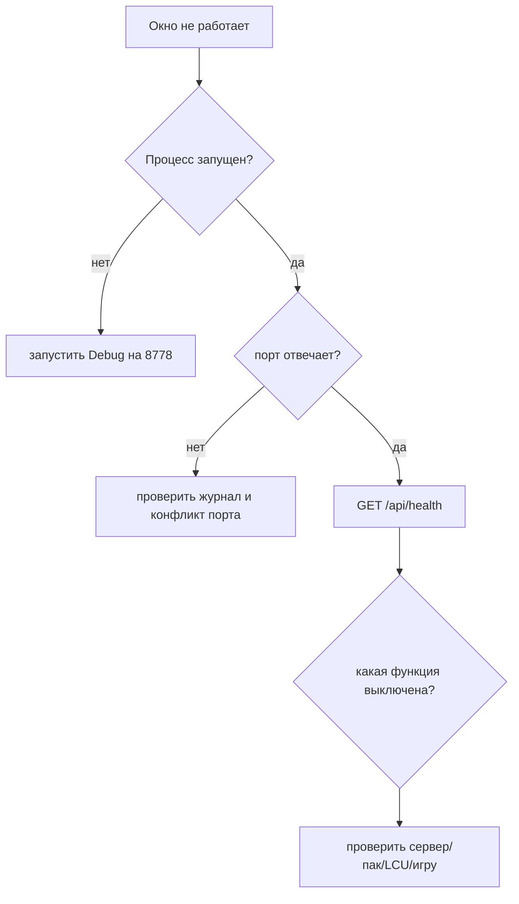

# 32. Диагностика: от симптома к источнику

В Sintence одновременно работают Win32-окно, локальный HTTP API, WebView2, LCU,
Live Client, сервер Sintence и Riot API. Диагностируй снизу вверх: сначала процесс и
порт, затем `/api/health`, потом конкретный источник данных.

## Первый маршрут проверки



Команды для отдельной копии:

```powershell
$env:SINTENCE_PORT = '8778'
$env:SINTENCE_NO_UPDATE = '1'
$env:SINTENCE_NO_PROFILE = '1'
$p = Start-Process 'build\src\Debug\sintence.exe' -PassThru
Invoke-RestMethod 'http://127.0.0.1:8778/api/health'
Stop-Process -Id $p.Id -Force
```

Не запускай отладку на 8777 поверх рабочей копии.

## Журнал

У exe нет консоли. Журнал по умолчанию:

```text
%LOCALAPPDATA%\Sintence\logs\sintence.log
```

Для порта 8778:

```text
%LOCALAPPDATA%\Sintence\logs\sintence-8778.log
```

Строка содержит дату, время до миллисекунд и поток. `LogError` добавляет префикс
`ОШИБКА:`. Файл сбрасывается сразу; после 5 МБ старый журнал переименовывается в
`.old.log`.

В PowerShell 5.1:

```powershell
Get-Content "$env:LOCALAPPDATA\Sintence\logs\sintence-8778.log" -Encoding UTF8
```

Не публикуй журнал целиком: в нём не должно быть токена, пароля lockfile или ключа Riot,
но перед отправкой всё равно проверь строки вокруг ошибки.

## `/api/health`

Проверь:

- `apiVersion` — совпадает ли с `EXPECTED_API_VERSION` интерфейса;
- `profiles`, `history`, `preferences`, `badges` — включены ли службы;
- `pack` — приехал ли пак и какой патч;
- `account.state` — `none`, `registering`, `ok`, `blocked` или `error`;
- `update.state` — не идёт ли обновление и не отключено ли оно для Debug/8778;
- `game` — видит ли приложение текущий матч.

Токен в health не возвращается. `account.userId` — служебный идентификатор, не секрет.

## Разбор HTTP-статусов

| Статус | Обычно означает | Следующая проверка |
|---:|---|---|
| `200` | ответ есть | проверить поле и zod |
| `202` | работа принята, но не готова | повторить через poll |
| `400` | параметр или JSON неверен | команда curl и схема запроса |
| `403` | POST не прошёл `TrustedWrite` или сервер заблокировал аккаунт | Host/Origin/заголовок и `account.state` |
| `409` | конфликт состояния | идёт игра, нет обновления или legacy-действие |
| `501` | функция отключена конфигурацией | задан ли `SINTENCE_SERVER` |
| `502` | Riot/внешняя загрузка не удалась | повторить разрешённым retry |
| `503` | временно нет матча, пака или сервера | журнал и повтор через интервал |

GET с кодом, отличным от 200, интерфейс превращает в `ApiResult.kind = 'status'` и не
читает тело ошибки. Для диагностики сначала смотри код через curl.

## Если нет интерфейса

Проверь:

1. существует ли `sintence-web/dist/index.html`;
2. не задан ли неверный `SINTENCE_WEB_DIR`;
3. была ли выполнена `npm run build` до CMake;
4. не держит ли WebView2 старую страницу — перезапусти exe;
5. не занимает ли второй процесс порт.

При сборке `EmbedApp.cmake` предупреждает, если `index.html` отсутствует. Встроенный
exe без файлов интерфейса покажет окно ошибки.

Для визуальной диагностики интерфейса используй обычный браузер:

```powershell
cd sintence-web
npm run dev:mock
```

WebView2 намеренно не даёт DevTools, F5 и контекстное меню.

## Если нет живого матча

Ожидаемые признаки:

- `GET /api/live` → `503`;
- `game` в health не активен;
- журнал не содержит ошибки процесса.

Проверь League и Live Client на `https://127.0.0.1:2999`. Practice Tool подходит для
проверки табло, но `position` у таких игроков может быть `NONE`, а боты имеют Riot ID
вида `Garen#BOT`.

Если матч есть, но данные пусты, смотри, разобрался ли `allgamedata`. Парсер должен
вернуть `nullopt` на битый обязательный JSON, а не падать.

## Если пусто лобби

Проверь:

1. запущен ли клиент League;
2. найден ли lockfile;
3. не изменился ли порт после перезапуска клиента;
4. отвечает ли `/lol-gameflow/v1/gameflow-phase`;
5. есть ли текущая фаза в `/api/lobby`.

Пароль lockfile не выводи. После 401 `LcuClient` сам сбрасывает credentials и перечитывает
файл при следующем запросе.

Пустые имена скрытых игроков — ожидаемая политика, а не ошибка парсера.

## Если нет профилей, истории или советов

| Симптом | Причина |
|---|---|
| профили `501` | приложение собрано без сервера |
| история `501` | нет `ServerConfig` или `HistoryService` |
| советы `501` | нет пака/сервера в зависимости от конкретной причины |
| советы `503` | пак ещё не загружен, нет активного игрока или нет матча для параметров |
| профиль `400` | клиент League не дал свой Riot ID |
| профиль `404 erased` | игрок удалён по политике приватности |
| `account.registering/error` | регистрация или токен недоступны |
| `account.blocked` | сервер запретил пользователя, перезапуск не обходит блокировку |

Проверяй `/v1` только через приложение и серверные журналы. Не подставляй Riot API key
в локальные команды.

## Если не работает действие по клику

Для рун, заклинаний, наблюдения и других POST нужны одновременно:

- HTTP `POST`;
- `X-Sintence-Action: 1`;
- корректный `Host` локального порта;
- разрешённый `Origin`;
- действие вызвано кликом, а не watcher.

`403 forbidden` обычно означает `TrustedWrite`. HTTP `200` с `status: failed`,
`need_replace` или `client_unavailable` означает, что защита пройдена, но LCU отказал
или действие требует второго клика.

## Если не собирается Debug

- `0xc0000135` при запуске — рядом нет `clang_rt.asan*.dll`;
- ошибка `VCPKG_ROOT` — CMake не может найти статические зависимости;
- ошибка Node — сначала `npm install`/`npm ci` в `sintence-web`;
- warning `out\\Sintence.exe запущен` — собранный exe лежит в `build`, закрой рабочую
  копию для обновления `out`;
- старый контракт — пересобери интерфейс и проверь `kApiVersion`/`EXPECTED_API_VERSION`.

## Как оформлять найденный сбой

В отчёт достаточно включить:

1. ветку и commit приложения/вики;
2. команду запуска и порт без секретных переменных;
3. HTTP-статус и безопасную часть JSON;
4. 20–30 строк журнала вокруг `ОШИБКА:` без токенов и паролей;
5. воспроизводимый сценарий: игра, лобби, мок или отсутствие сервера.

Не исправляй проблему простым подавлением ошибки. Сначала определи слой: Win32/WebView,
локальный API, LCU/Live Client, серверный шлюз или Riot.
